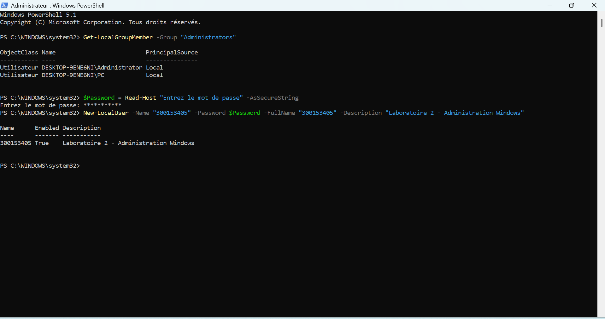
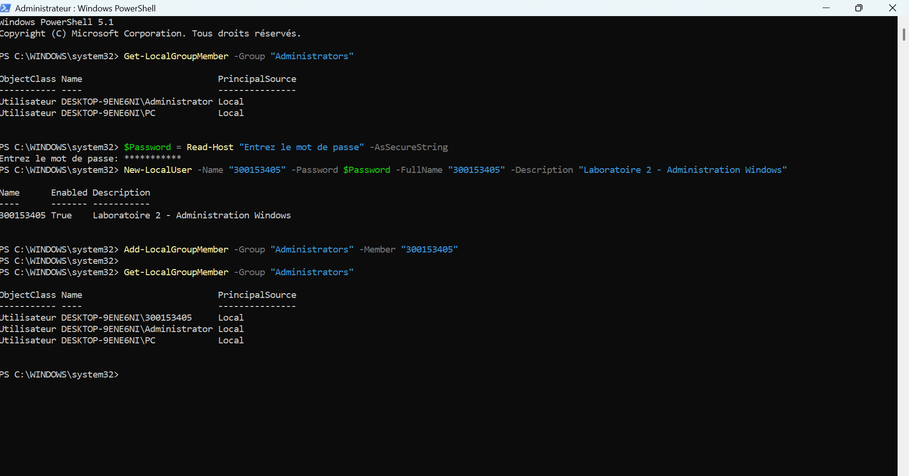
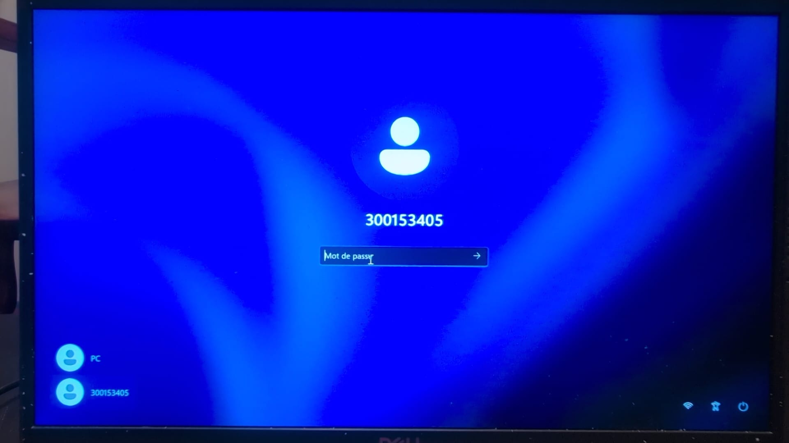
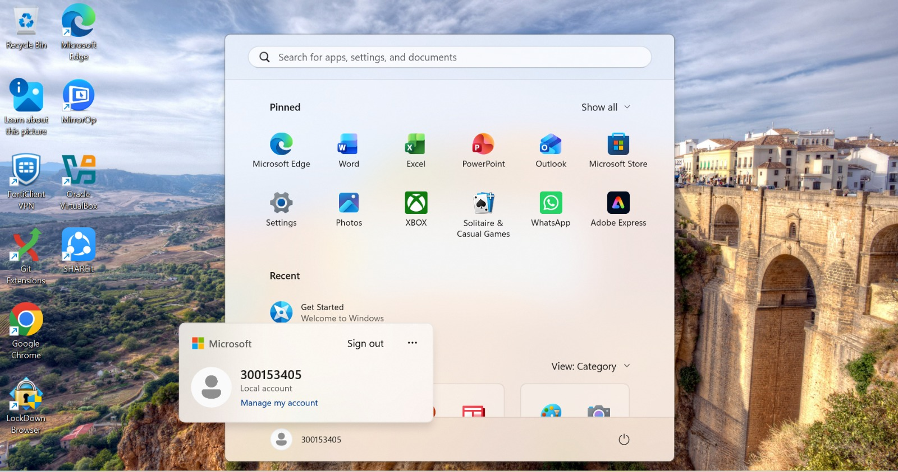
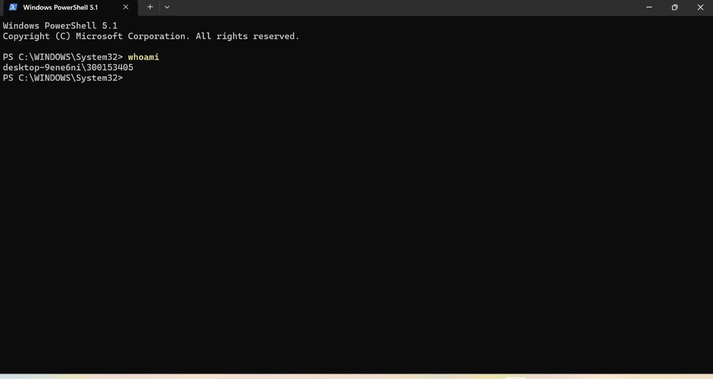

# Laboratoire 2 — Active Directory : gestion des utilisateurs locaux

**Cours :** INF1084 — Administration Windows  
**Collège Boréal**  
**Numéro étudiant :** 300153405

## Introduction

Dans ce laboratoire, j'ai créé un compte utilisateur local portant mon numéro étudiant `300153405` et je lui ai attribué les droits administrateur à l'aide de PowerShell.

J'ai ensuite vérifié son appartenance au groupe `Administrators` et effectué une connexion Windows avec ce compte pour confirmer son fonctionnement.

J'avais initialement réalisé ce travail sur le serveur Windows Server 2022 à l'adresse `10.7.237.7`. Ce serveur étant devenu inaccessible, j'ai reproduit les manipulations sur mon ordinateur personnel Windows 11.

## 1. Environnement de travail

Pour réaliser les manipulations, j'ai utilisé Windows PowerShell 5.1 en tant qu'administrateur.

| Élément | Configuration |
|---|---|
| Système d'exploitation | Windows 11 |
| Nom de l'ordinateur | `DESKTOP-9ENE6NI` |
| Compte principal | `PC` |
| Compte créé | `300153405` |
| Type de compte | Utilisateur local |
| Groupe administrateur | `Administrators` |
| Outil utilisé | Windows PowerShell 5.1 |

## 2. Vérification des administrateurs existants

Avant de créer mon compte, j'ai consulté les utilisateurs qui possédaient déjà les droits administrateur sur mon ordinateur.

J'ai utilisé la commande suivante :

```powershell
Get-LocalGroupMember -Group "Administrators"
```

Cette commande affiche les membres du groupe local `Administrators`.

**Résultat obtenu :**

```text
ObjectClass   Name                           PrincipalSource
-----------   ----                           ---------------
Utilisateur   DESKTOP-9ENE6NI\Administrator   Local
Utilisateur   DESKTOP-9ENE6NI\PC              Local
```

J'ai constaté que mon ordinateur possédait deux comptes administrateurs : `Administrator` et `PC`.

## 3. Création du compte utilisateur

### 3.1 Définition du mot de passe

J'ai commencé par définir un mot de passe pour le nouvel utilisateur :

```powershell
$Password = Read-Host "Entrez le mot de passe" -AsSecureString
```

La commande `Read-Host` permet de saisir le mot de passe, tandis que le paramètre `-AsSecureString` évite de l'afficher en clair.

Le mot de passe est ensuite conservé dans la variable `$Password` pour être utilisé lors de la création du compte.

### 3.2 Création de l'utilisateur

J'ai créé le compte local `300153405` avec la commande suivante :

```powershell
New-LocalUser -Name "300153405" -Password $Password -FullName "300153405" -Description "Laboratoire 2 - Administration Windows"
```

La commande `New-LocalUser` permet de créer un utilisateur local Windows.

J'ai utilisé les paramètres suivants :

| Paramètre | Description |
|---|---|
| `-Name` | Nom du compte utilisateur |
| `-Password` | Mot de passe sécurisé du compte |
| `-FullName` | Nom complet de l'utilisateur |
| `-Description` | Description du compte |

**Résultat obtenu :**

```text
Name       Enabled   Description
----       -------   -----------
300153405  True      Laboratoire 2 - Administration Windows
```

Le résultat confirme que mon compte `300153405` a été créé et qu'il est activé (`Enabled = True`).

**Capture — Création du compte utilisateur :**



## 4. Attribution des droits administrateur

Après avoir créé le compte, je l'ai ajouté au groupe local `Administrators`.

J'ai exécuté la commande suivante :

```powershell
Add-LocalGroupMember -Group "Administrators" -Member "300153405"
```

La commande `Add-LocalGroupMember` permet d'ajouter un utilisateur à un groupe local.

Dans mon cas, j'ai ajouté `300153405` au groupe `Administrators` pour lui attribuer les droits d'administration sur mon ordinateur.

### Vérification des droits

Pour confirmer que l'utilisateur avait été ajouté correctement, j'ai exécuté :

```powershell
Get-LocalGroupMember -Group "Administrators"
```

**Résultat obtenu :**

```text
ObjectClass   Name                           PrincipalSource
-----------   ----                           ---------------
Utilisateur   DESKTOP-9ENE6NI\300153405       Local
Utilisateur   DESKTOP-9ENE6NI\Administrator   Local
Utilisateur   DESKTOP-9ENE6NI\PC              Local
```

Le résultat montre que mon compte `300153405` fait désormais partie du groupe des administrateurs locaux.

**Capture — Attribution et vérification des droits administrateur :**



## 5. Connexion Windows avec le compte créé

Après avoir configuré les droits administrateur, j'ai effectué un test de connexion avec mon nouvel utilisateur.

### 5.1 Ouverture de session

Depuis l'écran de connexion Windows, j'ai sélectionné le compte `300153405` et saisi son mot de passe.

**Capture — Écran de connexion Windows :**



La connexion a réussi et Windows a ouvert une session avec mon compte.

J'ai ensuite vérifié le nom de l'utilisateur connecté dans le menu Démarrer.

**Capture — Session Windows ouverte :**



### 5.2 Vérification de l'utilisateur connecté

Pour confirmer que j'utilisais bien le compte `300153405`, j'ai ouvert PowerShell dans cette nouvelle session.

J'ai exécuté :

```powershell
whoami
```

**Résultat obtenu :**

```text
desktop-9ene6ni\300153405
```

La commande `whoami` affiche le nom du compte Windows utilisé dans la session actuelle.

Le résultat confirme que j'étais connecté avec mon compte local `300153405`.

**Capture — Vérification avec PowerShell :**



## 6. Résultats obtenus

| Manipulation | Résultat |
|---|---|
| Création du compte local `300153405` | Réussie |
| Activation du compte | Confirmée |
| Ajout au groupe `Administrators` | Réussi |
| Vérification des droits administrateur | Réussie |
| Connexion Windows avec le compte `300153405` | Réussie |
| Vérification de la session avec `whoami` | Réussie |

## Conclusion

J'ai réussi à créer un compte utilisateur local portant mon numéro étudiant `300153405` et à lui attribuer les droits administrateur avec PowerShell.

La commande `Get-LocalGroupMember` m'a permis de confirmer son appartenance au groupe `Administrators`.

J'ai également réussi à ouvrir une session Windows avec ce compte et à vérifier mon identité avec la commande `whoami`.

Ces manipulations m'ont permis de pratiquer la création et la gestion des utilisateurs locaux, ainsi que l'attribution des droits administrateur sous Windows.
