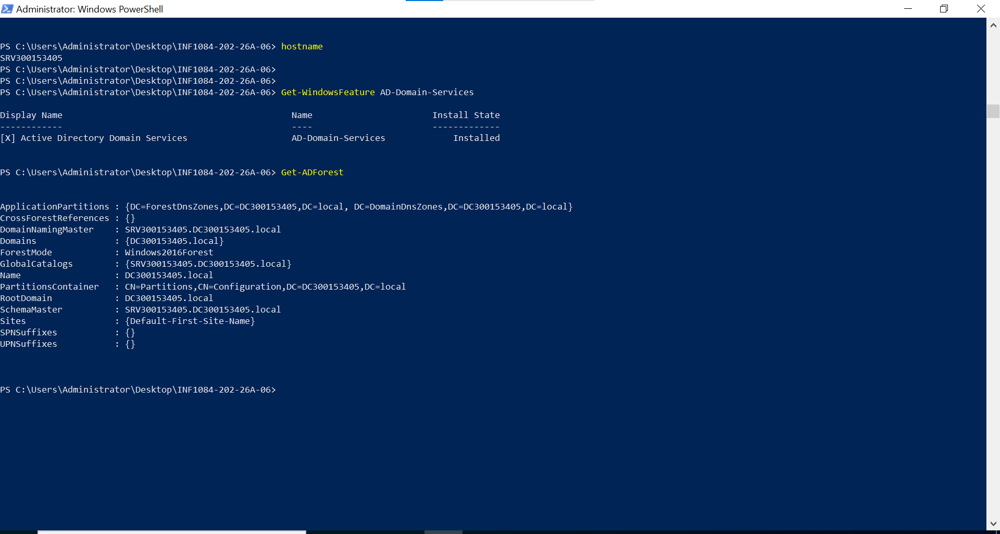
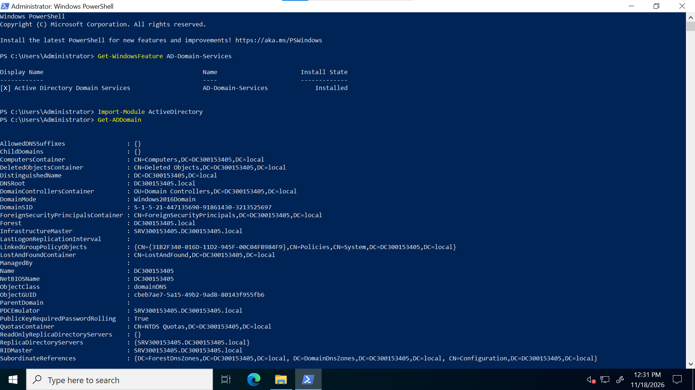

# Laboratoire 3 — Domaines et Active Directory

> **INF1084-202 — Administration Windows | Collège Boréal**  
> **Identifiant étudiant :** `300153405`  
> **Date de vérification :** 18 novembre 2026

## 1. Objectif du laboratoire

L'objectif de ce laboratoire est de mettre en place un **contrôleur de domaine Active Directory** sur **Windows Server 2022**, en suivant les étapes proposées dans le dossier `3.Domaines` du cours :

1. Renommer le serveur.
2. Installer le rôle **Active Directory Domain Services (AD DS)**.
3. Créer un domaine dans une nouvelle forêt, avec le service DNS prévu par la procédure.
4. Vérifier la configuration du domaine et de la forêt avec PowerShell.

Les opérations de configuration avaient déjà été réalisées sur ma machine virtuelle. Ayant perdu les captures prises pendant l'installation, j'ai effectué **de nouvelles vérifications le 18 novembre 2026** afin de documenter l'état réel du serveur, sans réinstaller le domaine.

## 2. Environnement de travail

| Élément | Configuration constatée ou utilisée |
|---|---|
| Système | Windows Server 2022 |
| Environnement | Machine virtuelle accessible à distance, avec Hyper-V |
| Nom du serveur | `SRV300153405` |
| Nom DNS du domaine | `DC300153405.local` |
| Nom NetBIOS du domaine | `DC300153405` |
| Rôle principal | Active Directory Domain Services (AD DS) |
| Mode fonctionnel du domaine | `Windows2016Domain` |
| Mode fonctionnel de la forêt | `Windows2016Forest` |
| Outil d'administration | Windows PowerShell (administrateur) |

## 3. Étapes de configuration et preuves

### Étape 1 — Renommer le serveur

Pour identifier clairement le contrôleur de domaine sur le réseau, le nom prévu pour le serveur est `SRV300153405`.

Commande de configuration présentée dans le laboratoire, adaptée à mon identifiant :

```powershell
Rename-Computer -NewName "SRV300153405" -Restart
```

Cette commande renomme le serveur, puis le redémarre. **Elle n'a pas été réexécutée lors de la vérification**, car le nom était déjà correct.

Commande de vérification réellement exécutée :

```powershell
hostname
```

Résultat obtenu :

```text
SRV300153405
```

**Preuve 1 — Nom du serveur, rôle AD DS et forêt Active Directory :**



### Étape 2 — Installer le rôle Active Directory Domain Services

Le rôle **AD DS** permet au serveur d'héberger les services d'annuaire nécessaires au domaine et de gérer les comptes, les groupes et l'authentification.

Commande d'installation fournie par la procédure du cours :

```powershell
Install-WindowsFeature AD-Domain-Services -IncludeManagementTools
```

Pour contrôler l'installation existante, j'ai exécuté :

```powershell
Get-WindowsFeature AD-Domain-Services
```

Résultat relevé :

```text
[X] Active Directory Domain Services    AD-Domain-Services    Installed
```

Le statut **`Installed`** confirme que le rôle AD DS est présent sur le serveur (voir **Preuve 1**).

### Étape 3 — Créer le domaine Active Directory

Le domaine de mon laboratoire porte le nom **`DC300153405.local`**, avec **`DC300153405`** comme nom NetBIOS. La procédure du cours utilise `Install-ADDSForest` pour créer le domaine racine d'une nouvelle forêt et installer DNS.

Voici la **commande de référence adaptée à mon environnement** ; elle est documentée ici pour expliquer l'étape, mais **n'a pas été relancée lors de la vérification** :

```powershell
Install-ADDSForest `
    -DomainName "DC300153405.local" `
    -DomainNetbiosName "DC300153405" `
    -InstallDns:$true `
    -SafeModeAdministratorPassword (Read-Host "Mot de passe DSRM" -AsSecureString) `
    -Force
```

- `-DomainName` définit le nom DNS complet du domaine.
- `-DomainNetbiosName` définit son nom court.
- `-InstallDns:$true` demande l'installation du rôle DNS pendant la promotion.
- `-SafeModeAdministratorPassword` définit le mot de passe de restauration des services d'annuaire (DSRM), sans l'afficher dans le README.
- `-Force` évite les demandes de confirmation non essentielles.

**Vérification réellement exécutée :**

```powershell
Import-Module ActiveDirectory
Get-ADDomain
```

Quelques informations confirmées par le résultat :

```text
DNSRoot              : DC300153405.local
NetBIOSName          : DC300153405
DomainMode           : Windows2016Domain
InfrastructureMaster : SRV300153405.DC300153405.local
```

**Preuve 2 — Informations du domaine obtenues avec `Get-ADDomain` :**



La commande renvoie les informations du domaine existant, ce qui confirme que le service d'annuaire répond aux requêtes PowerShell.

### Étape 4 — Vérifier la forêt Active Directory

Pour vérifier la forêt, j'ai exécuté :

```powershell
Get-ADForest
```

Informations observées :

```text
Name               : DC300153405.local
RootDomain         : DC300153405.local
ForestMode         : Windows2016Forest
DomainNamingMaster : SRV300153405.DC300153405.local
SchemaMaster       : SRV300153405.DC300153405.local
```

Le résultat indique qu'une forêt Active Directory est présente et que `SRV300153405` y assure notamment les rôles indiqués. La sortie montre aussi les partitions `ForestDnsZones` et `DomainDnsZones` ; cela ne remplace toutefois pas un test spécifique de résolution DNS (voir **Preuve 1**).

## 4. Tableau récapitulatif

| Vérification | Commande | Résultat observé |
|---|---|---|
| Nom du serveur | `hostname` | `SRV300153405` |
| Présence du rôle AD DS | `Get-WindowsFeature AD-Domain-Services` | `Installed` |
| Informations du domaine | `Get-ADDomain` | `DC300153405.local` |
| Nom NetBIOS du domaine | `Get-ADDomain` | `DC300153405` |
| Informations de la forêt | `Get-ADForest` | `DC300153405.local` |
| Mode de la forêt | `Get-ADForest` | `Windows2016Forest` |

Toutes les commandes de vérification ci-dessus ont renvoyé des résultats exploitables. Les captures **montrent l'état vérifié du système**, mais ne constituent pas des captures de l'exécution initiale des commandes d'installation.

## 5. Conclusion

Ce laboratoire m'a permis de mettre en place et de comprendre les principaux éléments d'un environnement **Active Directory** : le nom du serveur, le rôle **AD DS**, le domaine et la forêt. Les vérifications PowerShell confirment que le serveur `SRV300153405` dispose du rôle Active Directory et que le domaine `DC300153405.local` ainsi que sa forêt sont accessibles.

Même si les captures réalisées pendant l'installation ont été perdues, j'ai pu **documenter la configuration existante sans la modifier** en exécutant `hostname`, `Get-WindowsFeature AD-Domain-Services`, `Get-ADDomain` et `Get-ADForest`.

## 6. Référence

- [Consignes officielles du laboratoire 3 — Domaines (INF1084)](https://github.com/CollegeBoreal/INF1084-202-26A-06/tree/main/3.Domaines)

---

**Organisation des preuves :** les captures sont enregistrées dans le sous-dossier [`images/`](images/) de ce README. Sur GitHub, elles s'afficheront automatiquement si le README et ce dossier sont téléversés ensemble.

