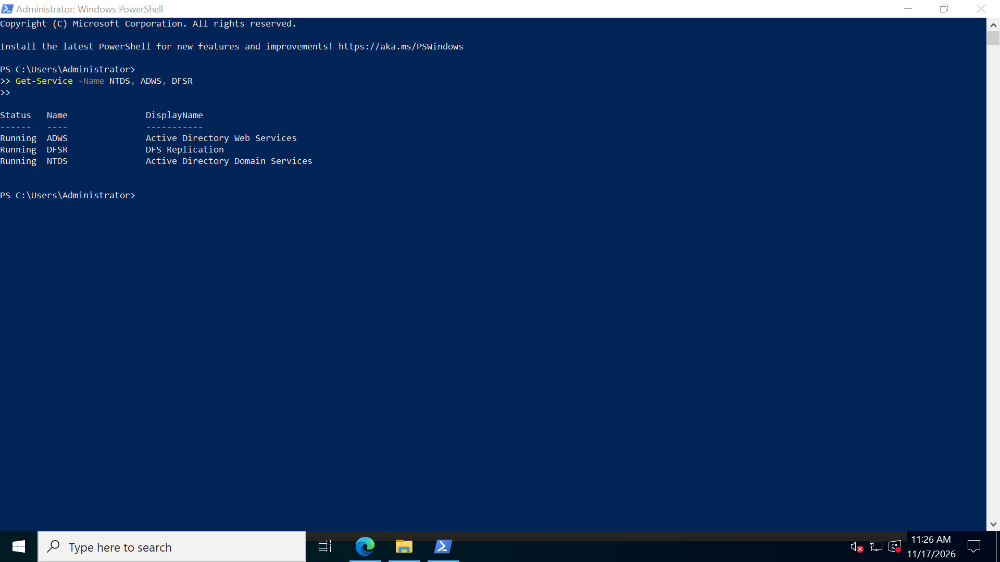

Les services Windows et Active Directory (AD DS)
Compte rendu des laboratoires PowerShell 1 à 4
ID ; 300147253
Objectif du travail
Explorer les services Active Directory, consulter leurs journaux, exporter les événements dans un fichier CSV et vérifier le service DFSR. Les manipulations ont été effectuées sur un serveur partagé du Collège Boréal ; aucune interruption de service n’a été réalisée.
Laboratoire 1 — Vérification des services AD
Le premier script, services1.ps1, liste les services AD et vérifie NTDS, ADWS et DFSR.
Get-Service | Where-Object {
$_.DisplayName -like "*Directory*" -or $_.Name -match "NTDS|ADWS|DFSR|kdc|Netlogon|IsmServ"
} | Sort-Object DisplayName
Get-Service -Name NTDS, ADWS, DFSR
Résultat observé : NTDS, ADWS, DFSR, IsmServ, Kdc et Netlogon sont tous à l’état Running. Le fichier services1.ps1 a été enregistré et son exécution a affiché les services attendus.
Capture 1 — Services Active Directory en cours d’exécution.
Laboratoire 2 — Consultation des journaux
Le script services2.ps1 contient les trois commandes demandées pour examiner les événements du service d’annuaire et les événements Netlogon.
Get-EventLog -LogName "Directory Service" -Newest 20
Get-EventLog -LogName "System" -Newest 20 | Where-Object {$_.Source -eq "Netlogon"}
Get-WinEvent -LogName "Directory Service" -MaxEvents 20 | Format-Table TimeCreated, Id, LevelDisplayName, Message -AutoSize
Résultat observé : 20 événements du journal Directory Service ont été affichés, avec les dates, identifiants et messages. Ils sont de niveau Information dans la capture. La recherche Netlogon parmi les 20 derniers événements du journal System n’a retourné aucune ligne. Après correction d’un fichier initialement vide, le script services2.ps1 a été exécuté avec succès.
Capture 2 — Exécution de services2.ps1 et affichage des événements.
Laboratoire 3 — Exportation CSV
Le script services3.ps1 exporte les 50 derniers événements AD dans ADLogs.csv. Le chemin a été adapté au dossier utilisateur pour éviter d’écrire dans un répertoire commun du serveur.
Get-WinEvent -LogName "Directory Service" -MaxEvents 50 | Export-Csv -Path "$HOME\ADLogs.csv" -NoTypeInformation
Contrôles : Test-Path "$HOME\ADLogs.csv" a renvoyé True et (Import-Csv "$HOME\ADLogs.csv").Count a renvoyé 50. L’exportation est donc validée.
Capture 3 — Fichier CSV existant et 50 événements exportés.
Laboratoire 4 — Vérification du service DFSR
Le script services4.ps1 vérifie l’état de DFSR. Les commandes d’arrêt et de redémarrage prévues dans l’énoncé sont documentées mais laissées en commentaires, car le serveur est partagé et l’autorisation du professeur n’a pas été confirmée.
Get-Service -Name DFSR
(Get-Service -Name DFSR).Status
# Stop-Service -Name DFSR
# (Get-Service -Name DFSR).Status
# Start-Service -Name DFSR
Résultat observé : l’exécution du script affiche DFSR — DFS Replication — Running, puis Running. La vérification est réussie ; l’arrêt et le redémarrage n’ont pas été testés. Ce laboratoire est donc partiellement réalisé par rapport aux consignes originales.
Capture 4 — Exécution sécurisée de services4.ps1 : DFSR est Running.
Bilan et conclusion
Laboratoire	État observé
1 — Services AD	Terminé
2 — Journaux	Terminé
3 — Exportation CSV	Terminé (50 événements)
4 — DFSR	Vérification terminée ; arrêt/redémarrage non réalisés
Ces laboratoires ont permis de pratiquer la consultation des services et des journaux Active Directory et la production d’un export CSV. Les trois premiers laboratoires sont terminés. Pour achever entièrement le quatrième, le test d’arrêt/redémarrage doit être autorisé et effectué dans un environnement approprié, sans perturber le serveur partagé.
Compte rendu basé sur les consignes du professeur et les résultats PowerShell observés.

https://github.com/CollegeBoreal/INF1084-202-26A-06/blob/main/4.Services/300147253/images/Capture%202.PNG
https://github.com/CollegeBoreal/INF1084-202-26A-06/blob/main/4.Services/300147253/images/Capture%203.PNG

