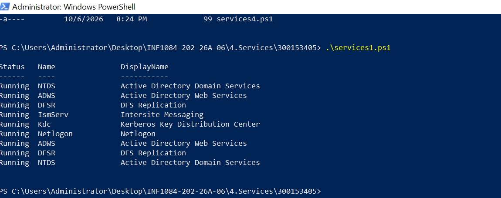
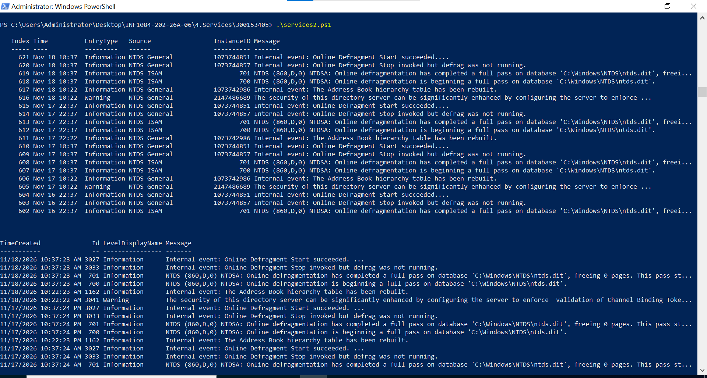
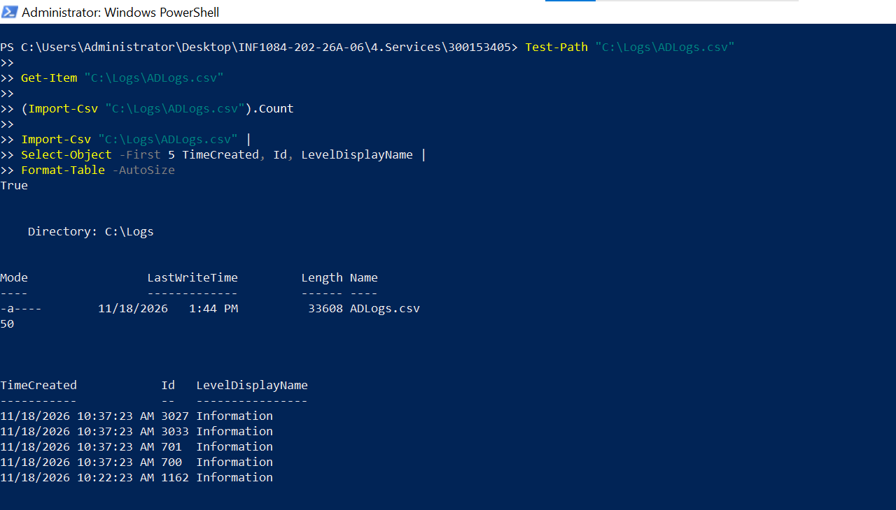
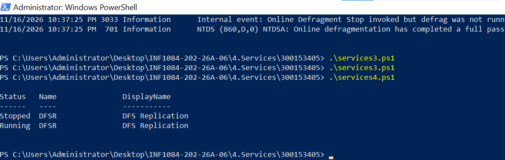

# Laboratoire 4 — Gestion des services Windows et Active Directory

> **INF1084 — Administration Windows**  
> **Étudiant :** Rekaik Khaled · **Matricule :** `300153405`  
> **Environnement :** Windows Server 2022 · **Outil :** Windows PowerShell (administrateur)  
> **Contrôleur de domaine :** `SRV300153405` · **Domaine :** `DC300153405.local`  
> **Vérifications documentées :** 18 novembre 2026

## Présentation du laboratoire

Ce laboratoire a pour objectif de **surveiller et administrer les services Windows associés à Active Directory Domain Services (AD DS)** à l'aide de scripts PowerShell. J'ai réalisé les quatre exercices du laboratoire : consultation de l'état des services, analyse des journaux d'événements, exportation des événements au format CSV et arrêt/redémarrage contrôlé d'un service.

Les scripts sont enregistrés dans le répertoire `4.Services/300153405` du dépôt du cours. Les captures ci-dessous proviennent de leur **exécution et de la vérification des résultats sur mon serveur**. Elles présentent l'état du laboratoire lors des vérifications, et non une reproduction artificielle des résultats.

| Exercice | Script | Objectif | Résultat constaté |
|:--|:--|:--|:--|
| 1 | [`services1.ps1`](services1.ps1) | Identifier les services AD et vérifier leur état | Services affichés, en état `Running` |
| 2 | [`services2.ps1`](services2.ps1) | Consulter les journaux *Directory Service* et *System* | Événements AD affichés dans PowerShell |
| 3 | [`services3.ps1`](services3.ps1) | Exporter 50 événements dans un CSV | `ADLogs.csv` créé, 50 entrées vérifiées |
| 4 | [`services4.ps1`](services4.ps1) | Arrêter puis démarrer DFSR | États `Stopped` puis `Running` observés |

## 1. Identifier les services Active Directory — `services1.ps1`

### Objectif et fonctionnement

J'ai utilisé `Get-Service` pour rechercher les services liés à Active Directory, puis pour vérifier directement les services `NTDS`, `ADWS` et `DFSR`.

```powershell
# Lister tous les services liés à AD
Get-Service | Where-Object {
    $_.DisplayName -like "*Directory*" -or
    $_.Name -match "NTDS|ADWS|DFSR|Kdc|Netlogon|IsmServ"
} | Sort-Object DisplayName

# Vérifier l'état de services spécifiques
Get-Service -Name NTDS, ADWS, DFSR
```

**Commande exécutée :**

```powershell
.\services1.ps1
```

### Résultat et interprétation

La sortie affiche les principaux services AD : `NTDS` (annuaire), `ADWS` (administration), `DFSR` (réplication), `IsmServ` (messagerie intersites), `Kdc` (authentification Kerberos) et `Netlogon` (authentification et localisation du domaine). Les services visibles sont à l'état **`Running`**. `NTDS`, `ADWS` et `DFSR` figurent deux fois, car le script les affiche une première fois dans la liste générale, puis une seconde fois dans une vérification ciblée.



*Figure 1 — Liste et état des services AD sur le contrôleur de domaine.*

## 2. Consulter les journaux d'événements — `services2.ps1`

### Objectif et fonctionnement

Le deuxième script consulte les **20 événements les plus récents** du journal `Directory Service`, recherche les événements `Netlogon` parmi les 20 derniers événements du journal `System`, puis présente les événements AD dans un tableau lisible.

```powershell
# Afficher les 20 derniers événements liés à NTDS
Get-EventLog -LogName "Directory Service" -Newest 20

# Afficher les événements Netlogon du journal System
Get-EventLog -LogName "System" -Newest 20 |
    Where-Object { $_.Source -eq "Netlogon" }

# Afficher les événements avec Get-WinEvent
Get-WinEvent -LogName "Directory Service" -MaxEvents 20 |
    Format-Table TimeCreated, Id, LevelDisplayName, Message -AutoSize
```

**Commande exécutée :**

```powershell
.\services2.ps1
```

### Résultat et interprétation

Le résultat présente les informations utiles pour surveiller AD DS : **date et heure**, **identifiant**, **niveau**, **source** et **message**. Les événements visibles concernent notamment le fonctionnement interne de la base de données Active Directory `ntds.dit`, avec des identifiants tels que `3027`, `3033`, `701`, `700` et `1162`.

La capture montre principalement des événements de niveau **`Information`**, ainsi que des événements de niveau **`Warning`**. Ces avertissements ne doivent pas être ignorés : ils nécessiteraient une analyse plus approfondie si l'objectif était un diagnostic de sécurité ou d'exploitation. L'absence éventuelle de sortie pour la recherche `Netlogon` signifie uniquement qu'aucune entrée correspondante n'a été trouvée **parmi les 20 événements `System` consultés**.



*Figure 2 — Consultation des événements AD avec `Get-EventLog` et `Get-WinEvent`.*

## 3. Exporter les événements AD en CSV — `services3.ps1`

### Objectif et fonctionnement

J'ai créé un script qui vérifie si le dossier `C:\Logs` existe et le crée au besoin. Les **50 derniers événements** du journal `Directory Service` sont ensuite exportés dans `C:\Logs\ADLogs.csv` avec `Export-Csv`.

```powershell
# Créer le dossier C:\Logs s'il n'existe pas
if (!(Test-Path "C:\Logs")) {
    New-Item -Path "C:\Logs" -ItemType Directory
}

# Exporter les 50 derniers événements AD dans un fichier CSV
Get-WinEvent -LogName "Directory Service" -MaxEvents 50 |
    Export-Csv -Path "C:\Logs\ADLogs.csv" -NoTypeInformation
```

**Commande exécutée :**

```powershell
.\services3.ps1
```

Il est normal que ce script n'affiche **aucun tableau dans la console** : `Export-Csv` écrit les données dans un fichier plutôt que sur l'écran. Pour confirmer son fonctionnement, j'ai exécuté les commandes de vérification suivantes :

```powershell
Test-Path "C:\Logs\ADLogs.csv"
Get-Item "C:\Logs\ADLogs.csv"
(Import-Csv "C:\Logs\ADLogs.csv").Count
Import-Csv "C:\Logs\ADLogs.csv" |
    Select-Object -First 5 TimeCreated, Id, LevelDisplayName |
    Format-Table -AutoSize
```

### Résultat vérifié

| Vérification | Valeur observée |
|:--|:--|
| Existence du fichier (`Test-Path`) | `True` |
| Emplacement | `C:\Logs\ADLogs.csv` |
| Taille | **33 608 octets** |
| Nombre d'enregistrements importés | **50** |
| Identifiants des 5 premiers événements | `3027`, `3033`, `701`, `700`, `1162` |
| Niveau affiché pour ces 5 événements | `Information` |

Les résultats confirment que le fichier CSV a été produit et qu'il peut être relu avec `Import-Csv`.



*Figure 3 — Vérification de l'export CSV : fichier présent, 50 événements et aperçu des données.*

## 4. Arrêter puis redémarrer DFS Replication — `services4.ps1`

### Objectif et fonctionnement

Le dernier exercice consiste à administrer le service **DFSR** (*Distributed File System Replication*). Ce service intervient notamment dans la réplication du dossier `SYSVOL` entre contrôleurs de domaine. Le script arrête le service, vérifie son état, le redémarre, puis vérifie son état final.

```powershell
Stop-Service -Name DFSR
Get-Service -Name DFSR

Start-Service -Name DFSR
Get-Service -Name DFSR
```

**Commande exécutée lors du laboratoire :**

```powershell
.\services4.ps1
```

### Résultat et précaution

La sortie enregistrée montre successivement **`Stopped`**, puis **`Running`** pour le service `DFSR`. Le service était donc de nouveau démarré à la fin de cette exécution.



*Figure 4 — État du service DFSR après l'arrêt puis le redémarrage.*

> **Précaution :** l'arrêt de DFSR peut perturber la réplication de `SYSVOL` dans un environnement Active Directory. Ce test doit rester limité à un environnement de laboratoire autorisé. Il n'est **pas nécessaire de réexécuter le script** pour produire une nouvelle capture, puisque le résultat a déjà été documenté.

## Bilan des compétences et des résultats

| Compétence évaluée | Preuve dans le README | Validation |
|:--|:--|:--:|
| Consulter l'état des services AD | Figure 1, `Running` | ✅ |
| Lire les journaux Windows associés à AD | Figure 2, événements affichés | ✅ |
| Exporter et contrôler un fichier CSV | Figure 3, `True`, 50 lignes, 33 608 octets | ✅ |
| Modifier puis vérifier l'état d'un service | Figure 4, `Stopped` puis `Running` | ✅ |

**Conclusion.** Ce laboratoire m'a permis d'utiliser PowerShell pour **surveiller les services nécessaires au fonctionnement d'Active Directory**, consulter leurs journaux, conserver des événements dans un fichier CSV et gérer le cycle de vie d'un service Windows. Les quatre scripts demandés sont présents dans mon dossier GitHub et les captures ajoutées dans ce README montrent les résultats réellement obtenus sur mon serveur `SRV300153405`.

---

### Organisation des fichiers

```text
4.Services/
└── 300153405/
    ├── README.md
    ├── services1.ps1
    ├── services2.ps1
    ├── services3.ps1
    ├── services4.ps1
    └── images/
        ├── 01-services-ad.png
        ├── 02-journaux-evenements.png
        ├── 03-export-csv-verifie.png
        └── 04-arret-redemarrage-dfsr.png
```

**Source des consignes :** [Laboratoire 4 — Services Windows et AD DS](https://github.com/CollegeBoreal/INF1084-202-26A-06/tree/main/4.Services).  
**Scripts personnels :** dossier `4.Services/300153405`  
**Captures :** preuves originales de vérification prises sur le serveur du laboratoire.

