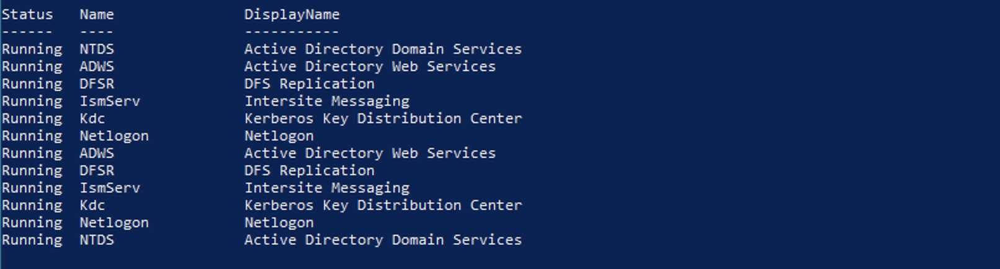
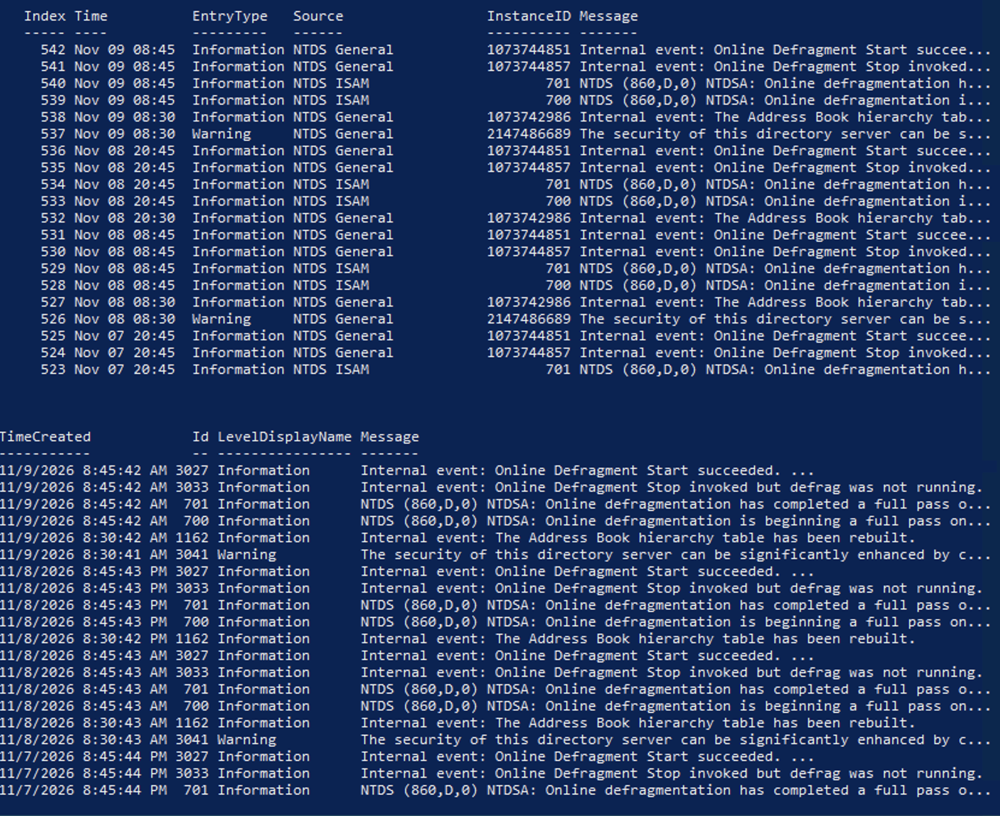
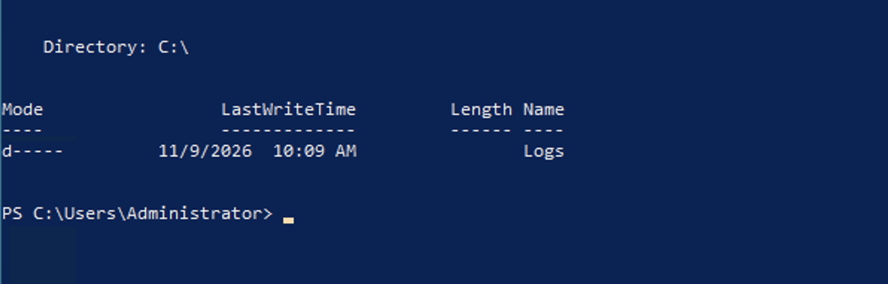

Services Active Directory
Objectif

L'objectif de ce laboratoire est d'explorer les principaux services Active Directory, consulter leurs événements, exporter les journaux dans un fichier CSV et effectuer l'arrêt et le redémarrage d'un service.

1. Lister les services Active Directory

La commande suivante permet d'afficher les services Active Directory importants ainsi que leur état.

# Services Active Directory

## 1. Lister les services Active Directory

Commande utilisée :

```powershell
Get-Service | Where-Object {
    $_.DisplayName -like "*Directory*" -or
    $_.Name -match "NTDS|ADWS|DFSR|Kdc|Netlogon|IsmServ"
} | Sort-Object DisplayName

Get-Service -Name NTDS,ADWS,DFSR,Kdc,Netlogon,IsmServ
```

Les résultats obtenus montrent que les services NTDS, ADWS, DFSR, KDC, Netlogon et IsmServ sont en état Running.



2. Afficher les événements d'un service Active Directory

Cette commande permet de consulter les événements enregistrés dans le journal Directory Service.

```powershell
Get-EventLog -LogName "Directory Service" -Newest 20

Get-EventLog -LogName "System" -Newest 20 |
Where-Object {$_.Source -eq "Netlogon"}

Get-WinEvent -LogName "Directory Service" -MaxEvents 20 |
Format-Table TimeCreated, Id, LevelDisplayName, Message -AutoSize
```

L'exécution de cette commande permet d'afficher les derniers événements liés aux services Active Directory et de vérifier leur bon fonctionnement.



3. Exporter les événements dans un fichier CSV

La commande suivante exporte les 50 derniers événements du journal Directory Service dans un fichier CSV.

```powershell
New-Item -ItemType Directory -Path C:\Logs -Force

Get-WinEvent -LogName "Directory Service" -MaxEvents 50 |
Export-Csv -Path "C:\Logs\ADLogs.csv" -NoTypeInformation
```

Vérification :

```powershell
dir C:\Logs
```

4. Arrêter et redémarrer un service

Le script suivant permet d'arrêter puis de redémarrer le service DFSR.
Commande utilisée :

```powershell
Stop-Service -Name DFSR

(Get-Service -Name DFSR).Status

Start-Service -Name DFSR

(Get-Service -Name DFSR).Status
```

