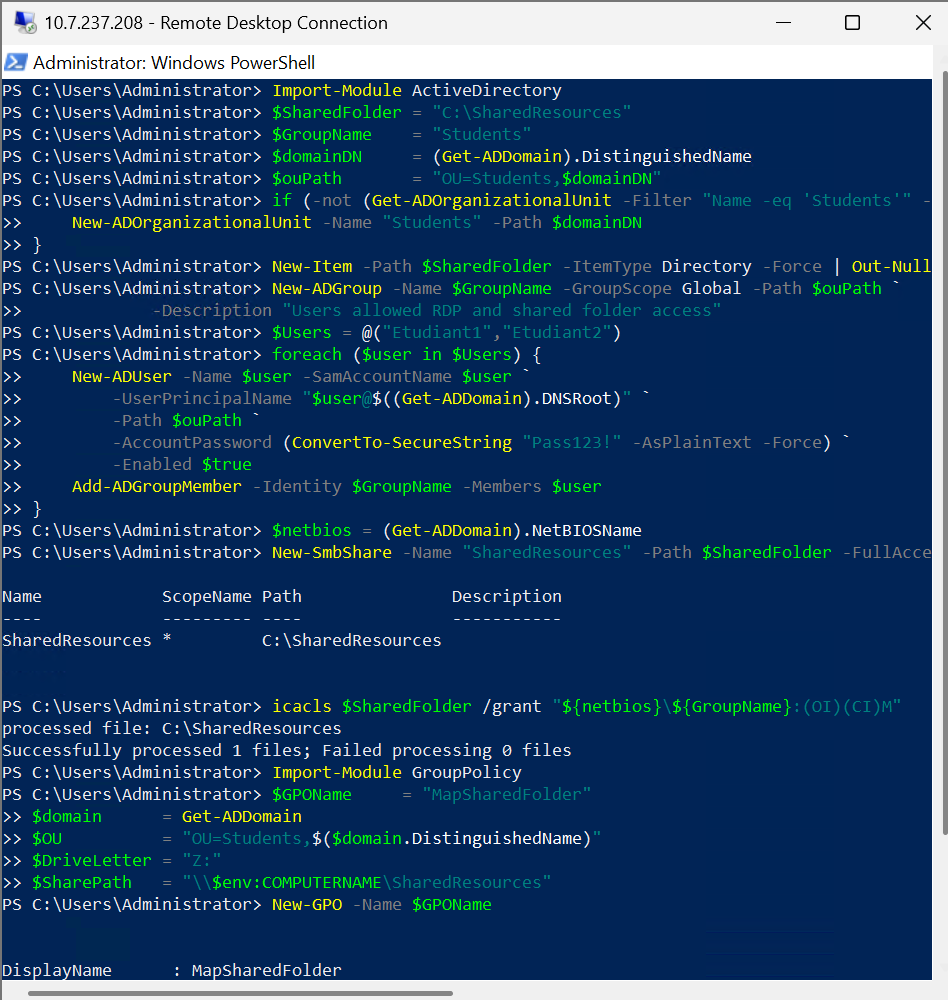
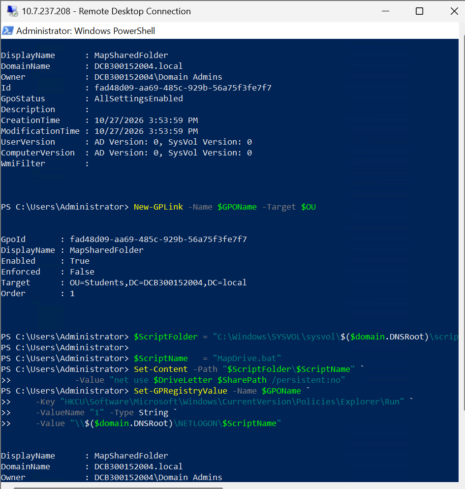
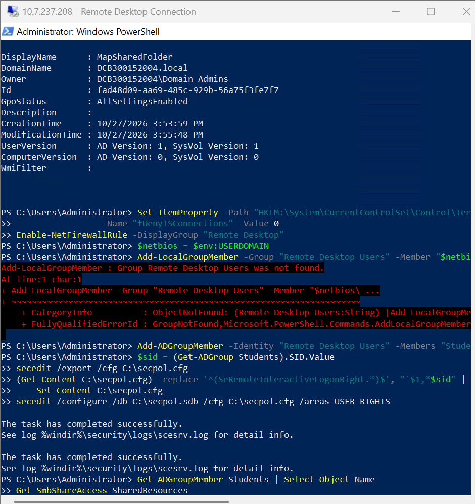
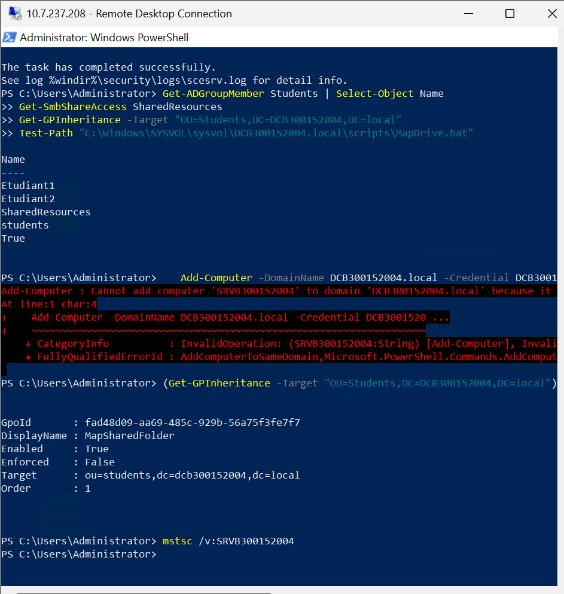
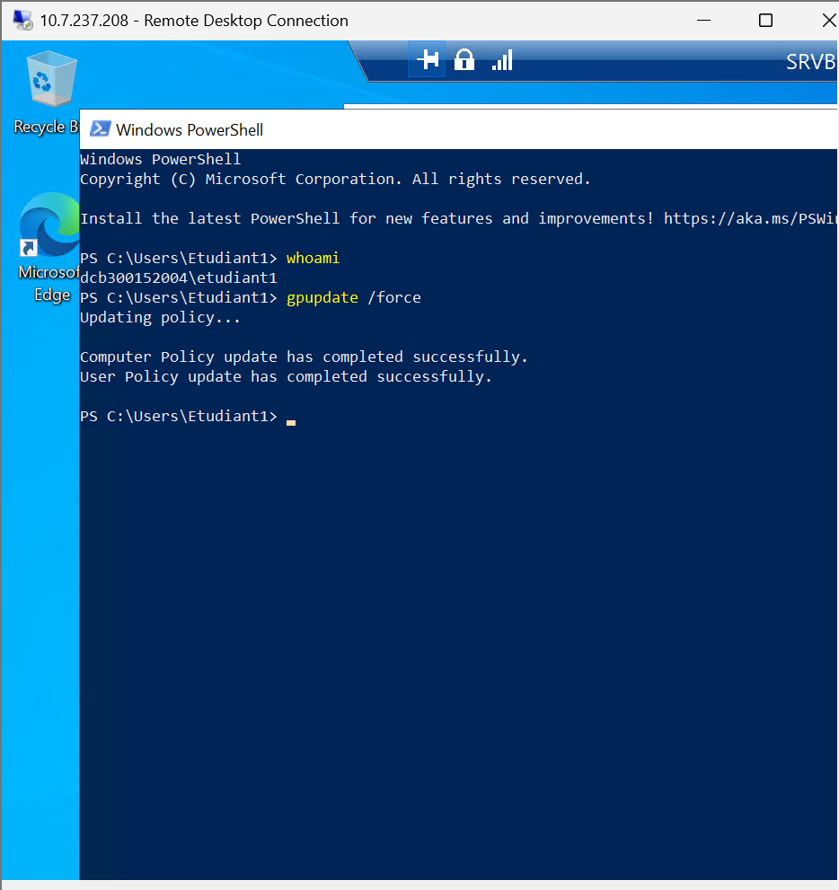
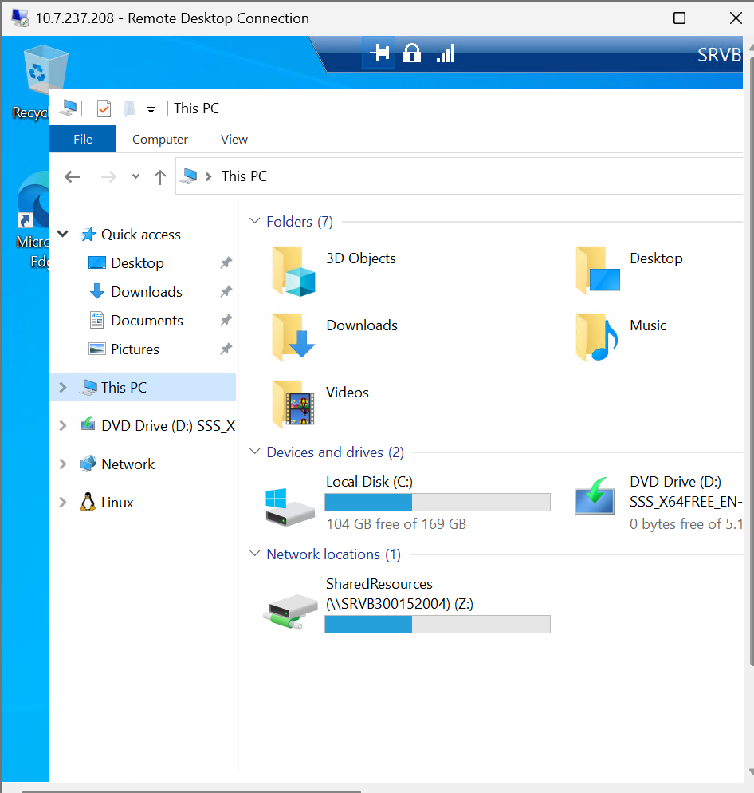
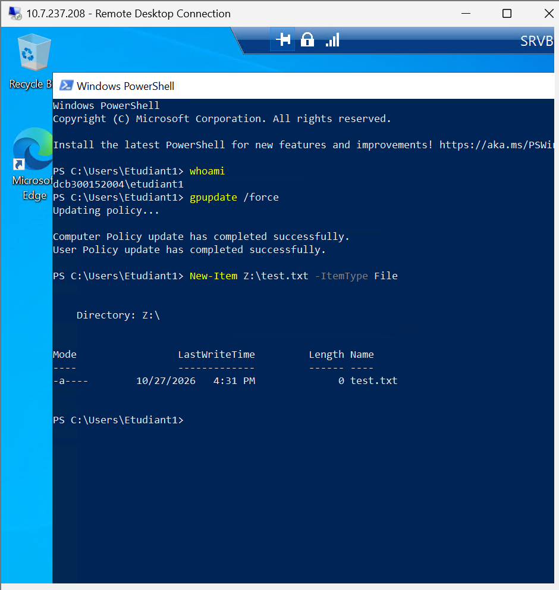
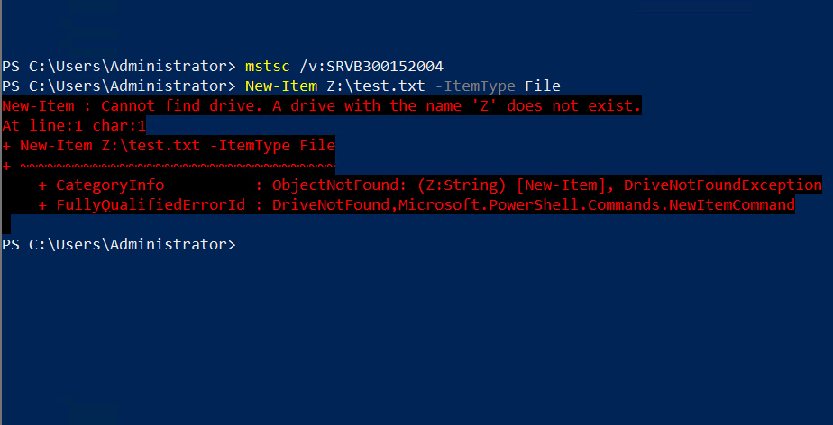

# Partage de ressources et RDP via PowerShell
# 300152004

Étape 1 Création de l'OU, du groupe, des utilisateurs et du partage

Je commence par créer l'OU `Students` et le groupe AD `Students` (portée Global). Ensuite, je crée les utilisateurs `Etudiant1` et `Etudiant2` avec le mot de passe `Pass123!` et je les ajoute au groupe. Je crée aussi le dossier `C:\SharedResources`, que je partage en SMB sous le nom `SharedResources`, puis j'attribue les droits NTFS (Modify) au groupe avec `icacls`. Je termine cette étape en lançant la création de la GPO `MapSharedFolder`.

Étape 2 GPO : liaison et script de connexion

Je lie la GPO à l'OU `Students` avec `New-GPLink`. Je crée ensuite le script `MapDrive.bat` dans SYSVOL, qui exécute `net use Z: \\SRVB300152004\SharedResources /persistent:no`. Enfin, j'ajoute ce script dans la GPO avec `Set-GPRegistryValue` (clé `Explorer\Run`), de sorte que le lecteur soit mappé à l'ouverture de session.

Étape 3 Activation du RDP pour le groupe Students

J'active le RDP en mettant `fDenyTSConnections` à 0 et j'autorise la règle de pare-feu « Remote Desktop ». Comme le groupe local « Remote Desktop Users » n'existe pas sur le contrôleur de domaine, j'utilise le groupe AD du même nom. J'exporte ensuite la stratégie de sécurité avec `secedit`, j'ajoute le SID de `Students` dans `SeRemoteInteractiveLogonRight`, puis je la réimporte.

Étape 4 Vérifications côté serveur

Après avoir ouvert le projet dans VS Code (code .), j'ai relancé ng serve. Le mode watch permet à Angular de recompiler automatiquement à chaque modification : la taille de main.js passe de 3.88 kB à 4.12, 4.14, puis 4.39 kB, ce qui montre que j'ai ajouté du code (titre, bouton, directives, etc.). Les messages « Component update sent to client(s) » et « Page reload sent to client(s) » confirment que le navigateur se met à jour en direct.

Étape 5 Tests

Je me connecte en RDP avec `Etudiant1` : `whoami` retourne `dcb300152004\etudiant1`, puis j'applique les stratégies avec `gpupdate /force`.

Étape 6 Lecteur réseau mappé automatiquement

Le lecteur `Z:` (`SharedResources` sur `\\SRVB300152004`) apparaît automatiquement dans l'explorateur.

Étape 7 Accès en écriture au partage

Je crée `Z:\test.txt` avec `Etudiant1` sans aucune erreur, ce qui prouve que le partage et les droits fonctionnent.

Étape 8 Test hors du groupe

Avec le compte `Administrator`, qui n'est pas dans le groupe `Students`, le lecteur `Z:` n'existe pas : la GPO ne s'applique donc qu'aux membres de l'OU `Students`.

