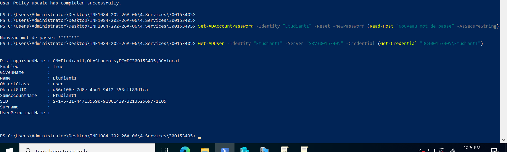
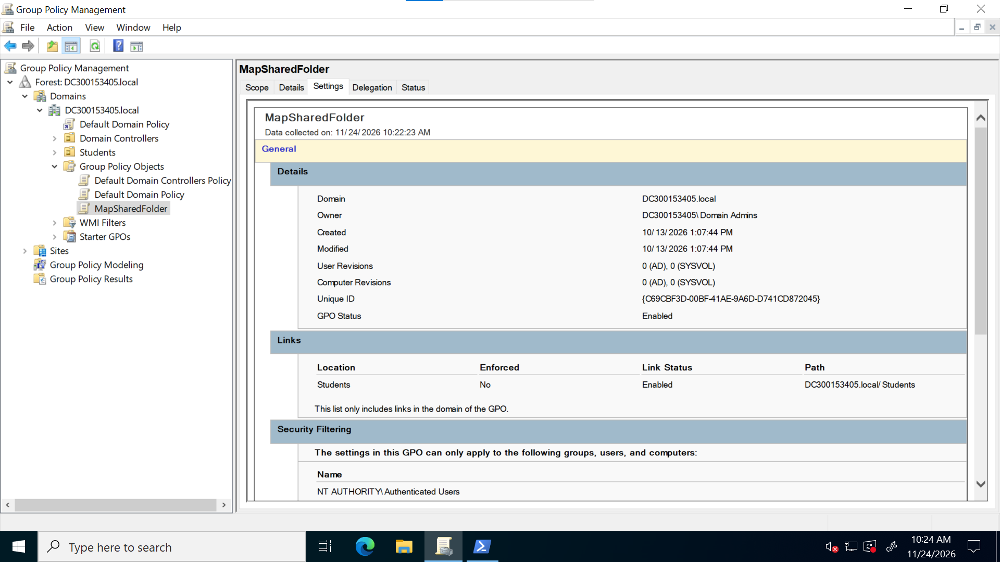
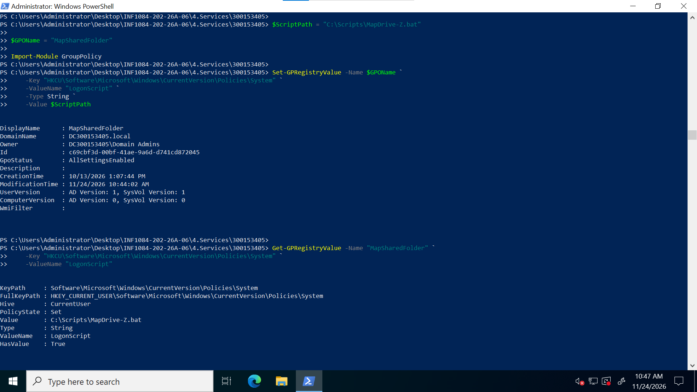
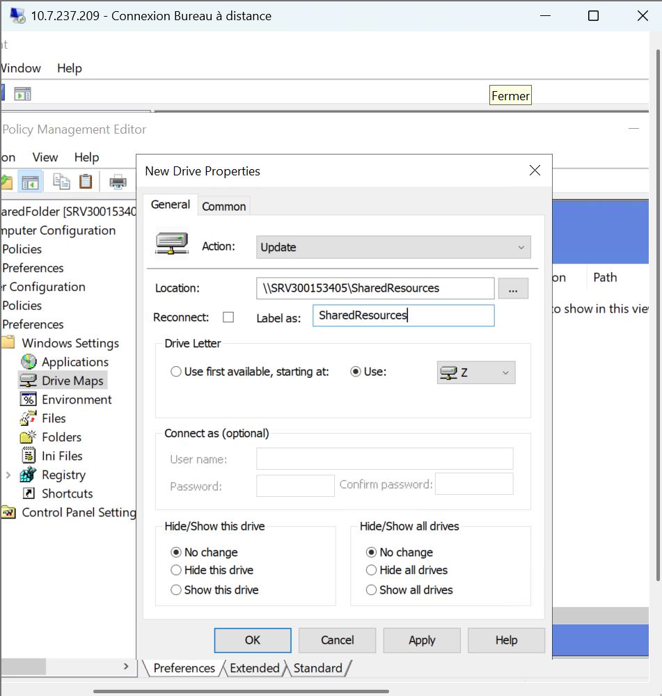
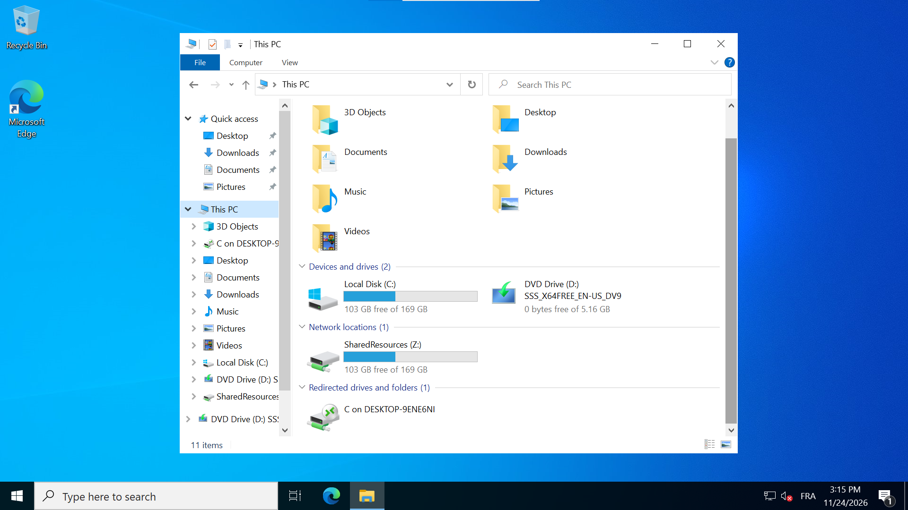
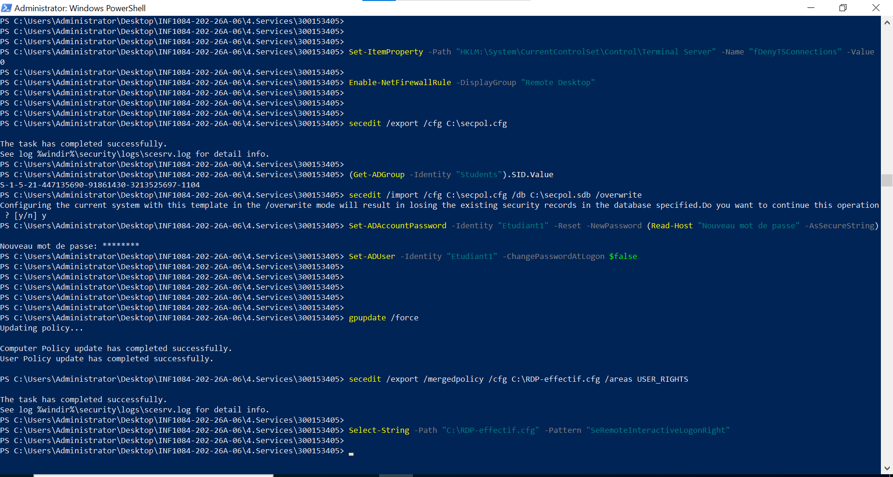
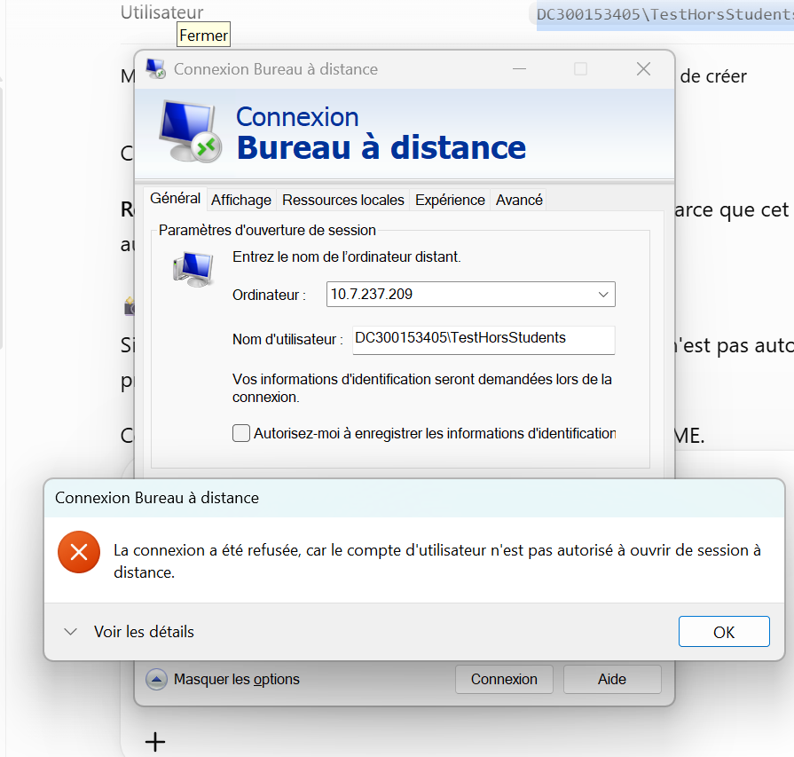

# Laboratoire 5 — Objets Active Directory, partage SMB, GPO et RDP

**Cours :** INF1084 — Administration Windows  
**Collège Boréal**  
**Identifiant étudiant :** `300153405`  
**Environnement :** Windows Server 2022 et Windows 11  
**Date des vérifications :** 24 novembre 2026

## Introduction

Dans ce laboratoire, j'ai configuré plusieurs objets Active Directory sur mon serveur Windows Server 2022. J'ai travaillé sur les comptes utilisateurs, un groupe de sécurité, un dossier partagé et une stratégie de groupe (GPO). J'ai ensuite configuré l'accès au Bureau à distance (RDP) et effectué des tests depuis mon ordinateur personnel.

Mon objectif était de permettre aux utilisateurs du groupe `Students` d'accéder au partage `SharedResources`, de retrouver automatiquement ce partage sous la lettre `Z:` et de se connecter au serveur par RDP. J'ai aussi créé un compte qui ne fait pas partie du groupe pour vérifier les restrictions d'accès.

Certaines configurations n'ont pas fonctionné dès le premier essai. Je présente donc les commandes utilisées, les vérifications que j'ai effectuées, les difficultés rencontrées et les résultats obtenus après correction.

## 1. Mon environnement de travail

| Élément | Configuration |
|---|---|
| Serveur / contrôleur de domaine | `SRV300153405` |
| Système du serveur | Windows Server 2022 |
| Domaine DNS | `DC300153405.local` |
| Nom NetBIOS | `DC300153405` |
| Adresse IP utilisée pour les tests | `10.7.237.209` |
| Unité d'organisation (OU) | `Students` |
| Groupe de sécurité | `Students` |
| Comptes utilisateurs | `Etudiant1`, `Etudiant2` |
| Compte pour les tests de refus | `TestHorsStudents` |
| Dossier local du serveur | `C:\SharedResources` |
| Nom du partage SMB | `SharedResources` |
| Chemin réseau | `\\SRV300153405\SharedResources` |
| Stratégie de groupe | `MapSharedFolder` |
| Lecteur réseau | `Z:` |
| Ordinateur utilisé pour les connexions RDP | Mon PC personnel sous Windows 11 |

Active Directory était déjà installé sur mon serveur. Je n'ai donc pas eu à recréer le domaine pour cette partie du travail.

J'ai utilisé **PowerShell** pour les manipulations et les vérifications. Pour le mappage automatique du lecteur `Z:`, j'ai également utilisé la console graphique de gestion des stratégies de groupe après avoir rencontré un problème avec la première configuration.

## 2. Préparation de PowerShell et du domaine

### 2.1 Importation des modules

J'ai utilisé les modules PowerShell qui permettent d'administrer Active Directory et les stratégies de groupe :

```powershell
Import-Module ActiveDirectory
Import-Module GroupPolicy
```

`ActiveDirectory` donne accès aux commandes qui servent notamment à créer des utilisateurs, gérer des groupes et consulter les objets du domaine. Le module `GroupPolicy` permet de créer une GPO, de la lier à une unité d'organisation et de consulter ses paramètres.

Ces modules sont nécessaires pour utiliser les commandes `New-ADUser`, `New-ADGroup`, `New-GPO` et `New-GPLink` présentées dans les sections suivantes.

### 2.2 Variables de mon domaine

Pour faciliter l'utilisation des commandes, j'ai retenu les valeurs qui correspondent à mon serveur :

```powershell
$studentNumber = 300153405
$domainName    = "DC300153405.local"
$netbiosName   = "DC300153405"
```

Le nom de domaine permet d'identifier mon environnement Active Directory. Le nom NetBIOS est notamment utilisé pour préciser le domaine d'un compte, par exemple `DC300153405\Etudiant1`.

Un fichier `bootstrap.ps1` peut servir à regrouper ces variables et à les charger dans une session PowerShell avec la syntaxe suivante :

```powershell
. .\bootstrap.ps1
```

Le point suivi d'un espace correspond au **dot-sourcing** : les variables définies dans le fichier deviennent accessibles dans la session PowerShell en cours. Je présente ici le principe et mes valeurs de domaine, sans prétendre disposer d'une capture confirmant l'exécution exacte de ce fichier au début du travail.

Pour les opérations qui demandent des identifiants administrateur, PowerShell permet également de les saisir sans les écrire directement dans un script :

```powershell
$cred = Get-Credential
```

Je n'affiche aucun mot de passe dans cette documentation.

## 3. Création des objets Active Directory et du partage

### 3.1 Création du dossier SharedResources

J'ai préparé un dossier sur le disque `C:` de mon serveur afin de le rendre accessible sur le réseau :

```powershell
$SharedFolder = "C:\SharedResources"
New-Item -Path $SharedFolder -ItemType Directory -Force
```

La variable `$SharedFolder` contient le chemin du dossier. La commande `New-Item` crée le répertoire, tandis que `-ItemType Directory` précise qu'il s'agit d'un dossier. Avec `-Force`, la commande peut aussi être utilisée lorsque le dossier existe déjà, sans en supprimer le contenu.

À cette étape, `C:\SharedResources` est seulement un dossier local. Pour que d'autres utilisateurs puissent y accéder par le réseau, il faut ensuite créer un partage SMB et configurer les autorisations nécessaires.

### 3.2 Création du groupe de sécurité Students

J'ai créé un groupe de sécurité `Students` afin de gérer les accès des comptes étudiants au moyen d'un groupe commun :

```powershell
$GroupName = "Students"
New-ADGroup -Name $GroupName -GroupScope Global `
    -Description "Users allowed RDP and shared folder access"
```

`New-ADGroup` crée le groupe dans Active Directory. L'option `-GroupScope Global` définit sa portée globale. Ce groupe peut ensuite être utilisé pour attribuer des autorisations sans devoir les configurer individuellement pour chaque compte.

**À ne pas confondre :** le *groupe* `Students` sert à réunir des comptes pour gérer leurs autorisations, tandis que l'*unité d'organisation* `Students` sert à organiser des objets Active Directory et à cibler des stratégies de groupe. Ils portent le même nom, mais ne remplissent pas la même fonction.

### 3.3 Création de Etudiant1 et Etudiant2

J'ai configuré les deux comptes `Etudiant1` et `Etudiant2`, puis je les ai ajoutés au groupe `Students`.

La partie correspondante du script `utilisateurs1.ps1` utilise une boucle `foreach` :

```powershell
$Users = @("Etudiant1", "Etudiant2")

foreach ($user in $Users) {
    New-ADUser -Name $user `
        -SamAccountName $user `
        -AccountPassword (ConvertTo-SecureString "<MOT_DE_PASSE_MASQUE>" -AsPlainText -Force) `
        -Enabled $true

    Add-ADGroupMember -Identity $GroupName -Members $user
}
```

**Remarque :** le texte `<MOT_DE_PASSE_MASQUE>` remplace volontairement le mot de passe du script. Ce bloc documente la structure des commandes ; il ne doit pas être exécuté tel quel.

`New-ADUser` crée les comptes dans Active Directory. Le paramètre `-SamAccountName` définit le nom utilisé pour l'ouverture de session. L'option `-Enabled $true` active les comptes. Enfin, `Add-ADGroupMember` ajoute chaque utilisateur au groupe `Students`.

J'ai également travaillé avec une unité d'organisation `Students` dans mon domaine. Son chemin est :

```text
OU=Students,DC=DC300153405,DC=local
```

La présence d'un compte dans l'OU et son appartenance au groupe sont deux éléments distincts. Le script de création présenté ci-dessus n'indique pas à lui seul comment les comptes ont été placés dans l'OU : je ne rajoute donc pas de commande de déplacement que je n'ai pas conservée parmi mes manipulations.

J'ai vérifié dans Active Directory que le compte `Etudiant1` était activé et présent dans l'OU `Students`.



*Vérification du compte `Etudiant1` dans mon domaine Active Directory.*

### 3.4 Création du partage SMB

Après avoir préparé le dossier et le groupe, j'ai configuré le partage réseau :

```powershell
New-SmbShare -Name "SharedResources" -Path $SharedFolder -FullAccess $GroupName
```

Cette commande publie le dossier `C:\SharedResources` sous le nom `SharedResources`. Le paramètre `-FullAccess` attribue au groupe `Students` une autorisation de contrôle total **au niveau du partage SMB**.

Le chemin réseau de mon partage est :

```text
\\SRV300153405\SharedResources
```

Il faut distinguer les **autorisations du partage SMB** des **autorisations NTFS du dossier**. Lorsqu'un utilisateur accède aux fichiers par le réseau, les permissions effectives dépendent des deux niveaux. Je ne conclus donc pas que toutes les permissions NTFS sont correctement définies à partir de la seule commande `New-SmbShare`.

J'ai vérifié le fonctionnement du partage plus loin, en ouvrant le lecteur `Z:` avec `Etudiant1` puis en testant l'accès avec un compte extérieur au groupe.

## 4. Création de la GPO MapSharedFolder

### 4.1 Création et liaison à l'OU Students

J'ai créé une GPO nommée `MapSharedFolder` afin de gérer la connexion du lecteur réseau pour les comptes concernés.

```powershell
$GPOName = "MapSharedFolder"
New-GPO -Name $GPOName
```

Une GPO contient des paramètres qui peuvent être appliqués aux utilisateurs ou aux ordinateurs d'un domaine. La création de la GPO ne suffit pas : elle doit être liée à l'emplacement Active Directory auquel je souhaite appliquer ses paramètres.

J'ai utilisé le chemin de mon OU `Students` pour établir cette liaison :

```powershell
$OU = "OU=Students,DC=DC300153405,DC=local"
New-GPLink -Name $GPOName -Target $OU
```

`New-GPLink` associe la stratégie à l'OU. Comme je travaille sur un paramètre utilisateur, les comptes concernés doivent être dans le périmètre d'application de cette GPO.

J'ai ensuite vérifié la présence du lien dans la console de gestion des stratégies de groupe.



*La stratégie `MapSharedFolder` est associée à l'OU `Students`.*

### 4.2 Création du script MapDrive-Z.bat

Pour connecter le dossier partagé au lecteur `Z:`, j'ai créé un fichier de commandes dans `C:\Scripts`.

```powershell
$DriveLetter = "Z:"
$SharePath   = "\\SRV300153405\SharedResources"
$ScriptFolder = "C:\Scripts"
$ScriptPath   = "$ScriptFolder\MapDrive-Z.bat"

if (-not (Test-Path $ScriptFolder)) {
    New-Item -ItemType Directory -Path $ScriptFolder
}

$scriptContent = "net use $DriveLetter $SharePath /persistent:no"
Set-Content -Path $ScriptPath -Value $scriptContent
```

`Test-Path` vérifie si le dossier `C:\Scripts` existe. Si ce n'est pas le cas, `New-Item` le crée. La commande `Set-Content` écrit ensuite la ligne de connexion réseau dans le fichier `.bat`.

Le contenu du fichier est :

```bat
net use Z: \\SRV300153405\SharedResources /persistent:no
```

La commande `net use` associe la lettre `Z:` au partage réseau. L'option `/persistent:no` indique que Windows ne doit pas conserver cette connexion comme connexion persistante d'une session à l'autre. Dans mon cas, l'objectif était que la GPO rétablisse automatiquement le lecteur lors de l'ouverture de session.


*Création et vérification du script de mappage.*

### 4.3 Première configuration avec LogonScript

J'ai ensuite configuré une valeur de registre dans la GPO avec PowerShell :

```powershell
Set-GPRegistryValue -Name $GPOName `
    -Key "HKCU\Software\Microsoft\Windows\CurrentVersion\Policies\System" `
    -ValueName "LogonScript" `
    -Type String `
    -Value $ScriptPath
```

`HKCU` correspond au registre de l'utilisateur connecté. Cette commande enregistre une valeur nommée `LogonScript` qui contient le chemin du fichier `.bat`.

J'ai vérifié que la valeur avait été enregistrée dans la GPO.



*La valeur `LogonScript` est présente dans la stratégie.*

Cependant, **l'enregistrement de cette valeur de registre ne signifie pas nécessairement que Windows exécutera le fichier `.bat` comme script de connexion**. Lors de mon premier test, le lecteur `Z:` n'était pas créé automatiquement. J'ai donc dû modifier la méthode de mappage.

## 5. Correction du mappage automatique du lecteur Z:

### 5.1 Constat lors du premier test

J'ai ouvert une session avec `Etudiant1` et consulté l'Explorateur de fichiers. Malgré la présence du script `MapDrive-Z.bat` et de la valeur `LogonScript`, le lecteur `Z:` n'apparaissait pas dans **Ce PC**.


*Le lecteur réseau n'apparaissait pas automatiquement lors du premier essai.*

Ce résultat m'a montré qu'il fallait vérifier non seulement l'existence du script, mais également **la manière dont le lecteur est créé au moment de la connexion de l'utilisateur**.

### 5.2 Configuration de Drive Maps dans la GPO

J'ai ouvert la console de gestion des stratégies de groupe :

```powershell
gpmc.msc
```

Dans la GPO `MapSharedFolder`, je suis allé dans :

**User Configuration → Preferences → Windows Settings → Drive Maps**

J'ai ajouté un nouveau lecteur avec les paramètres suivants :

| Paramètre | Valeur |
|---|---|
| Action | `Update` |
| Location | `\\SRV300153405\SharedResources` |
| Drive letter | `Z:` |
| Label | `SharedResources` |

Avec l'action **Update**, la préférence peut créer le lecteur s'il n'existe pas et mettre à jour sa configuration s'il est déjà présent. Le champ **Location** contient le chemin réseau du dossier partagé. Le champ **Drive letter** précise la lettre qui sera visible dans l'Explorateur de fichiers.



*Paramètres de mappage du lecteur `Z:` dans la GPO.*

### 5.3 Test après correction

Après avoir enregistré la préférence, j'ai fermé la session `Etudiant1`, puis je me suis reconnecté avec le même compte.

Cette fois, le lecteur `SharedResources (Z:)` était visible dans l'Explorateur de fichiers.



*Le lecteur `Z:` apparaît automatiquement après la nouvelle ouverture de session.*

J'ai ensuite ouvert ce lecteur pour vérifier qu'il pointait vers un dossier accessible.


*Le dossier s'ouvre sans erreur. Il ne contenait pas de fichier au moment de mon test.*

Ce résultat confirme le bon fonctionnement du **mappage automatique avec Drive Maps** dans la session testée. Il ne signifie pas que la première méthode avec `LogonScript` fonctionnait : c'est bien la modification de la GPO que j'ai conservée pour obtenir le résultat attendu.

## 6. Configuration de l'accès Bureau à distance (RDP)

### 6.1 Activation de RDP sur le serveur

J'ai configuré Windows Server pour accepter les connexions Bureau à distance :

```powershell
Set-ItemProperty `
    -Path "HKLM:\System\CurrentControlSet\Control\Terminal Server" `
    -Name "fDenyTSConnections" `
    -Value 0
```

La valeur `fDenyTSConnections` permet de contrôler l'acceptation des connexions Bureau à distance. Avec la valeur `0`, les connexions RDP sont autorisées au niveau de ce paramètre du serveur.

J'ai également utilisé la commande suivante pour activer les règles correspondantes du pare-feu Windows :

```powershell
Enable-NetFirewallRule -DisplayGroup "Remote Desktop"
```

L'activation de RDP et l'ouverture du pare-feu sont nécessaires, mais **elles ne suffisent pas à autoriser n'importe quel compte à ouvrir une session**. Il faut aussi vérifier les droits de connexion de l'utilisateur.

### 6.2 Droit d'ouverture de session à distance

Pour permettre aux utilisateurs concernés de se connecter, j'ai examiné le droit de sécurité `SeRemoteInteractiveLogonRight`, qui correspond à l'autorisation d'ouvrir une session par les Services Bureau à distance.

J'ai exporté la configuration de sécurité avec :

```powershell
secedit /export /cfg C:\secpol.cfg
```

J'ai ensuite travaillé sur la ligne `SeRemoteInteractiveLogonRight` afin d'y inclure le groupe `Students`, puis utilisé la commande d'importation :

```powershell
secedit /import /cfg C:\secpol.cfg /db C:\secpol.sdb /overwrite
```

Cette importation charge la configuration dans une base de sécurité ; **elle ne prouve pas, à elle seule, que le droit final est effectivement appliqué**. C'est pourquoi j'ai également vérifié la stratégie effective et testé les connexions RDP.

J'ai actualisé les stratégies avec :

```powershell
gpupdate /force
```

Pendant les vérifications, j'ai aussi ajouté le groupe `Students` au groupe intégré `Remote Desktop Users` :

```powershell
Add-ADGroupMember -Identity "Remote Desktop Users" -Members "Students"
```

Sur un contrôleur de domaine, les droits de connexion à distance doivent être examinés avec attention. L'appartenance à un groupe destiné aux utilisateurs RDP et le droit `SeRemoteInteractiveLogonRight` sont deux aspects à vérifier.



*Vérifications et modifications de la configuration RDP.*

### 6.3 Vérification des droits effectifs

Lors de mes vérifications, la valeur exportée du droit de connexion RDP contenait notamment les identifiants de sécurité (SID) suivants :

```text
S-1-5-32-544
S-1-5-21-447135690-91861430-3213525697-1104
```

Le premier SID correspond au groupe intégré des administrateurs. Le deuxième correspond au groupe `Students` de mon domaine.

La présence de ces deux groupes dans le droit exporté m'a permis de vérifier la configuration de sécurité. J'ai ensuite confirmé le fonctionnement en ouvrant réellement des sessions RDP avec mes comptes étudiants.


*Contrôle du droit de connexion à distance dans la configuration exportée.*

## 7. Tests avec les utilisateurs autorisés

### 7.1 Connexion RDP avec Etudiant1

Depuis mon ordinateur personnel sous Windows 11, j'ai ouvert **Connexion Bureau à distance** et utilisé l'adresse du serveur :

```text
10.7.237.209
```

J'ai saisi le compte de domaine :

```text
DC300153405\Etudiant1
```

Après les corrections apportées aux autorisations et aux paramètres des comptes, j'ai réussi à ouvrir une session RDP avec `Etudiant1`.


*Session Windows ouverte à distance avec le compte `Etudiant1`.*

J'ai également réussi à ouvrir une session RDP avec `Etudiant2`. En revanche, les captures de vérification détaillées du lecteur `Z:` présentées ci-dessous concernent `Etudiant1` : je ne présente pas un test du lecteur pour `Etudiant2` qui n'a pas été documenté de la même manière.

### 7.2 Vérification de mon identité dans la session

Dans la session de `Etudiant1`, j'ai exécuté :

```powershell
whoami
```

Le résultat était :

```text
dc300153405\etudiant1
```

Cette commande m'a confirmé que mes vérifications étaient effectuées dans la session du compte étudiant et non dans celle d'un administrateur.

### 7.3 Vérification du lecteur Z: dans PowerShell

J'ai ensuite exécuté :

```powershell
net use
```

La liste des connexions réseau indiquait que `Z:` était relié au partage :

```text
OK    Z:    \\SRV300153405\SharedResources
```

J'ai aussi testé l'accès au lecteur avec :

```powershell
dir Z:\
cd Z:\
```

`dir Z:\` permet d'afficher le contenu du dossier. La commande `cd Z:\` permet de se placer dans ce lecteur. Ces deux commandes ont fonctionné sans erreur. Le dossier étant vide au moment du test, l'affichage ne présentait pas de fichiers.


*Vérification de l'utilisateur connecté, du mappage `Z:` et de l'accès au dossier partagé.*

Ces commandes m'ont permis de confirmer trois points : j'étais connecté avec `Etudiant1`, le lecteur `Z:` était bien associé au partage réseau et je pouvais consulter le dossier sans recevoir de message d'accès refusé.

## 8. Test avec un utilisateur hors du groupe Students

### 8.1 Création du compte de test

Pour vérifier la restriction des accès, j'ai créé un troisième compte Active Directory :

```text
TestHorsStudents
```

J'ai créé ce compte dans le conteneur `Users` de mon domaine, sans l'ajouter au groupe `Students`.


*Compte utilisé uniquement pour les tests d'accès non autorisé.*

Ce test me permet de comparer le comportement d'un compte membre de `Students` à celui d'un compte qui n'en fait pas partie.

### 8.2 Tentative de connexion RDP

Depuis mon ordinateur personnel, j'ai essayé d'ouvrir une session RDP avec :

```text
DC300153405\TestHorsStudents
```

Windows a refusé la connexion en indiquant que ce compte n'était pas autorisé à ouvrir une session à distance.



*La connexion RDP a été refusée pour le compte extérieur au groupe autorisé.*

Ce résultat est différent du test avec `Etudiant1` et `Etudiant2`, qui ont pu ouvrir une session après les corrections.

### 8.3 Connexion au partage SMB

J'ai ensuite testé l'accès réseau au partage en utilisant les identifiants du compte `TestHorsStudents` :

```powershell
net use \\10.7.237.209\SharedResources * /user:DC300153405\TestHorsStudents
```

L'astérisque `*` permet de demander le mot de passe pendant l'exécution, sans l'écrire dans la commande.

La commande a indiqué que l'opération s'était terminée correctement.


*La connexion réseau a pu être établie avec les identifiants du compte de test.*

Cela ne signifie pas automatiquement que cet utilisateur peut lire les fichiers : **la réussite de `net use` ne constitue pas une preuve d'autorisation d'accès au contenu du dossier**.

### 8.4 Vérification de l'accès réel au contenu

Pour vérifier ce point, j'ai exécuté :

```powershell
dir \\10.7.237.209\SharedResources
```

Le résultat obtenu était :

```text
Accès refusé
```


*Le compte peut établir la connexion SMB, mais ne peut pas consulter le contenu du partage.*

J'ai donc confirmé que ce compte ne disposait pas de l'accès nécessaire pour parcourir le dossier. Pour déterminer précisément quelle autorisation provoquait le refus, il faudrait examiner séparément les permissions SMB et NTFS ; je ne présente pas ce test comme une vérification exhaustive de toutes les ACL.

## 9. Difficultés rencontrées et corrections

### 9.1 Connexions RDP refusées au début

Lors des premières tentatives, je ne réussissais pas à me connecter au serveur avec `Etudiant1` et `Etudiant2`.

J'ai vérifié les paramètres RDP, le pare-feu et le droit `SeRemoteInteractiveLogonRight`. J'ai également travaillé sur l'appartenance au groupe `Remote Desktop Users` et sur les paramètres des comptes utilisateurs. Pendant ces essais, j'ai dû réinitialiser les mots de passe concernés et désactiver la demande de changement de mot de passe à la prochaine ouverture de session.

Après ces différentes modifications, les deux connexions RDP ont fonctionné. Comme plusieurs paramètres ont été corrigés pendant le dépannage, je ne peux pas attribuer avec certitude le résultat à une seule commande.

### 9.2 Lecteur Z: absent malgré le script

J'avais créé `MapDrive-Z.bat` et enregistré la valeur `LogonScript` dans la GPO. Pourtant, le lecteur `Z:` n'apparaissait pas à l'ouverture de session.

J'ai conservé la GPO `MapSharedFolder` et configuré une préférence **Drive Maps** avec le chemin `\\SRV300153405\SharedResources` et la lettre `Z:`.

Après déconnexion et reconnexion de `Etudiant1`, le lecteur était visible et accessible. J'ai confirmé le résultat avec `net use`, `dir Z:\` et `cd Z:\`.

### 9.3 Connexion SMB réussie, mais lecture refusée

Avec `TestHorsStudents`, la commande `net use` avait réussi. J'ai donc effectué un test supplémentaire avec `dir` pour vérifier l'accès au dossier lui-même.

La réponse `Accès refusé` a montré que la connexion réseau et l'autorisation de consulter un répertoire sont deux vérifications différentes. Ce deuxième test était nécessaire pour interpréter correctement le résultat.

## 10. Résultats obtenus

| Vérification | Résultat observé |
|---|---|
| Présence de `Etudiant1` dans l'OU `Students` | Compte activé, vérifié dans Active Directory |
| Comptes `Etudiant1` et `Etudiant2` | Configurés et utilisés pour les tests |
| Groupe de sécurité `Students` | Configuré |
| Partage réseau `SharedResources` | Accessible avec `Etudiant1` |
| GPO `MapSharedFolder` | Présente et liée à l'OU `Students` |
| Première tentative de mappage par `LogonScript` | Lecteur `Z:` absent |
| Mappage avec la préférence `Drive Maps` | Lecteur `Z:` visible après reconnexion de `Etudiant1` |
| Connexion RDP avec `Etudiant1` | Réussie |
| Connexion RDP avec `Etudiant2` | Réussie |
| Commandes `net use`, `dir Z:\`, `cd Z:\` avec `Etudiant1` | Réussies |
| Connexion RDP avec `TestHorsStudents` | Refusée |
| Connexion `net use` au partage avec `TestHorsStudents` | Établie |
| Consultation du dossier avec `TestHorsStudents` | Refusée (`Accès refusé`) |

## Conclusion

Ce travail m'a permis de pratiquer la gestion des comptes et des groupes Active Directory, la création d'un partage SMB, la configuration d'une GPO et l'administration des connexions RDP sur Windows Server 2022.

J'ai réussi à me connecter à mon serveur avec `Etudiant1` et `Etudiant2`. Dans la session de `Etudiant1`, j'ai aussi confirmé que le lecteur `Z:` apparaissait automatiquement et que le dossier `SharedResources` était accessible.

Le principal problème concernait le mappage automatique du lecteur. J'ai finalement obtenu le résultat attendu en utilisant les préférences **Drive Maps** de ma GPO. J'ai également dû effectuer plusieurs vérifications pour régler les problèmes de connexion RDP.

Enfin, les tests réalisés avec `TestHorsStudents` m'ont permis de constater qu'un utilisateur extérieur au groupe ne pouvait pas ouvrir une session RDP ni consulter le contenu du dossier partagé, même lorsqu'une connexion SMB pouvait être établie.

Ces vérifications m'ont aidé à mieux comprendre la différence entre la création des ressources, l'attribution des autorisations et le contrôle réel de leur fonctionnement.

