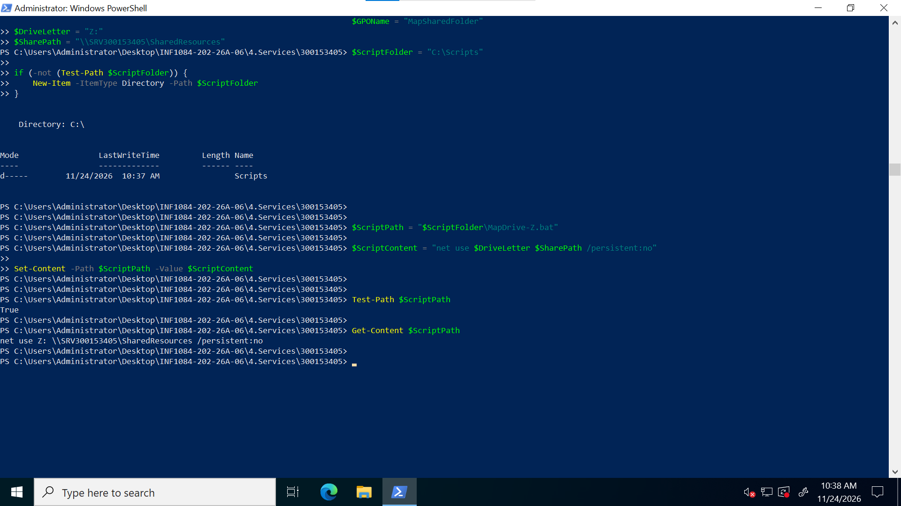
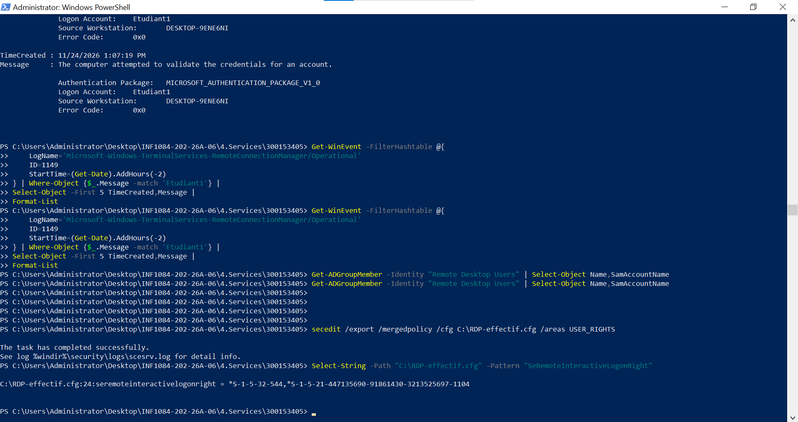
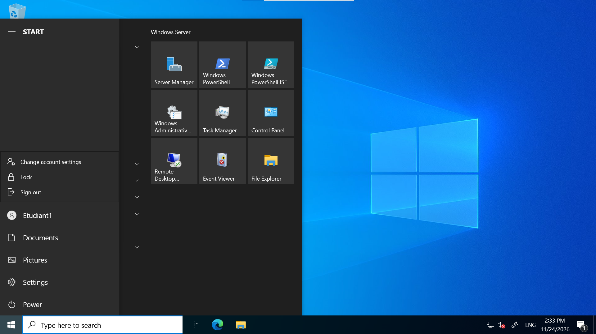
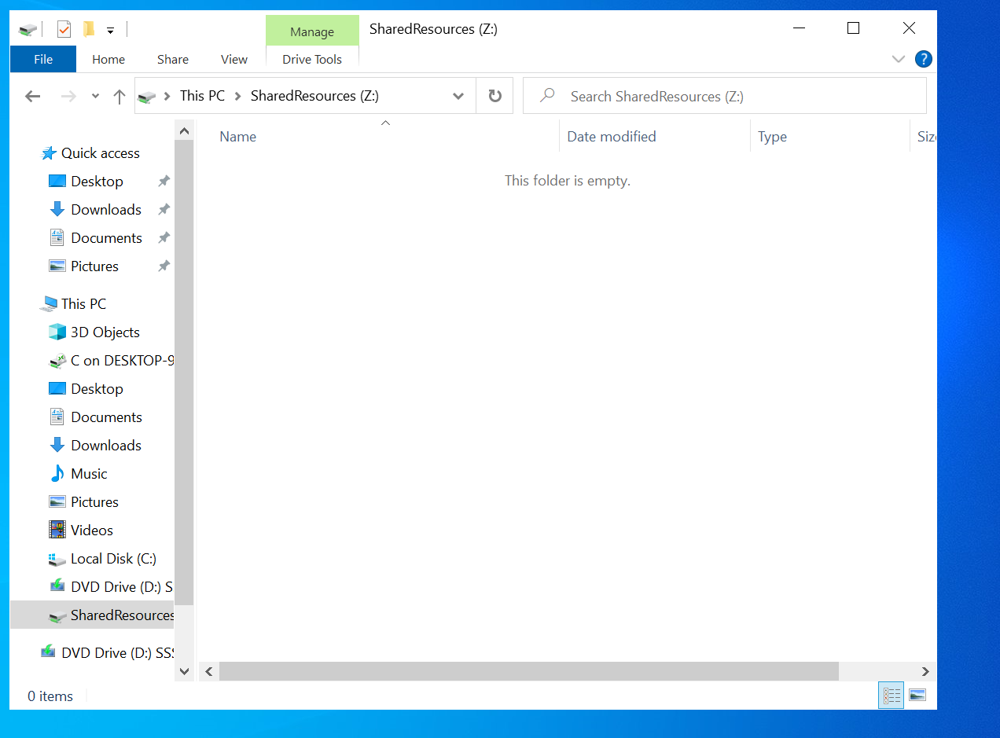
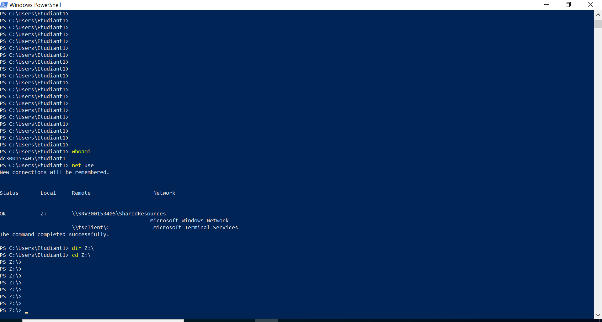
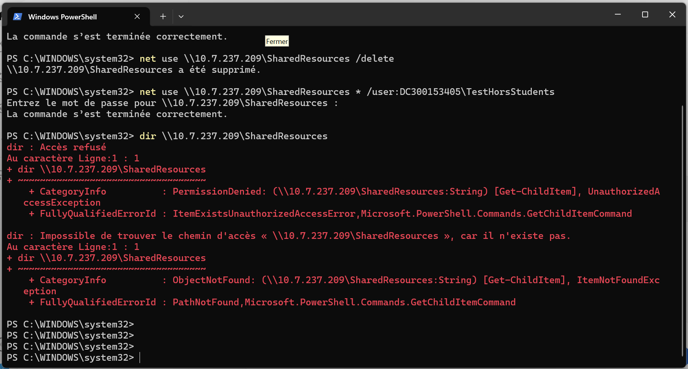
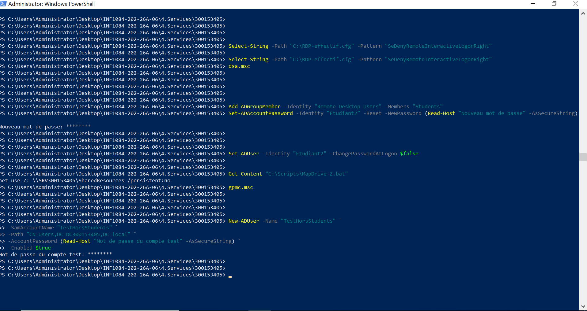
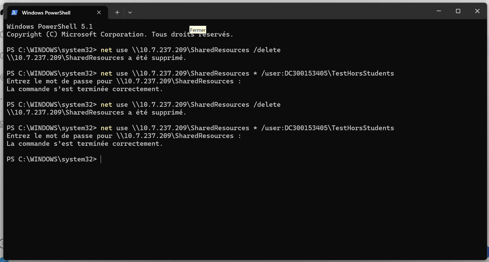
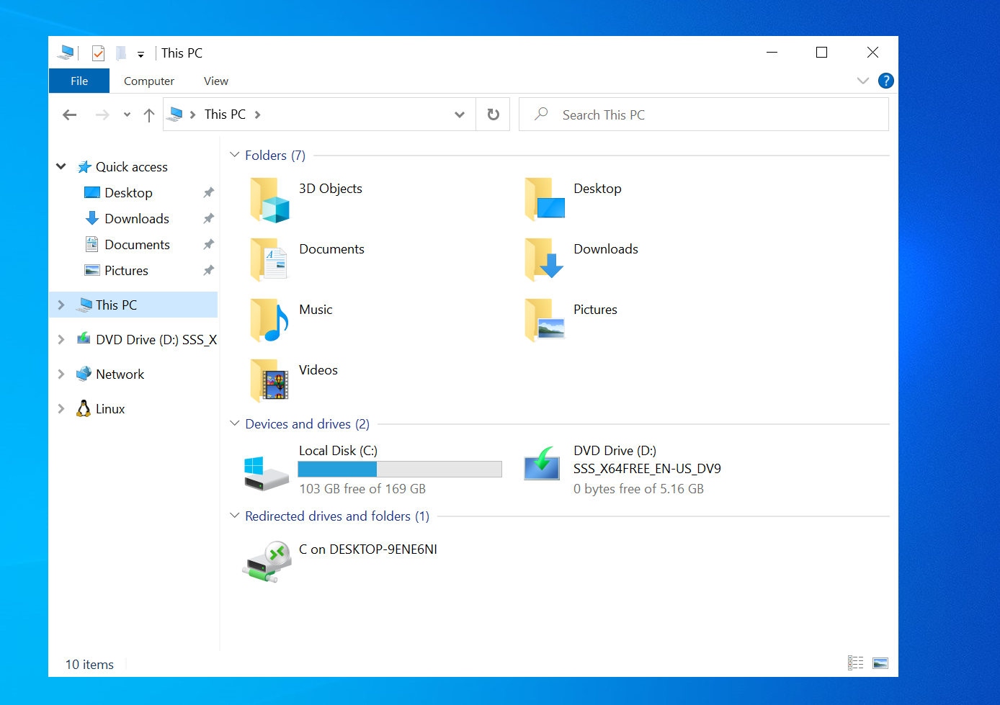

# Laboratoire 5 — Objets Active Directory, partage SMB, GPO et RDP

**INF1084 · Administration Windows — Collège Boréal**  
**Identifiant étudiant :** `300153405`  
**Date des vérifications :** 24 novembre 2026  
**État :** tests fonctionnels terminés, avec corrections documentées

> **Résumé.** Dans le domaine `DC300153405.local`, j’ai configuré des comptes et un groupe `Students`, un partage `SharedResources`, une GPO `MapSharedFolder` et l’accès RDP. Après dépannage, `Etudiant1` peut ouvrir une session à distance et retrouve automatiquement le lecteur `Z:`. Un compte hors du groupe ne peut ni ouvrir une session RDP ni consulter le contenu du partage. Les captures ci-dessous proviennent de mes propres essais.

## Sommaire

1. [Objectif et environnement](#1-objectif-et-environnement)
2. [Objets Active Directory et partage SMB](#2-objets-active-directory-et-partage-smb)
3. [GPO et mappage du lecteur Z:](#3-gpo-et-mappage-du-lecteur-z)
4. [Activation RDP et gestion des autorisations](#4-activation-rdp-et-gestion-des-autorisations)
5. [Tests positifs — utilisateur autorisé](#5-tests-positifs--utilisateur-autorisé)
6. [Tests négatifs — utilisateur hors Students](#6-tests-négatifs--utilisateur-hors-students)
7. [Difficultés rencontrées et corrections](#7-difficultés-rencontrées-et-corrections)
8. [Bilan, limites et références](#8-bilan-limites-et-références)

---

## 1. Objectif et environnement

L’objectif du laboratoire est de mettre en pratique **Active Directory, les groupes, les unités d’organisation (OU), les stratégies de groupe (GPO), SMB et RDP**, puis de distinguer les accès autorisés des accès refusés.

| Élément | Configuration utilisée |
|---|---|
| Serveur Windows / contrôleur de domaine | `SRV300153405` |
| Domaine DNS | `DC300153405.local` |
| Nom NetBIOS | `DC300153405` |
| Adresse utilisée pour les tests RDP et SMB | `10.7.237.209` |
| Unité d’organisation (OU) | `Students` |
| Groupe AD | `Students` |
| Comptes de travail | `Etudiant1`, `Etudiant2` |
| Compte de test négatif | `TestHorsStudents` |
| Dossier sur le serveur | `C:\SharedResources` |
| Partage SMB | `\\SRV300153405\SharedResources` |
| GPO | `MapSharedFolder` (liée à l’OU `Students`) |
| Lecteur réseau attendu | `Z:` |
| Poste de vérification | PC Windows personnel, connecté au serveur par RDP |

**Précision sur le scénario de test :** les connexions RDP ont été testées depuis mon PC personnel vers le serveur. Je n’ai pas créé une VM membre supplémentaire uniquement pour ce test. Cette variante est signalée car le laboratoire donne une VM membre comme prérequis indicatif.

## 2. Objets Active Directory et partage SMB

Les objets nécessaires ont été mis en place : une OU `Students`, le groupe `Students`, les comptes `Etudiant1` et `Etudiant2` et le partage `SharedResources`. Les deux comptes étudiants font partie du groupe de travail autorisé. L’accès au partage a été testé en condition réelle ; il ne faut pas confondre l’établissement d’une connexion SMB avec le droit d’énumérer les fichiers (voir [section 6](#6-tests-négatifs--utilisateur-hors-students)).

**Chemins de référence :**

```text
Domaine : DC300153405.local
OU      : OU=Students,DC=DC300153405,DC=local
Groupe  : Students
Comptes : Etudiant1 / Etudiant2
Serveur : SRV300153405
Dossier : C:\SharedResources
Partage : \\SRV300153405\SharedResources
```

La création du partage SMB et des utilisateurs suit le principe de la section « Créer le dossier partagé » du laboratoire. Les preuves les plus solides de son fonctionnement sont les tests d’accès dans les sessions utilisateur, présentés plus bas. **Je ne reproduis pas une sortie de commande qui n’a pas été conservée en capture.**

## 3. GPO et mappage du lecteur Z:

### 3.1 GPO existante et liaison à l’OU

La GPO **`MapSharedFolder`** a été vérifiée dans Group Policy Management. Son lien à l’OU `Students` est activé : les paramètres utilisateur sont destinés aux comptes situés dans cette OU.


*Figure 1 — GPO `MapSharedFolder` présente et liée à `Students`.*

### 3.2 Première configuration PowerShell : le fichier de commandes

J’ai créé et vérifié le fichier `C:\Scripts\MapDrive-Z.bat`. Son contenu observé est :

```bat
net use Z: \\SRV300153405\SharedResources /persistent:no
```

Ce fichier a été généré en PowerShell avec `Set-Content`. La valeur `LogonScript` a également été écrite dans la GPO à l’aide de `Set-GPRegistryValue`, puis vérifiée avec `Get-GPRegistryValue`.

<details>
<summary>Voir les preuves : script et valeur LogonScript</summary>

**Création et contenu du fichier :**



**Valeur de registre écrite dans la GPO :**


</details>

**Constat important :** malgré l’existence du fichier `.bat` et de la valeur `LogonScript`, **le lecteur `Z:` n’apparaissait pas automatiquement** lors du premier test. Une valeur de registre personnalisée ne constitue pas, à elle seule, un enregistrement de script de connexion au sens des paramètres Windows prévus pour cela.

### 3.3 Correction retenue : préférence GPO « Drive Maps »

J’ai conservé la GPO existante et ajouté un élément de **mappage de lecteur** dans :

`User Configuration → Preferences → Windows Settings → Drive Maps`

| Propriété | Valeur réellement configurée |
|---|---|
| Action | `Update` |
| Location | `\\SRV300153405\SharedResources` |
| Drive Letter | `Z:` |
| Label as | `SharedResources` |
| Reconnect | Décoché |
| Connect as | Aucun identifiant spécifique |


*Figure 2 — Préférence « Mapped Drive » ajoutée à `MapSharedFolder`.*

**Transparence sur la méthode :** les premières opérations ont été réalisées avec PowerShell, conformément au laboratoire. La correction finale du mappage a été effectuée **dans l’éditeur graphique GPO**. Je la documente explicitement : c’est l’option « Preferences → Drive Maps » présentée dans la partie théorique du cours, mais ce n’est pas une manipulation exclusivement PowerShell.

## 4. Activation RDP et gestion des autorisations

Le serveur a été configuré pour accepter le Bureau à distance avec les commandes de la section 4 du laboratoire :

```powershell
Set-ItemProperty -Path "HKLM:\System\CurrentControlSet\Control\Terminal Server" -Name "fDenyTSConnections" -Value 0
Enable-NetFirewallRule -DisplayGroup "Remote Desktop"
```

Le droit **`SeRemoteInteractiveLogonRight`** a ensuite été ajusté pour inclure le groupe `Students`. J’ai utilisé `secedit` pour exporter, modifier et réimporter la configuration, puis `gpupdate /force` pour mettre à jour les stratégies. Un ajout complémentaire de `Students` au groupe intégré `Remote Desktop Users` a également été effectué lors du dépannage.

```powershell
secedit /export /cfg C:\secpol.cfg
# Ajout du SID du groupe Students dans SeRemoteInteractiveLogonRight
secedit /import /cfg C:\secpol.cfg /db C:\secpol.sdb /overwrite
gpupdate /force
```

Le contrôle **après application** montrait les SID attendus dans la politique effective :

```text
SeRemoteInteractiveLogonRight = *S-1-5-32-544,*S-1-5-21-447135690-91861430-3213525697-1104
```

Le premier SID représente les administrateurs intégrés ; le second est celui du groupe `Students` dans mon domaine. Ce contrôle confirme **la présence du droit dans la politique exportée**, mais ne remplace pas un test réel de connexion.

<details>
<summary>Voir les preuves PowerShell RDP et politique de sécurité</summary>




</details>

## 5. Tests positifs — utilisateur autorisé

### 5.1 Connexion RDP

La connexion au serveur a été obtenue avec `DC300153405\Etudiant1`. J’ai également testé une connexion avec `Etudiant2` après correction de la situation de son mot de passe. La capture nominative ci-dessous illustre `Etudiant1`.



*Figure 3 — Session ouverte avec `Etudiant1`.*

### 5.2 Mappage automatique après fermeture et réouverture de la session

Lors du **premier** test, aucun lecteur `Z:` n’était affiché. Après avoir ajouté la préférence `Drive Maps`, je me suis **déconnecté avec « Sign out »**, puis reconnecté avec `Etudiant1`. Le lecteur `SharedResources (Z:)` était alors visible automatiquement sous **This PC → Network locations** ; aucune commande `net use Z: ...` n’a été saisie pour créer ce lecteur dans cette nouvelle session.


*Figure 4 — Lecteur `Z:` créé après reconnexion grâce à la GPO.*

Le dossier s’ouvre sans erreur et est vide, ce qui est normal tant qu’aucun fichier n’y a été placé.



*Figure 5 — Accès en lecture au contenu du partage (dossier vide).* 

### 5.3 Vérifications PowerShell depuis la session `Etudiant1`

Les commandes suivantes ont été lancées **dans la session RDP de l’étudiant**, et non dans la session `Administrator` :

```powershell
whoami
net use
dir Z:\
cd Z:\
```

Résultats observés :

```text
whoami  -> dc300153405\etudiant1
net use -> OK    Z:    \\SRV300153405\SharedResources
dir Z:\  -> aucune erreur (dossier vide)
cd Z:\   -> invite de commande PS Z:\>
```



*Figure 6 — Vérifications finales réalisées avec l’utilisateur autorisé : identité, mappage et accès.*

## 6. Tests négatifs — utilisateur hors Students

Afin de reproduire le test demandé « utilisateur hors du groupe », j’ai créé dans le conteneur `Users` un compte **`TestHorsStudents`**, sans l’ajouter à `Students`. Ce compte est une **adaptation pour le test**, pas un nouvel objet imposé explicitement par le laboratoire. Le mot de passe n’est pas publié dans ce dépôt.

### 6.1 Tentative RDP : refus attendu

Depuis mon ordinateur personnel, j’ai essayé de me connecter au serveur `10.7.237.209` avec `DC300153405\TestHorsStudents`.


*Figure 7 — Refus explicite : le compte n’est pas autorisé à ouvrir une session à distance.*

### 6.2 Tentative SMB : distinction entre connexion et autorisation

J’ai exécuté depuis mon **PC personnel** :

```powershell
net use \\10.7.237.209\SharedResources * /user:DC300153405\TestHorsStudents
```

Le message `La commande s’est terminée correctement` indique que la **connexion SMB a été établie** ; cela **ne prouve pas** que le compte a accès aux fichiers.

Le test décisif a été :

```powershell
dir \\10.7.237.209\SharedResources
```

Il a renvoyé **`Accès refusé`**. Le compte hors du groupe ne peut donc pas consulter le contenu du partage, même si `net use` est accepté. Cela vérifie le refus d’accès au contenu ; **la capture ne permet pas d’attribuer précisément ce refus aux permissions SMB ou NTFS sans contrôle supplémentaire des ACL**.



*Figure 8 — Test de lecture négatif : `dir` retourne « Accès refusé ».*

<details>
<summary>Voir les preuves supplémentaires : création du compte et connexion SMB établie</summary>





</details>

## 7. Difficultés rencontrées et corrections

Le dépannage a inclus des vérifications supplémentaires pour comprendre les erreurs initiales. Je distingue les **faits observés**, les **corrections réellement effectuées** et ce qui **n’a pas été démontré**.

| Problème observé | Diagnostic / mesure prise | Résultat et portée de la conclusion |
|---|---|---|
| Premières ouvertures RDP refusées pour les étudiants | Activation RDP et pare-feu ; contrôle des droits `SeRemoteInteractiveLogonRight` ; import `secedit` et mise à jour des stratégies ; ajout du groupe `Students` dans `Remote Desktop Users`. | Les sessions `Etudiant1` puis `Etudiant2` ont finalement fonctionné. **La contribution exacte de chaque correction n’a pas été isolée.** |
| Message de mot de passe expiré, notamment pour `Etudiant2` | Réinitialisation contrôlée du mot de passe et désactivation de l’obligation de modification à la prochaine connexion. | Le compte a ensuite pu être utilisé pour le test RDP. Aucun mot de passe n’est conservé dans ce rapport. |
| Plusieurs tentatives RDP rejetaient les identifiants | Consultation des événements Windows `4625` ; code observé `0xC0000064`. Validation NTLM `4776` observée avec le code `0x0` pour certaines opérations. | Les comptes ont été reconnus pour d’autres accès, notamment SMB. **La cause exacte de tous les échecs RDP précédents n’a pas été établie de manière certaine.** |
| Le nom DNS complet du serveur n’était pas résolu depuis le PC personnel | Tentative par nom DNS, puis maintien de l’adresse IP du serveur pour les tests. | L’accès par IP fonctionnait ; la résolution DNS depuis le PC personnel n’a pas été modifiée. |
| Lecteur `Z:` absent à la première ouverture de session | Fichier `.bat` et valeur `LogonScript` présents, mais pas de préférence `Drive Maps` configurée. Ajout de l’élément `Update / Z:` dans la **même GPO**, puis « Sign out » et reconnexion. | **Correction observée comme efficace** : le lecteur `Z:` apparaît automatiquement et son contenu est accessible. |
| Le compte hors groupe réussissait la commande `net use` | Test complémentaire d’énumération avec `dir` pour vérifier l’autorisation réelle. | Connexion SMB établie, mais **lecture du dossier refusée**. Le test négatif de consultation est concluant. |

<details>
<summary>Comparer l’état du lecteur avant et après la correction GPO</summary>

**Avant :** le lecteur `Z:` ne figure pas dans **This PC**.



**Après :** le lecteur `Z:` apparaît sous **Network locations**.


</details>

## 8. Bilan, limites et références

### Tableau de validation

| Critère | Résultat constaté |
|---|---|
| OU, groupe et comptes étudiants présents | ✅ Réalisé |
| Partage `SharedResources` disponible pour l’utilisateur autorisé | ✅ Accessible |
| Connexion RDP `Etudiant1` | ✅ Réussie |
| Connexion RDP `Etudiant2` | ✅ Réussie lors du test effectué ; capture nominative non fournie |
| `Z:` mappé automatiquement à la reconnexion | ✅ Réussi |
| Consultation de `Z:` et `dir Z:\` | ✅ Réussie (dossier vide) |
| Connexion RDP de `TestHorsStudents` | ✅ Refusée comme attendu |
| Consultation SMB de `TestHorsStudents` | ✅ Refusée comme attendu |
| Création/modification de fichiers dans `SharedResources` | Non testée ; ne pas confondre avec l’accès en lecture |

### Points de vigilance

- L’élément **Drive Maps** a été configuré graphiquement, bien que les consignes pratiques privilégient PowerShell : ce choix est déclaré, car il correspond à l’exemple GPO du cours et a résolu le problème de mappage.
- Les tests ont été réalisés vers le **contrôleur de domaine** depuis un **PC personnel**, pas depuis une VM membre dédiée. Un tel accès RDP doit rester limité à l’environnement pédagogique et aux comptes explicitement autorisés.
- Le compte `TestHorsStudents` est un compte de **test temporaire**. Après la validation du laboratoire, il conviendra de le désactiver ou de le supprimer, conformément aux consignes d’administration du cours.
- Les captures documentent des accès autorisés/refusés et non un audit complet des listes de contrôle d’accès (ACL). Les résultats sont rapportés sans extrapolation.

### Conclusion

Ce laboratoire m’a permis de mettre en œuvre et de vérifier des objets Active Directory, un partage SMB, une GPO utilisateur et des restrictions RDP. La principale correction fonctionnelle a été l’ajout d’une **préférence `Drive Maps`** dans `MapSharedFolder`. Le test final `whoami` / `net use` / `dir Z:\` confirme le mappage et l’accès avec `Etudiant1`. Le compte `TestHorsStudents` illustre la différence entre une connexion réseau établie et une **autorisation de lire le partage**.

### Références

- [Consignes officielles — INF1084 / 5.Objects](https://github.com/CollegeBoreal/INF1084-202-26A-06/blob/main/5.Objects/README.md)
- [Documentation Microsoft — Vue d’ensemble des stratégies de groupe](https://learn.microsoft.com/fr-fr/windows-server/identity/group-policy/group-policy-overview)
- [Documentation Microsoft — Commande `secedit /export`](https://learn.microsoft.com/en-us/windows-server/administration/windows-commands/secedit-export)

---

**Organisation des preuves.** Toutes les images utilisées dans ce rapport se trouvent dans `images/` avec des noms descriptifs. Les captures originales ont été conservées sans modification de leur contenu ; seuls les noms de fichiers ont été harmonisés pour faciliter la vérification sur GitHub.
