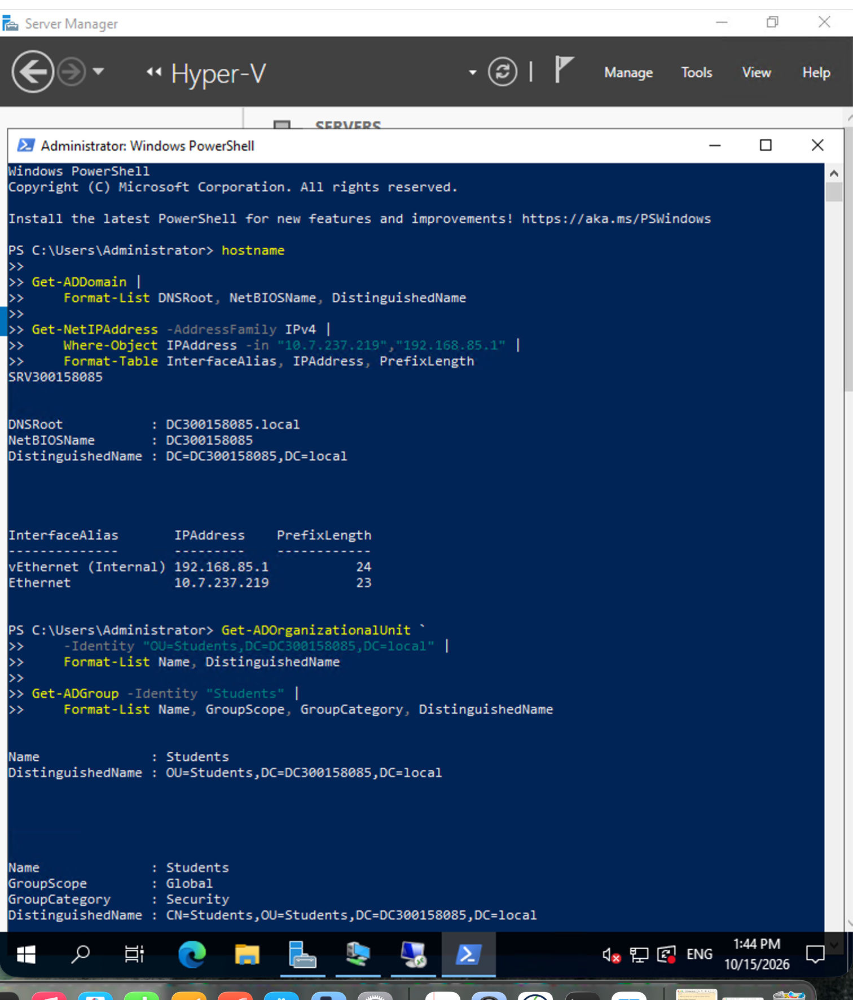
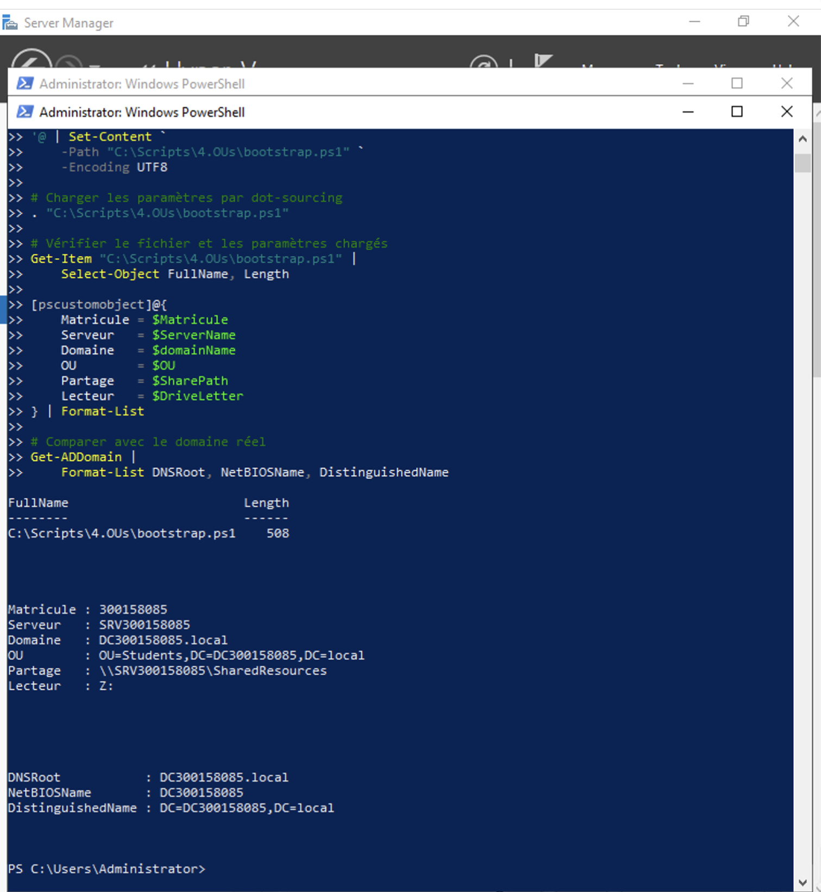
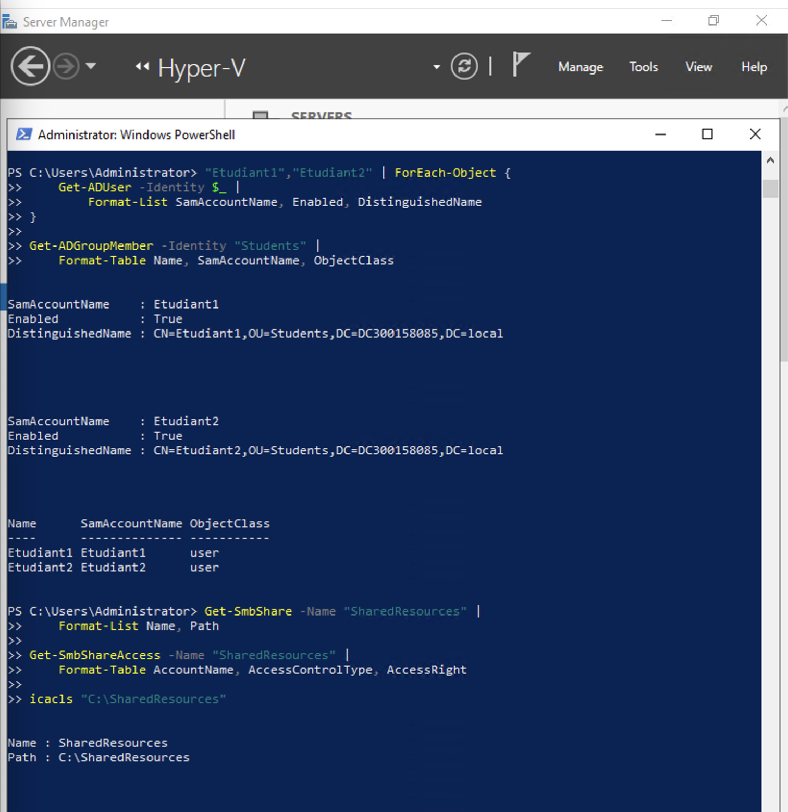
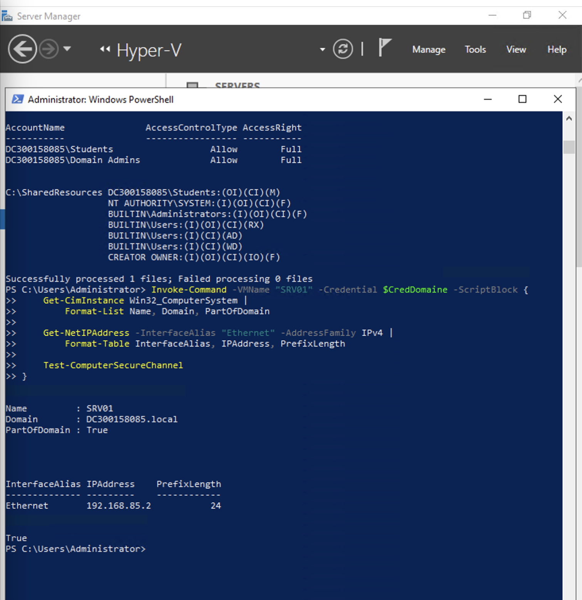
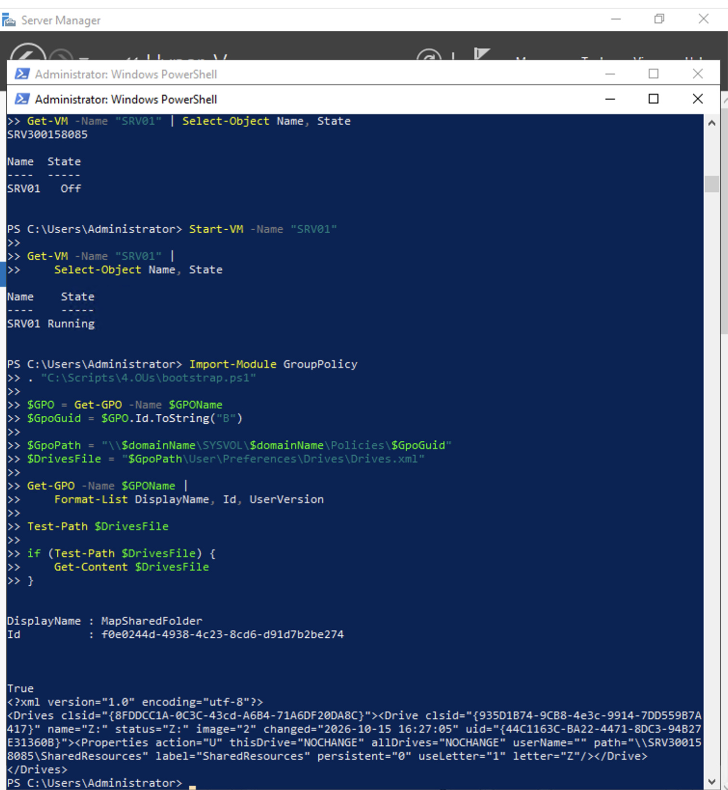
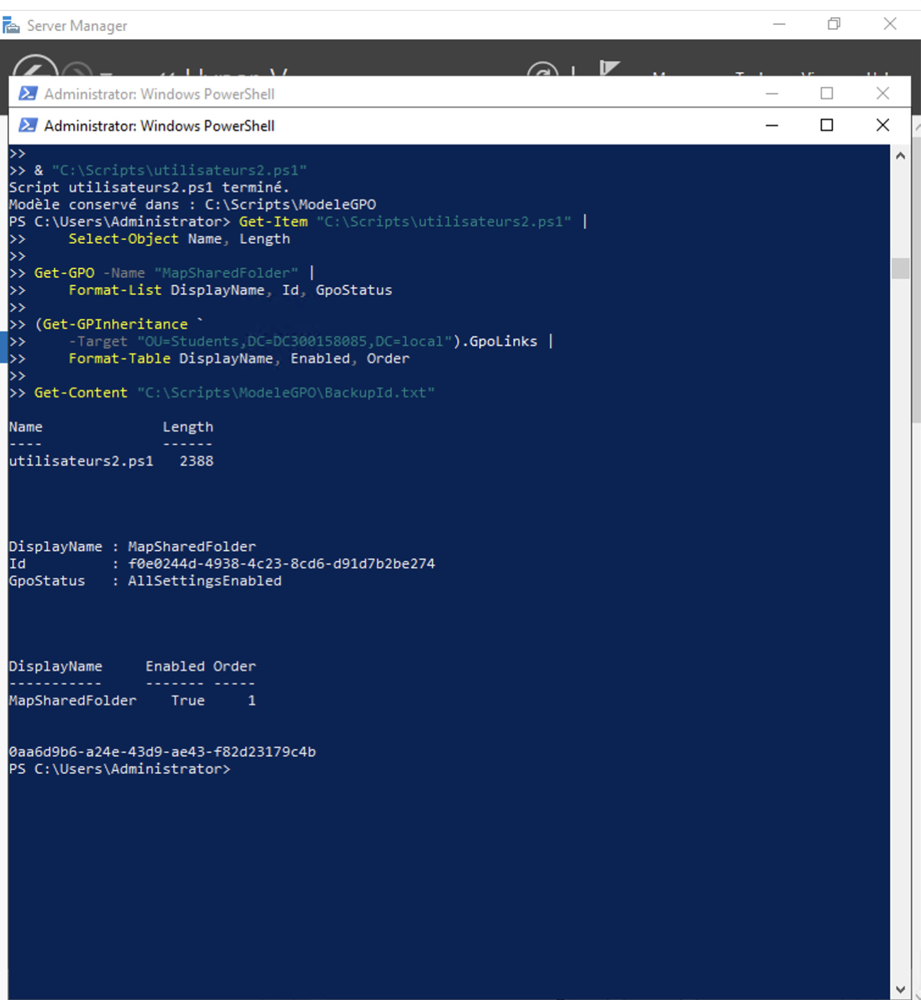
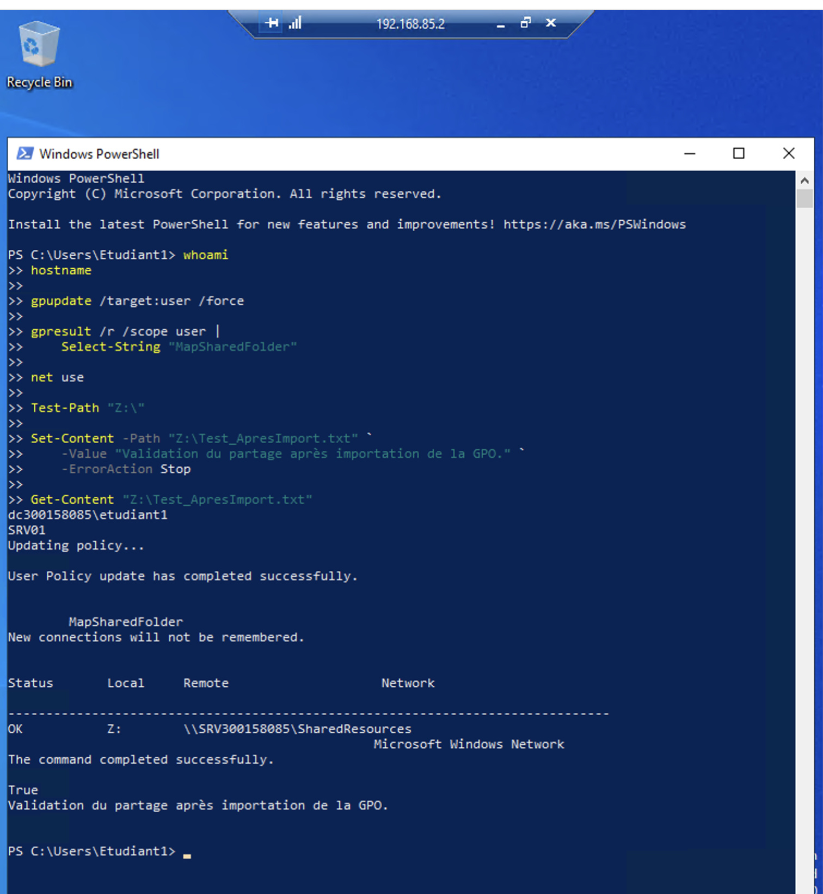
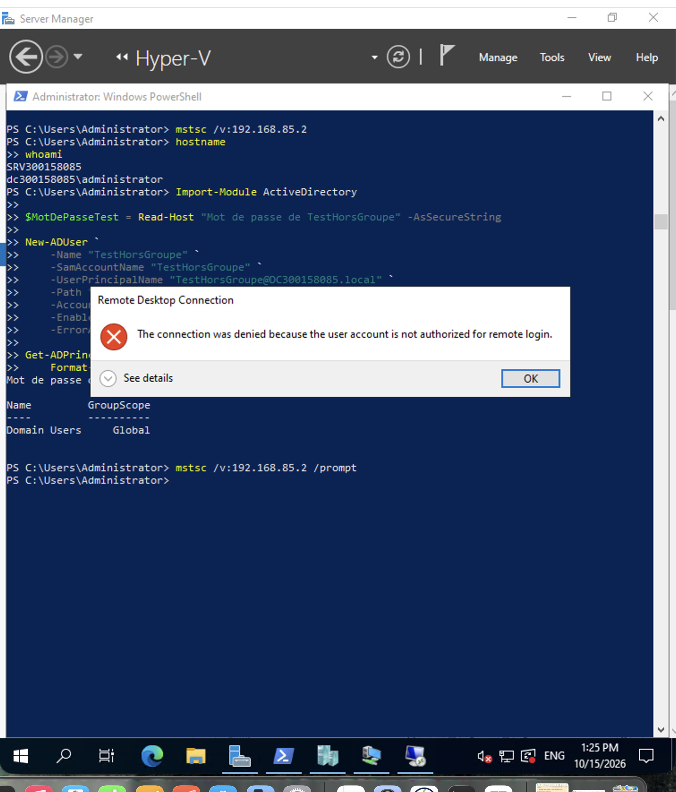
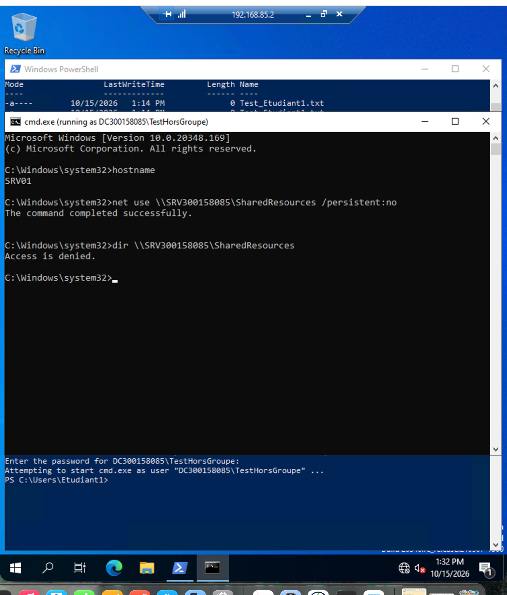

# Laboratoire — Active Directory, partage SMB, GPO et RDP

**Collège Boréal — Techniques des systèmes informatiques**  
**Cours :** INF1084 — Objets gérables par Active Directory  
**Étudiant :** Kevin Mayele  
**Matricule :** 300158085  
**Date :** 15 octobre 2026  

## 1. Objectif du laboratoire

L’objectif est de gérer les accès aux ressources dans un domaine Active Directory sous Windows Server 2022.

Le travail comprend la création d’une unité organisationnelle, d’un groupe de sécurité et de deux utilisateurs, la configuration d’un partage SMB, le mappage d’un lecteur réseau par GPO et l’autorisation des connexions Bureau à distance. Des tests permettent de vérifier les accès d’un utilisateur autorisé et leur refus pour un utilisateur hors du groupe.

## 2. Environnement de travail

| Élément | Configuration |
|---|---|
| Contrôleur de domaine et hôte Hyper-V | SRV300158085 |
| Système du contrôleur de domaine | Windows Server 2022 Datacenter |
| Domaine DNS | DC300158085.local |
| Nom NetBIOS | DC300158085 |
| Nom distinctif du domaine | DC=DC300158085,DC=local |
| Adresse principale du serveur | 10.7.237.219/23 |
| Adresse interne du serveur | 192.168.85.1/24 |
| VM membre | SRV01 |
| Système de SRV01 | Windows Server 2022 Standard Evaluation |
| Adresse de SRV01 | 192.168.85.2/24 |
| DNS de SRV01 | 192.168.85.1 |
| Commutateur Hyper-V utilisé | Internal |
| OU | Students |
| Groupe global de sécurité | Students |
| Utilisateurs | Etudiant1 et Etudiant2 |
| Dossier partagé | C:\SharedResources |
| Chemin réseau | \\SRV300158085\SharedResources |
| GPO | MapSharedFolder |
| Lecteur réseau | Z: |

Les modules ActiveDirectory et GroupPolicy sont disponibles sur le contrôleur de domaine. Les opérations d’administration ont été exécutées dans une session PowerShell administrateur sur SRV300158085.



## 3. Organisation des fichiers

Le dossier de remise porte mon matricule : `300158085`. Il contient le README, les captures et les scripts du laboratoire.

| Fichier ou dossier | Fonction |
|---|---|
| README.md | Description des étapes et des résultats |
| images | Captures de vérification au format JPG |
| 4.OUs/bootstrap.ps1 | Paramètres de mon environnement |
| utilisateurs1.ps1 | Gestion des objets AD et du partage |
| utilisateurs2.ps1 | Réimportation de la configuration GPO et gestion de sa liaison |
| ModeleGPO | Sauvegarde nécessaire à utilisateurs2.ps1 |

Les scripts chargent le fichier de paramètres à partir de leur propre emplacement. Le dossier ModeleGPO doit rester à côté de utilisateurs2.ps1.

## 4. Préparation et dot-sourcing

Le fichier `4.OUs/bootstrap.ps1` mentionné dans le cours n’était pas présent dans le dépôt consulté. J’ai créé une version locale adaptée à mon environnement.

Ce fichier définit notamment les variables suivantes :

```powershell
$Matricule = "300158085"
$domainName = "DC300158085.local"
$netbiosName = "DC300158085"
$ServerName = "SRV300158085"
$DomainDN = "DC=DC300158085,DC=local"
$OU = "OU=Students,$DomainDN"
$GroupName = "Students"
$SharedFolder = "C:\SharedResources"
$GPOName = "MapSharedFolder"
$SharePath = "\\$ServerName\SharedResources"
$DriveLetter = "Z:"
```

Les paramètres ont été chargés par dot-sourcing :

```powershell
Import-Module ActiveDirectory
Import-Module GroupPolicy

. "C:\Scripts\4.OUs\bootstrap.ps1"

Get-ADDomain |
    Format-List DNSRoot, NetBIOSName, DistinguishedName
```

La comparaison avec le domaine réel confirme que les paramètres correspondent à DC300158085.local.



## 5. Création de l’OU et du groupe de sécurité

L’OU Students a été créée à la racine du domaine. Elle contient les utilisateurs du laboratoire et le groupe Students.

```powershell
New-ADOrganizationalUnit `
    -Name "Students" `
    -Path $DomainDN

New-ADGroup `
    -Name $GroupName `
    -SamAccountName $GroupName `
    -GroupScope Global `
    -GroupCategory Security `
    -Path $OU
```

Ces opérations sont intégrées à utilisateurs1.ps1 avec une vérification préalable de l’existence des objets.

Vérification :

```powershell
Get-ADOrganizationalUnit -Identity $OU |
    Format-List Name, DistinguishedName

Get-ADGroup -Identity "Students" |
    Format-List Name, GroupScope, GroupCategory, DistinguishedName
```

Le résultat confirme que Students est un groupe global de sécurité situé dans l’OU Students.

## 6. Création des utilisateurs

Les comptes Etudiant1 et Etudiant2 ont été créés dans l’OU Students, activés et ajoutés au groupe Students.

Les mots de passe ont été saisis avec `Read-Host -AsSecureString`, sans être enregistrés dans les scripts.

Exemple pour Etudiant1 :

```powershell
$Password1 = Read-Host "Mot de passe pour Etudiant1" -AsSecureString

New-ADUser `
    -Name "Etudiant1" `
    -SamAccountName "Etudiant1" `
    -UserPrincipalName "Etudiant1@$domainName" `
    -Path $OU `
    -AccountPassword $Password1 `
    -Enabled $true `
    -ErrorAction Stop
```

La même procédure a été appliquée à Etudiant2, puis les deux comptes ont été ajoutés au groupe :

```powershell
Add-ADGroupMember `
    -Identity "Students" `
    -Members "Etudiant1","Etudiant2"
```

Vérification :

```powershell
"Etudiant1","Etudiant2" | ForEach-Object {
    Get-ADUser -Identity $_ |
        Format-List SamAccountName, Enabled, DistinguishedName
}

Get-ADGroupMember -Identity "Students" |
    Format-Table Name, SamAccountName, ObjectClass
```

Les deux comptes sont activés et membres du groupe Students.



## 7. Création du dossier et du partage SMB

### Dossier et permissions NTFS

```powershell
New-Item -Path $SharedFolder -ItemType Directory -Force

icacls $SharedFolder /grant "${netbiosName}\Students:(OI)(CI)M"
```

Le groupe Students reçoit le droit NTFS Modification sur le dossier, ses sous-dossiers et ses fichiers. Les permissions héritées ont été conservées.

### Partage SMB

Le groupe des administrateurs du domaine a été retrouvé à partir de son SID :

```powershell
$DomainAdminsSID = "$((Get-ADDomain).DomainSID.Value)-512"
$DomainAdmins = (Get-ADGroup -Identity $DomainAdminsSID).SamAccountName

New-SmbShare `
    -Name "SharedResources" `
    -Path $SharedFolder `
    -FullAccess "${netbiosName}\Students","${netbiosName}\${DomainAdmins}"
```

### Vérification

```powershell
Get-SmbShare -Name "SharedResources" |
    Format-List Name, Path

Get-SmbShareAccess -Name "SharedResources" |
    Format-Table AccountName, AccessControlType, AccessRight

icacls "C:\SharedResources"
```

| Niveau | Groupe | Autorisation |
|---|---|---|
| SMB | DC300158085\Students | Full |
| SMB | DC300158085\Domain Admins | Full |
| NTFS | DC300158085\Students | Modification |

L’accès effectif par le réseau dépend des autorisations SMB et NTFS.

Ces opérations ont été regroupées dans utilisateurs1.ps1. Le script a été exécuté sur le contrôleur de domaine :

```powershell
& "C:\Scripts\utilisateurs1.ps1"
```

Il s’est terminé sans erreur visible. Les objets déjà présents ont été réutilisés et les mots de passe existants ont été conservés.

## 8. Préparation de la VM membre

La VM Hyper-V SRV01 portait initialement le nom Windows TEMPLATE_VM et appartenait au groupe de travail WORKGROUP.

Elle a été connectée au commutateur Internal, puis configurée avec l’adresse 192.168.85.2/24 et le serveur DNS 192.168.85.1. Le contrôleur de domaine utilise 192.168.85.1/24 sur ce même réseau interne.

La résolution DNS a permis de retrouver le contrôleur de domaine. La VM a ensuite été jointe au domaine et renommée :

```powershell
Invoke-Command -VMName "SRV01" -Credential $CredSRV01 `
    -ArgumentList $CredDomaine -ScriptBlock {

    param($IdentifiantsDomaine)

    Add-Computer `
        -DomainName "DC300158085.local" `
        -NewName "SRV01" `
        -OUPath "OU=Students,DC=DC300158085,DC=local" `
        -Credential $IdentifiantsDomaine `
        -PassThru `
        -ErrorAction Stop
}
```

Les variables d’identifiants ont été renseignées avec Get-Credential. Après un arrêt normal et un démarrage de la VM, les vérifications ont confirmé :

- Nom Windows : SRV01.
- Domaine : DC300158085.local.
- PartOfDomain : True.
- Adresse IPv4 : 192.168.85.2/24.
- Test-ComputerSecureChannel : True.



## 9. Configuration de la GPO MapSharedFolder

### Création et liaison

```powershell
New-GPO -Name "MapSharedFolder"

New-GPLink `
    -Name "MapSharedFolder" `
    -Target "OU=Students,DC=DC300158085,DC=local" `
    -LinkEnabled Yes
```

La GPO cible les utilisateurs de l’OU Students. Son filtrage de sécurité conserve Authenticated Users.

### Paramètres du lecteur réseau

La préférence a d’abord été configurée dans :

**User Configuration > Preferences > Windows Settings > Drive Maps**

| Paramètre | Valeur |
|---|---|
| Action | Update |
| Chemin | \\SRV300158085\SharedResources |
| Lettre | Z: |
| Libellé | SharedResources |
| Connexion persistante | Désactivée |

Le fichier Drives.xml situé dans SYSVOL confirme ces paramètres.



### Sauvegarde et réapplication par PowerShell

Le script utilisateurs2.ps1 utilise la configuration existante comme modèle.

Lors de sa première exécution, il vérifie le mappage, sauvegarde la GPO avec Backup-GPO et conserve l’identifiant dans ModeleGPO/BackupId.txt. Il réapplique ensuite les paramètres avec Import-GPO et crée ou active la liaison à l’OU Students.

```powershell
& "C:\Scripts\utilisateurs2.ps1"

Get-GPO -Name "MapSharedFolder" |
    Format-List DisplayName, Id, GpoStatus

(Get-GPInheritance `
    -Target "OU=Students,DC=DC300158085,DC=local").GpoLinks |
    Format-Table DisplayName, Enabled, Order
```

Le script s’est terminé sans erreur visible. La GPO présente l’état AllSettingsEnabled et sa liaison est activée, en position 1.



## 10. Activation du Bureau à distance

Les connexions RDP ont été activées sur SRV01. Les règles de pare-feu correspondantes ont été activées et Students a été ajouté au groupe local Remote Desktop Users.

Depuis le contrôleur de domaine :

```powershell
Invoke-Command -VMName "SRV01" -Credential $CredDomaine -ScriptBlock {
    Set-ItemProperty `
        -Path "HKLM:\SYSTEM\CurrentControlSet\Control\Terminal Server" `
        -Name "fDenyTSConnections" `
        -Value 0

    Enable-NetFirewallRule -Name "RemoteDesktop-UserMode-In-TCP"
    Enable-NetFirewallRule -Name "RemoteDesktop-UserMode-In-UDP"

    $GroupeRDP = Get-LocalGroup -SID "S-1-5-32-555"

    Add-LocalGroupMember `
        -Group $GroupeRDP.Name `
        -Member "DC300158085\Students"

    Get-LocalGroupMember -Group $GroupeRDP.Name
}
```

La vérification réseau a été réalisée avec :

```powershell
Test-NetConnection "192.168.85.2" -Port 3389
```

Le résultat TcpTestSucceeded : True confirme que le port RDP était accessible depuis le contrôleur de domaine.

## 11. Tests avec Etudiant1

Après la réimportation de la GPO, j’ai ouvert une session Bureau à distance sur SRV01 avec DC300158085\Etudiant1.

Dans cette session :

```powershell
whoami
hostname

gpupdate /target:user /force

gpresult /r /scope user |
    Select-String "MapSharedFolder"

net use
Test-Path "Z:\"

Set-Content -Path "Z:\Test_ApresImport.txt" `
    -Value "Validation du partage après importation de la GPO." `
    -ErrorAction Stop

Get-Content "Z:\Test_ApresImport.txt"
```

Les résultats confirment :

- L’identité DC300158085\Etudiant1 sur SRV01.
- La réussite de la mise à jour des stratégies utilisateur.
- La présence de MapSharedFolder dans gpresult.
- Le lecteur Z: connecté au bon partage avec l’état OK.
- Un résultat True pour Test-Path.
- La réussite de l’écriture et de la lecture du fichier.

Aucune commande de mappage manuel de Z: n’a été exécutée pendant ce test.



## 12. Tests avec un utilisateur hors du groupe

Le compte TestHorsGroupe a été créé dans le conteneur Users, sans être ajouté au groupe Students.

La commande suivante a affiché uniquement Domain Users :

```powershell
Get-ADPrincipalGroupMembership -Identity "TestHorsGroupe" |
    Format-Table Name, GroupScope
```

### Refus de connexion RDP

Une tentative de connexion à SRV01 avec TestHorsGroupe a retourné :

> The connection was denied because the user account is not authorized for remote login.

Le compte n’est donc pas autorisé à ouvrir une session Bureau à distance sur SRV01.



### Refus de lecture du partage

Depuis SRV01, une fenêtre utilisant les identifiants réseau de TestHorsGroupe a été ouverte :

```cmd
runas /netonly /user:DC300158085\TestHorsGroupe "cmd.exe"
```

Dans cette fenêtre :

```cmd
hostname
net use \\SRV300158085\SharedResources /persistent:no
dir \\SRV300158085\SharedResources
```

La commande net use a annoncé une réussite, mais dir a retourné **Access is denied**.

Le refus de lecture du contenu constitue la preuve du contrôle d’accès. La réussite de net use ne suffit pas à démontrer que l’utilisateur peut consulter les fichiers.

La consultation des sessions SMB sur le serveur a également confirmé l’identité réseau TestHorsGroupe depuis 192.168.85.2.



## 13. Bilan des vérifications

| Vérification | Résultat observé |
|---|---|
| OU Students | Présente dans le domaine |
| Groupe Students | Global, de type Security |
| Etudiant1 et Etudiant2 | Activés et membres de Students |
| Dossier et partage SMB | Présents au chemin attendu |
| Permissions NTFS de Students | Modification |
| Permissions SMB | Full pour Students et Domain Admins |
| SRV01 membre du domaine | Oui, canal sécurisé valide |
| Dot-sourcing de bootstrap.ps1 | Effectué |
| utilisateurs1.ps1 | Exécuté sans erreur visible |
| utilisateurs2.ps1 | Sauvegarde et importation réalisées |
| Liaison de MapSharedFolder | Activée sur l’OU Students |
| Connexion RDP d’Etudiant1 | Réussie |
| Lecteur Z: après importation | Connecté et accessible |
| Écriture et lecture sur Z: | Réussies |
| Connexion RDP de TestHorsGroupe | Refusée |
| Lecture SMB de TestHorsGroupe | Refusée |

Les tests de session et de lecteur réseau ont été réalisés avec Etudiant1. Etudiant2 a été vérifié dans Active Directory, sans test de session présenté.

Les tests de refus ont été réalisés avant la sauvegarde et la réimportation de la GPO. Cette opération n’a pas modifié les autorisations SMB ou RDP.

## 14. Difficultés et adaptations

La VM disposait initialement d’une adresse automatique en 169.254.x.x. La configuration du réseau interne et du DNS a permis de joindre le contrôleur de domaine.

La jonction au domaine a nécessité un redémarrage pour appliquer le changement de nom et l’appartenance au domaine.

Une tentative de création d’utilisateur depuis la session Etudiant1 a échoué, car les commandes Active Directory n’y étaient pas disponibles. L’opération a ensuite été effectuée sur le contrôleur de domaine dans la session administrateur.

Trois adaptations distinguent la méthode réalisée de l’exemple fourni dans le cours :

1. Le fichier bootstrap.ps1 absent du dépôt consulté a été remplacé par une version locale contenant mes paramètres.
2. Le mappage a d’abord été configuré graphiquement, puis sauvegardé et réappliqué par PowerShell. Il ne s’agit donc pas d’une création initiale entièrement réalisée par PowerShell.
3. L’autorisation RDP a été accordée par l’ajout de Students au groupe local Remote Desktop Users. Les droits n’ont pas été modifiés par exportation et réimportation avec secedit.

Les résultats fonctionnels ont été vérifiés. Ces adaptations ne doivent toutefois pas être confondues avec une reproduction exacte de chaque commande du cours.

## 15. Conclusion personnelle

Ce laboratoire m’a permis de comprendre le lien entre les objets Active Directory, les stratégies de groupe et les autorisations d’accès.

J’ai vérifié qu’Etudiant1 pouvait se connecter à SRV01, recevoir le lecteur Z: par GPO et écrire dans le partage. Les essais avec TestHorsGroupe ont confirmé le refus de connexion RDP et de lecture des fichiers.

J’ai également appris à distinguer une configuration déclarée d’un résultat réellement testé dans une session utilisateur.

## 16. Remise sur Git

Le dossier de remise est destiné à l’emplacement suivant :

`5.Objects/300158085`

Après l’ajout du README, des scripts, du modèle GPO et des captures, les commandes de remise sont exécutées depuis la racine du dépôt local :

```bash
git status --short
git add 5.Objects/300158085
git commit -m "Documenter le laboratoire AD, SMB, GPO et RDP de 300158085"
git push
```

La vérification finale porte sur l’affichage du README, la présence des fichiers et le chargement des neuf captures dans GitHub.

## Références

- [Consignes du laboratoire](https://github.com/CollegeBoreal/INF1084-202-26A-06/blob/main/5.Objects/README.md)
- [Microsoft Learn — Backup-GPO](https://learn.microsoft.com/en-us/powershell/module/grouppolicy/backup-gpo?view=windowsserver2022-ps)
- [Microsoft Learn — Import-GPO](https://learn.microsoft.com/en-us/powershell/module/grouppolicy/import-gpo?view=windowsserver2022-ps)
