# Laboratoire 5 - Objets Active Directory, partage de ressources et RDP

**Nom :** Touadjni Islem  
**ID :** 300159195  
**Cours :** INF1084 - Administration Windows

## Objectif

Ce laboratoire a pour objectif de manipuler plusieurs objets Active Directory et de mettre en place un environnement dans lequel un groupe d'utilisateurs peut :

- accéder à un dossier partagé par SMB ;
- recevoir automatiquement un lecteur réseau `Z:` ;
- ouvrir une session à distance par RDP ;
- être contrôlé par une GPO liée à une unité d'organisation.

Le travail a été réalisé principalement avec **PowerShell** sur le contrôleur de domaine Windows Server.

---

## 1. Vérification du domaine Active Directory

J'ai commencé par créer le dossier de travail `C:\ObjectsLab`, importer le module Active Directory et vérifier les informations du domaine avec `Get-ADDomain`.

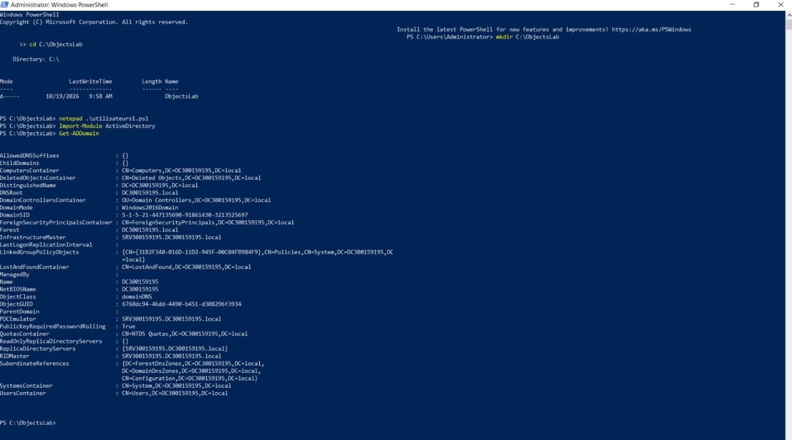

Le domaine utilisé pendant le laboratoire est :

```text
DC300159195.local
```

---

## 2. Création du dossier partagé, du groupe et des utilisateurs

Le script `utilisateurs1.ps1` permet de :

- créer `C:\SharedResources` ;
- créer le groupe global `Students` ;
- créer les comptes `Etudiant1` et `Etudiant2` ;
- ajouter les deux utilisateurs au groupe ;
- publier le dossier avec un partage SMB nommé `SharedResources`.

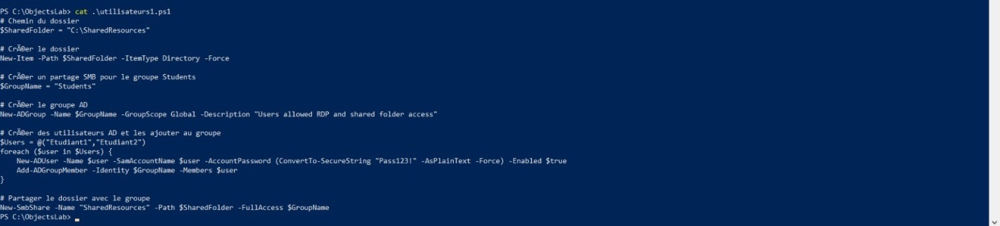

### Vérification

Les comptes Active Directory et les membres du groupe ont ensuite été vérifiés avec `Get-ADUser` et `Get-ADGroupMember`.

Le partage SMB a également été vérifié avec `Get-SmbShare`.

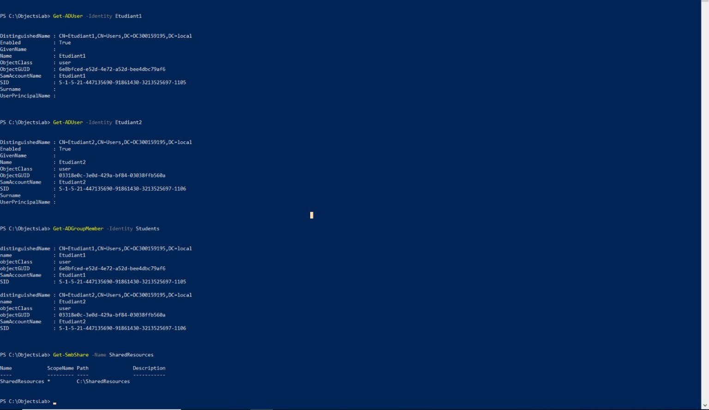

---

## 3. Création de l'OU Students

Une unité d'organisation `Students` a été créée dans le domaine.

Les comptes `Etudiant1` et `Etudiant2` ont ensuite été déplacés dans cette OU avec `Move-ADObject`.

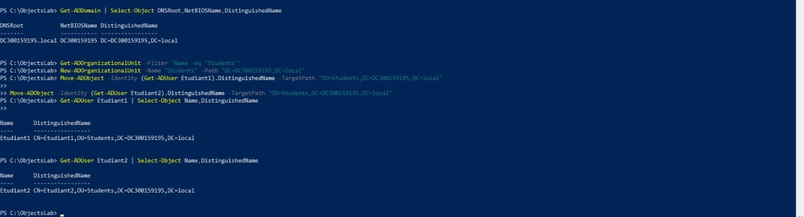

Les Distinguished Names obtenus confirment que les utilisateurs se trouvent maintenant dans :

```text
OU=Students,DC=DC300159195,DC=local
```

---

## 4. Création de la GPO MapSharedFolder

Le script `utilisateurs2.ps1` crée une GPO nommée :

```text
MapSharedFolder
```

Cette GPO est liée à l'OU `Students`.

Elle utilise un script de connexion afin de mapper le partage réseau vers le lecteur `Z:`.

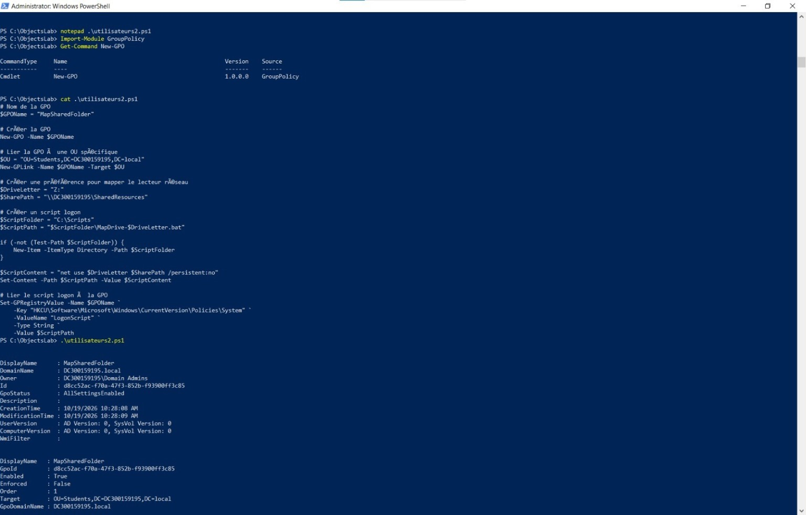

### Vérification du lien de la GPO

`Get-GPO` et `Get-GPInheritance` ont été utilisés afin de confirmer que `MapSharedFolder` existe et qu'elle est bien liée à l'OU `Students`.

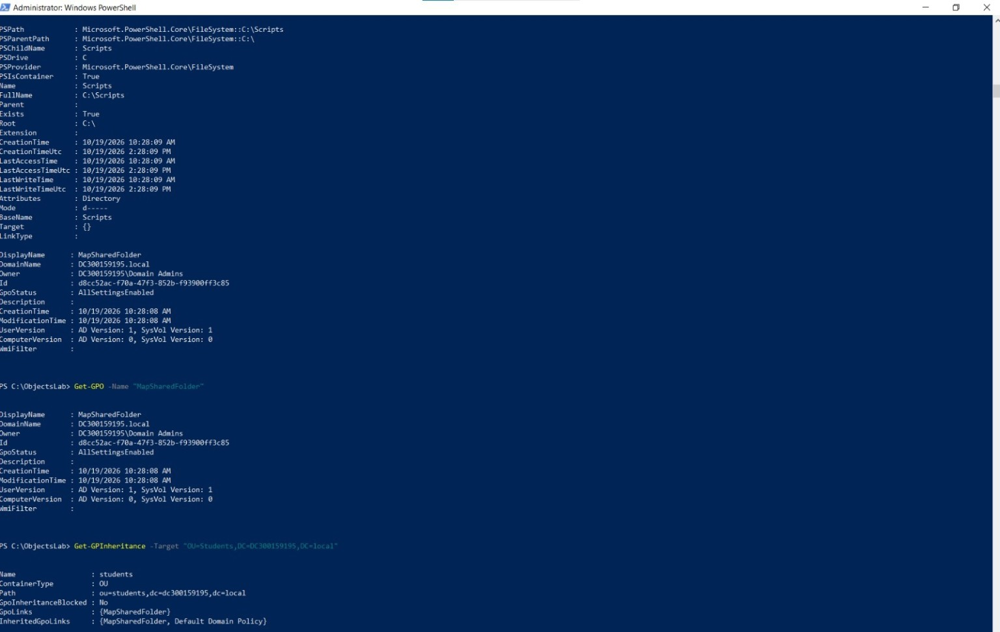

---

## 5. Configuration du script de connexion

Le script de connexion est stocké dans :

```text
C:\Scripts\MapDrive-Z.bat
```

Le contenu final utilisé est :

```bat
net use Z: \\SRV300159195\SharedResources /persistent:no
```

La valeur `LogonScript` a été configurée dans la GPO, puis vérifiée avec `Get-GPRegistryValue`.

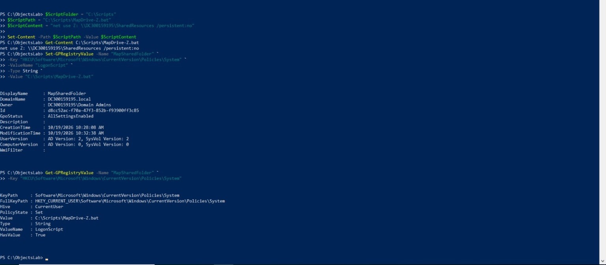

---

## 6. Activation de Remote Desktop

Le script `utilisateurs3.ps1` active Remote Desktop sur le serveur et active les règles correspondantes dans le pare-feu Windows.

La valeur suivante a été vérifiée :

```text
fDenyTSConnections : 0
```

Les règles `Remote Desktop` du pare-feu apparaissent également avec l'état `True`.

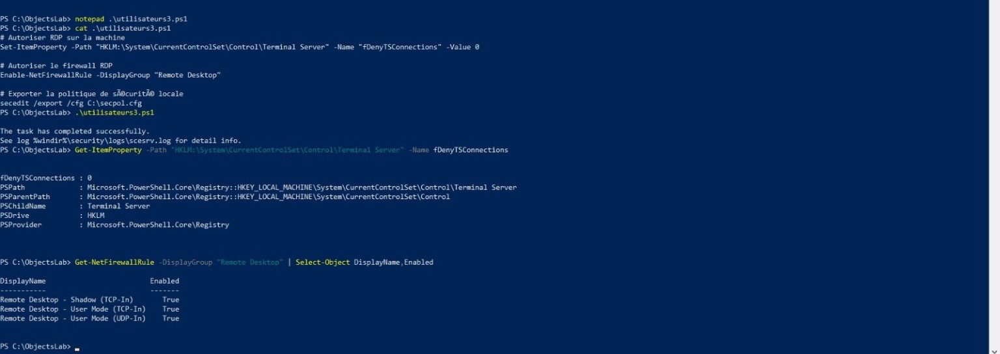

---

## 7. Attribution du droit RDP au groupe Students

Lors de la première vérification de la politique locale, le droit `SeRemoteInteractiveLogonRight` ne contenait que le groupe Administrators.

Le SID du groupe `Students` a donc été récupéré afin de lui accorder explicitement le droit de connexion à distance.

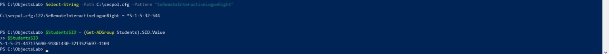

Le script `utilisateurs4.ps1` exporte ensuite la politique locale, ajoute le SID du groupe `Students` à `SeRemoteInteractiveLogonRight`, puis réimporte la configuration.

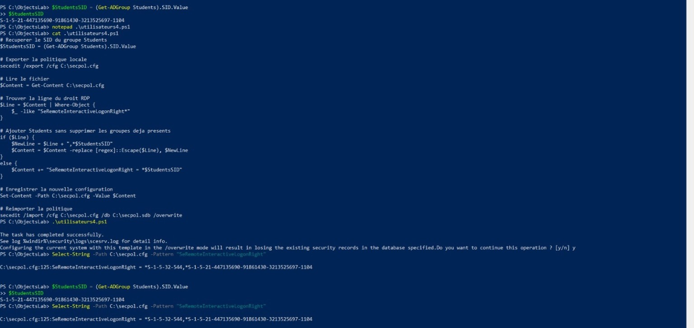

Après l'importation, `gpupdate /force` a été exécuté et la politique a été vérifiée.

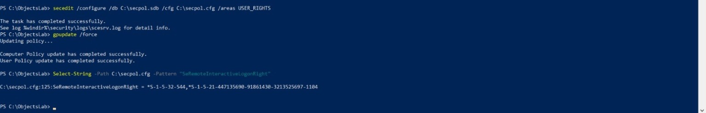

Une nouvelle exportation de la politique effective confirme la présence de `Students` avec le groupe Administrators :

```text
SeRemoteInteractiveLogonRight = Students,*S-1-5-32-544
```

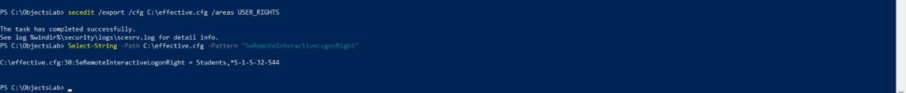

---

## 8. Premier test avec Etudiant1

Une session a été ouverte avec `Etudiant1`.

La commande `whoami` confirme l'identité :

```text
dc300159195\etudiant1
```

`whoami /groups` confirme également l'appartenance au groupe `Students`.

Lors du premier test, aucun lecteur réseau n'était encore présent dans `net use`.

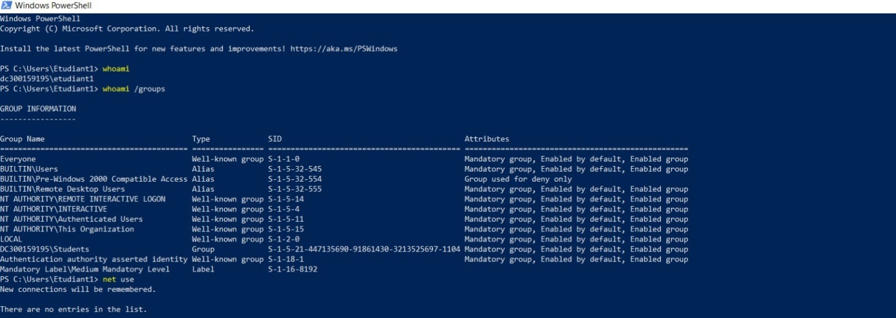

---

## 9. Vérification du partage et correction du chemin réseau

Le nom du serveur a été vérifié avec `hostname`.

Le chemin fonctionnel du partage est :

```text
\\SRV300159195\SharedResources
```

Un test manuel avec `net use` a confirmé que le lecteur `Z:` pouvait être créé correctement.

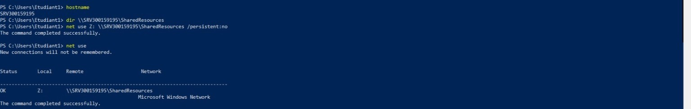

Cette vérification a permis de corriger le chemin du script `MapDrive-Z.bat`.

Après la correction, le script contient :

```text
net use Z: \\SRV300159195\SharedResources /persistent:no
```

Puis les stratégies ont été réappliquées avec :

```powershell
gpupdate /force
```

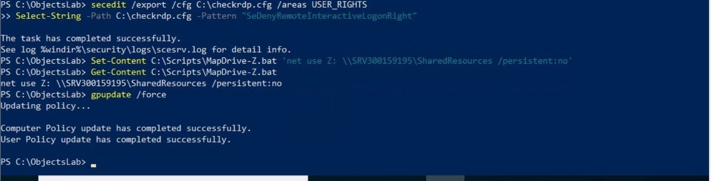

---

## 10. Test final avec Etudiant1

Après une nouvelle ouverture de session avec `Etudiant1`, `net use` affiche automatiquement :

```text
Z:   \\SRV300159195\SharedResources
```

La commande :

```powershell
dir Z:\
```

s'exécute sans erreur.

Cela confirme que l'utilisateur autorisé peut ouvrir une session RDP et accéder au partage réseau.

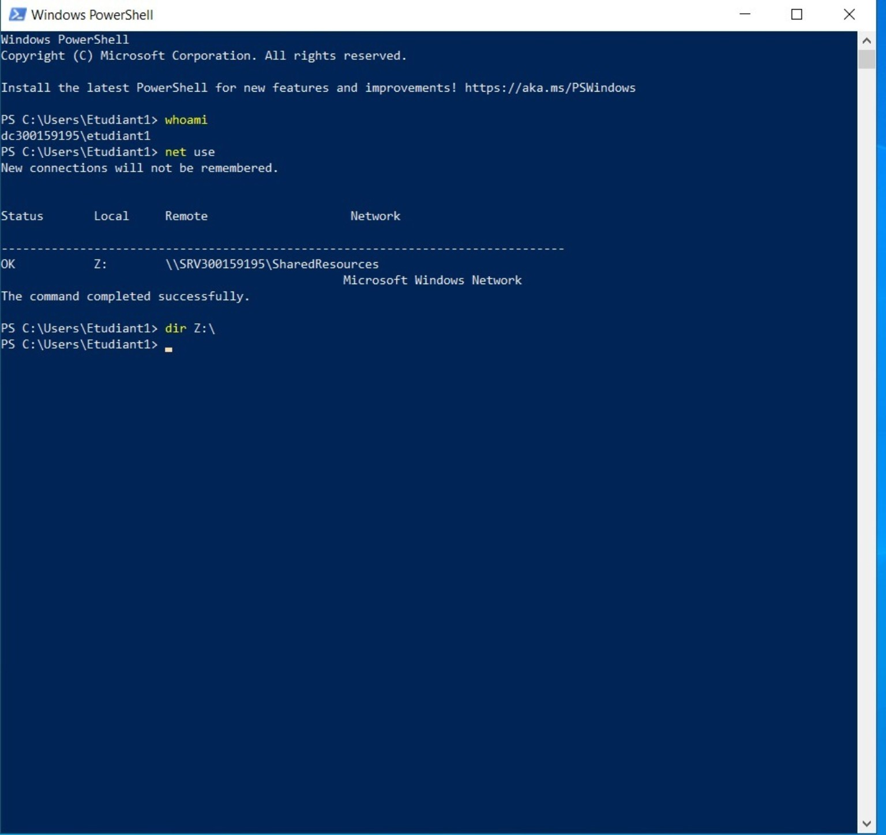

---

## 11. Test d'un utilisateur hors du groupe Students

Pour vérifier la restriction, un compte nommé `TestHorsGroupe` a été créé sans être ajouté au groupe `Students`.

La commande `Get-ADGroupMember Students` confirme que seuls `Etudiant1` et `Etudiant2` sont membres du groupe.

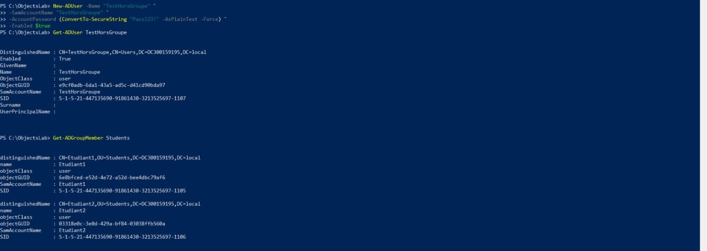

Une tentative de connexion RDP a ensuite été effectuée avec :

```text
DC300159195\TestHorsGroupe
```

Windows refuse correctement la connexion car ce compte n'est pas autorisé à ouvrir une session à distance.

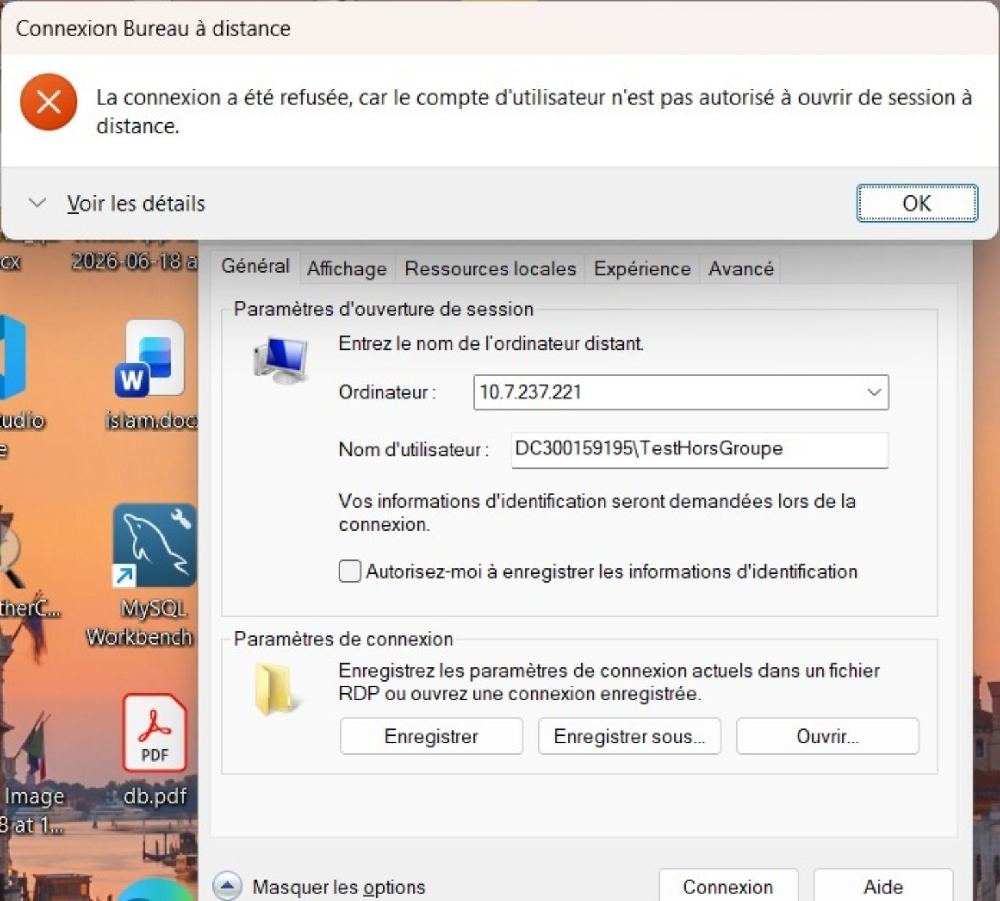

---

## Résultats finaux

| Test | Résultat |
|---|---|
| Création de `Students` | Réussi |
| Création de `Etudiant1` et `Etudiant2` | Réussi |
| Création du partage `SharedResources` | Réussi |
| Création de l'OU `Students` | Réussi |
| Création et liaison de `MapSharedFolder` | Réussi |
| Activation de RDP | Réussi |
| Accès RDP pour `Etudiant1` | Réussi |
| Mapping automatique du lecteur `Z:` | Réussi |
| Accès à `SharedResources` par `Etudiant1` | Réussi |
| RDP pour `TestHorsGroupe` | Refusé comme prévu |

## Conclusion

Ce laboratoire m'a permis de mettre en pratique la gestion des objets Active Directory avec PowerShell, notamment les utilisateurs, groupes et unités d'organisation.

J'ai également configuré un partage SMB, une GPO pour le lecteur réseau, les paramètres RDP et les droits de connexion à distance. Les tests finaux montrent que les utilisateurs autorisés du groupe `Students` peuvent se connecter et utiliser le lecteur réseau `Z:`, tandis qu'un utilisateur extérieur au groupe est correctement refusé.
