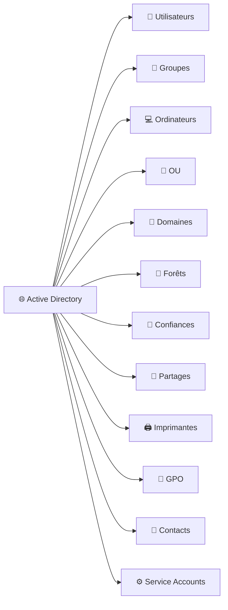
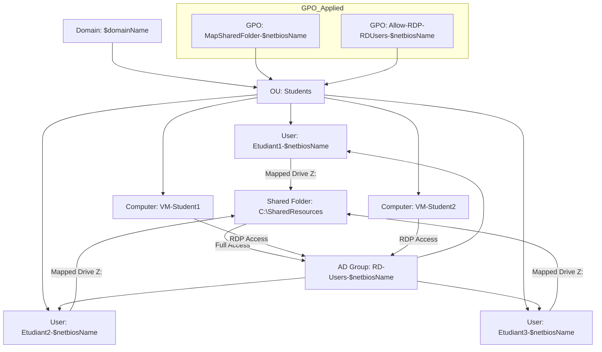

# 🌐 Leçon : Objets gérables par Active Directory

|:hash: | Fonctions                                          |
|-------|:---------------------------------------------------|
| :one: | [:tada: Participation](.scripts/Participation.md)  |
| :two: | [:checkered_flag: Verification](.scripts/Check.md) |

---

## 1️⃣ Les objets principaux d’AD

| Objet                         | Description                                                               | Exemple                            | Emoji |
| ----------------------------- | ------------------------------------------------------------------------- | ---------------------------------- | ----- |
| **Utilisateur**               | Compte représentant une personne qui se connecte au domaine               | `Etudiant1`                        | 👤    |
| **Groupe**                    | Collection d’utilisateurs ou d’ordinateurs pour appliquer des permissions | `Students`                         | 👥    |
| **Ordinateur**                | Machine jointe au domaine et gérée via GPO                                | VM étudiant                        | 💻    |
| **Unité d’Organisation (OU)** | Conteneur logique pour organiser objets et appliquer des GPO              | `Students`                       | 📂    |
| **Domaine**                   | Conteneur regroupant les objets et définissant la sécurité                | `DC999999999-00.local`             | 🏢    |
| **Forêt**                     | Ensemble de domaines partageant le schéma et la configuration globale     | `CollegeBoreal.local`              | 🌲    |
| **Confiance (Trust)**         | Relation entre deux domaines ou forêts pour permettre l’accès partagé     | Forest trust                       | 🤝    |
| **Partage de ressources**     | Dossier ou fichier partagé sur le réseau                                  | `\\DC999999999-00\SharedResources` | 📁    |
| **Imprimante**                | Objet représentant une imprimante réseau                                  | `Printer1`                         | 🖨️   |
| **GPO (Group Policy Object)** | Objet appliquant des politiques aux utilisateurs ou ordinateurs           | `MapSharedFolder`                  | 📜    |
| **Contacts**                  | Personne ou entité externe sans compte AD                                 | `Contact-Prof`                     | 📇    |
| **Service Account**           | Compte spécial pour services ou applications                              | `SQLService`                       | ⚙️    |

---

## :three: Schéma Mermaid simplifié



---

### 🔹 Points clés

* AD gère **tout objet nécessitant sécurité ou accès centralisé**.
* Les **GPO** permettent d’appliquer automatiquement **paramètres, partages, RDP et sécurité** à des utilisateurs et ordinateurs.
* Les emojis aident à **visualiser rapidement** chaque type d’objet.

## **GPO** = **Group Policy Object**

En français : **Objet de stratégie de groupe**.

C’est un **ensemble de règles et configurations** que l’on peut appliquer à des ordinateurs ou des utilisateurs dans un **domaine Active Directory**.

En gros, c’est le **moyen de gérer centralement la configuration de toutes les machines et comptes d’un domaine**.

---

### 1️⃣ À quoi sert un GPO ?

* **Configurer le système** : par exemple, définir le fond d’écran, la page d’accueil du navigateur, ou désactiver certains boutons du panneau de configuration.
* **Sécuriser le domaine** : forcer des mots de passe forts, interdire l’accès à certains comptes, configurer l’antivirus, etc.
* **Automatiser des actions** :

  * Créer des lecteurs réseau automatiquement pour les utilisateurs
  * Déployer des scripts de connexion/déconnexion
  * Installer des logiciels sur toutes les machines
* **Contrôler l’accès aux ressources** : partager des fichiers ou autoriser l’accès à distance (RDP) pour certains groupes.

---

### 2️⃣ Comment ça fonctionne ?

1. On crée un **GPO** dans **Active Directory**.
2. On **associe ce GPO à une OU (Organizational Unit)**, un domaine ou un site.
3. Tous les **utilisateurs ou ordinateurs de l’OU** appliquent automatiquement les règles du GPO.

> Exemple : tu crées un GPO qui mappe automatiquement un lecteur réseau `Z:` pour tous les étudiants dans l’OU `Students`.
> Chaque étudiant verra le lecteur `Z:` sans rien faire.

---

### 3️⃣ Types de paramètres dans un GPO

* **User Configuration** → paramètres appliqués aux **utilisateurs**
* **Computer Configuration** → paramètres appliqués aux **ordinateurs**

Chacun peut contenir :

* **Policies (stratégies)** : paramètres bloquants ou obligatoires
* **Preferences (préférences)** : paramètres « souples » que l’utilisateur peut modifier

---

### 4️⃣ Exemple concret

* Objectif : tous les étudiants ont un **lecteur réseau Z:** mappé automatiquement vers un dossier partagé.
* On crée un GPO :

  * **User Configuration → Preferences → Drive Maps → Z:**
  * On le lie à l’OU `Students`
* Résultat : tous les comptes dans l’OU `Students` ont le lecteur `Z:` sans intervention manuelle.

---



---

1. Créer un **dossier partagé**
2. Créer des **groupes et utilisateurs AD**
3. Map le **lecteur réseau via GPO (preferences)**
4. Activer **RDP pour un groupe d’utilisateurs**
5. Appliquer les **GPO sur une OU spécifique**

---

### :books: Quelques commandes liées au GPO

#### ✅ 1️⃣ Lister **toutes** les GPO du domaine

```powershell
Get-GPO -All
```

👉 Cela affiche une liste complète avec les `DisplayName`, `ID`, `Owner`, etc.

---

#### ✅ 2️⃣ Afficher une **GPO spécifique** par son nom

```powershell
$GPOName = "MapSharedFolder"
Get-GPO -Name $GPOName
```

---

#### ✅ 3️⃣ Ou si tu connais déjà le GUID (pas nécessaire la plupart du temps)

```powershell
Get-GPO -Guid "200a4ea8-cfe5-460f-ac45-d2ea43792127"
```

---

💡 Le plus utile est :

```powershell
Get-GPO -All | Format-Table DisplayName, Owner, GpoStatus, CreationTime
```

## :abacus: Laboratoire: Partage de ressources et RDP via PowerShell

- [ ] Créer un répertoire avec ton  :id: (votre identifiant boreal)
  - [ ] `mkdir ` :id:
  - [ ] `cd ` :id:
- [ ] dans le répertoire ajouter le fichier `README.md`
  - [ ] `touch README.md`
  - [ ] Créer un répertoire images
    - [ ] `mkdir images`
    - [ ] `touch images/.gitkeep`
- [ ] envoyer vers le serveur `git`
  - [ ] remonter au repertoire précédent
    - [ ] `cd ..`
  - [ ] `git add `:id:
  - [ ] `git commit -m "mon fichier ..."`
  - [ ] `git push`


### 1️⃣ Pré-requis

* DC Windows Server 2022 avec AD DS installé
* Module Active Directory disponible (`Import-Module ActiveDirectory`)
* Module GroupPolicy disponible (`Import-Module GroupPolicy`)
* VM membre pour tester le partage et RDP

- [ ] Créer un fichier `bootstrap.ps1` oû vous mettrez les informations concernant vos informations. (utiliser dot-sourcing )

```powershell
# vos informations
$studentNumber = 300098957
$studentInstance = 40

# les noms respectifs
$domainName = "DC$studentNumber-$studentInstance.local"
$netbiosName = "DC$studentNumber-$studentInstance"

# les informations de sécurité
$plain = 'Infra@2024'
$secure = ConvertTo-SecureString $plain -AsPlainText -Force
$cred = New-Object System.Management.Automation.PSCredential("Administrator@$domainName", $secure)
```

---

:key: Pour les operations néscessitant les informations sécurisées de l'administrateur

```powershell
$cred = Get-Credential  # entrer Administrator@$domainName et le mot de passe
```

---

### 2️⃣ Créer le dossier partagé

* `utilisateurs1.ps1`

```powershell
# Chemin du dossier
$SharedFolder = "C:\SharedResources"

# Créer le dossier
New-Item -Path $SharedFolder -ItemType Directory -Force

# Créer un partage SMB pour le groupe Students
$GroupName = "Students"

# Créer le groupe AD
New-ADGroup -Name $GroupName -GroupScope Global -Description "Users allowed RDP and shared folder access"

# Créer des utilisateurs AD et les ajouter au groupe
$Users = @("Etudiant1","Etudiant2")
foreach ($user in $Users) {
    New-ADUser -Name $user -SamAccountName $user -AccountPassword (ConvertTo-SecureString "Pass123!" -AsPlainText -Force) -Enabled $true
    Add-ADGroupMember -Identity $GroupName -Members $user
}

# Partager le dossier avec le groupe
New-SmbShare -Name "SharedResources" -Path $SharedFolder -FullAccess $GroupName
```

---

### 3️⃣ Créer une GPO pour mapper le lecteur réseau

* `utilisateurs2.ps1`

```powershell
# Nom de la GPO
$GPOName = "MapSharedFolder"

# Créer la GPO
New-GPO -Name $GPOName

# Lier la GPO à une OU spécifique (ex: "Students")
$OU = "OU=Students,DC=$netbiosName,DC=local"
New-GPLink -Name $GPOName -Target $OU

# Créer une preference pour mapper le lecteur réseau
$DriveLetter = "Z:"
$SharePath = "\\$netbiosName\SharedResources"

# Créer un script logon
$ScriptFolder = "C:\Scripts"
$ScriptPath = "$ScriptFolder\MapDrive-$DriveLetter.bat"
if (-not (Test-Path $ScriptFolder)) { New-Item -ItemType Directory -Path $ScriptFolder }

$scriptContent = "net use $DriveLetter $SharePath /persistent:no"
Set-Content -Path $ScriptPath -Value $scriptContent

# Lier le script logon à la GPO
Set-GPRegistryValue -Name $GPOName `
                    -Key "HKCU\Software\Microsoft\Windows\CurrentVersion\Policies\System" `
                    -ValueName "LogonScript" `
                    -Type String `
                    -Value $ScriptPath
```

---

### 4️⃣ Activer RDP pour le groupe

```powershell
# Autoriser RDP sur la machine
Set-ItemProperty -Path "HKLM:\System\CurrentControlSet\Control\Terminal Server" -Name "fDenyTSConnections" -Value 0

# Autoriser le firewall RDP
Enable-NetFirewallRule -DisplayGroup "Remote Desktop"

# Donner le droit logon via RDP au groupe Students
secedit /export /cfg C:\secpol.cfg
# Modifier le fichier pour inclure Students dans "SeRemoteInteractiveLogonRight"
# Puis réimporter
secedit /import /cfg C:\secpol.cfg /db C:\secpol.sdb /overwrite
```

> Astuce : on peut aussi utiliser `ntrights.exe` du Resource Kit pour assigner RDP à un groupe via PowerShell.

---

### 5️⃣ Test

1. Connecte-toi avec un des utilisateurs du groupe `Students`
2. Vérifie que :

   * Le lecteur réseau `Z:` est mappé automatiquement
   * L’utilisateur peut se connecter en **RDP**
3. Essaye un utilisateur hors du groupe → il ne doit **pas** avoir accès.

---

💡 **Avantages pédagogiques** :

* Les étudiants manipulent **AD, GPO, RDP, SMB** uniquement via **PowerShell**
* Aucun besoin d’interface graphique
* Tout peut être reproduit sur Hyper-V pour plusieurs VMs

