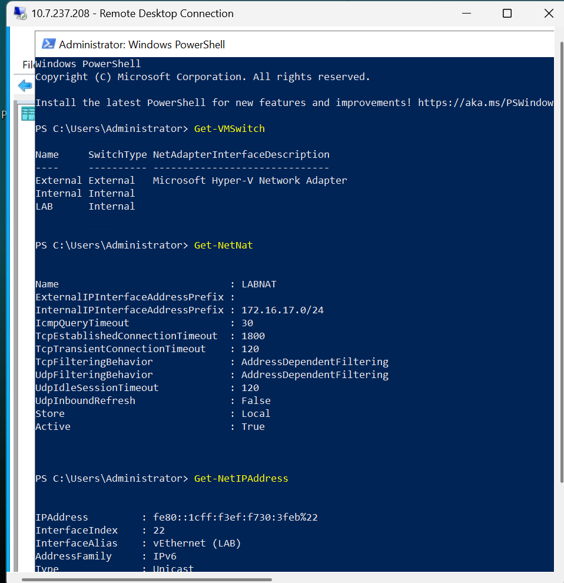
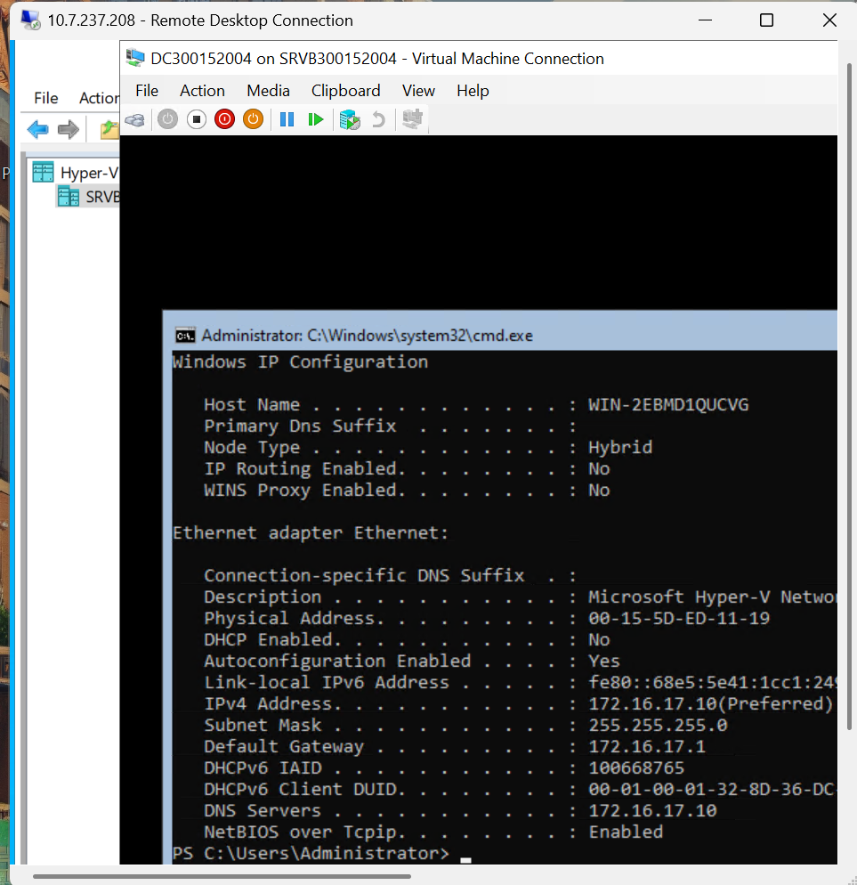
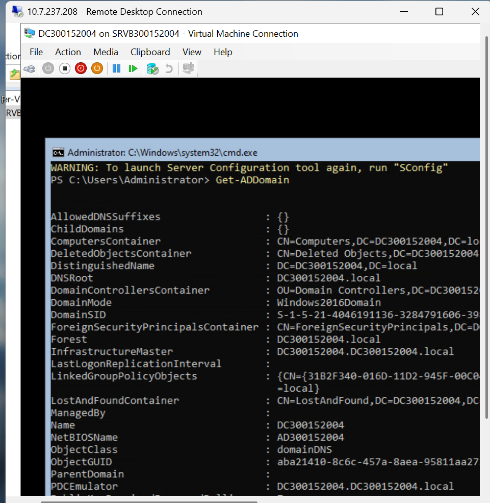
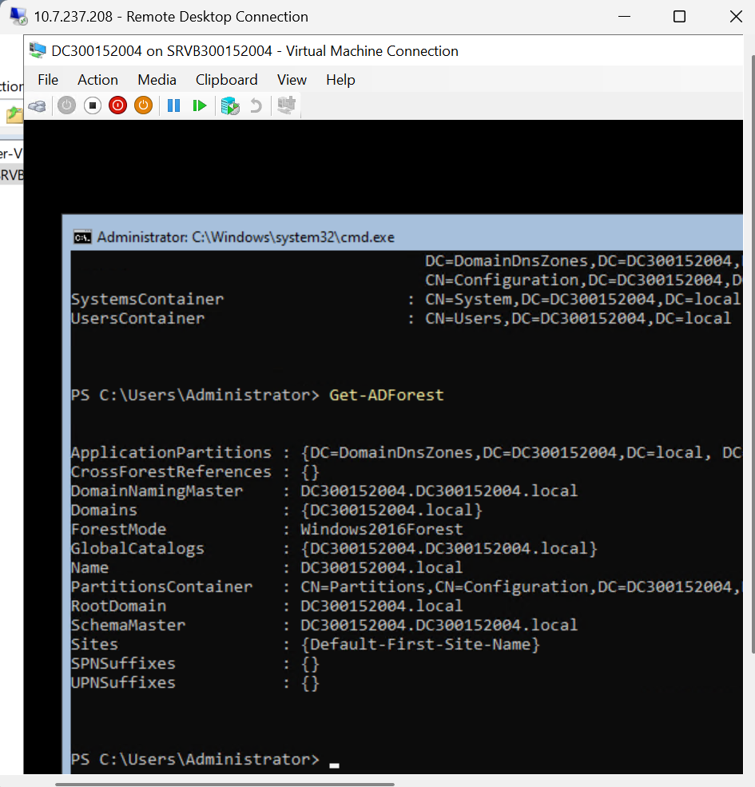
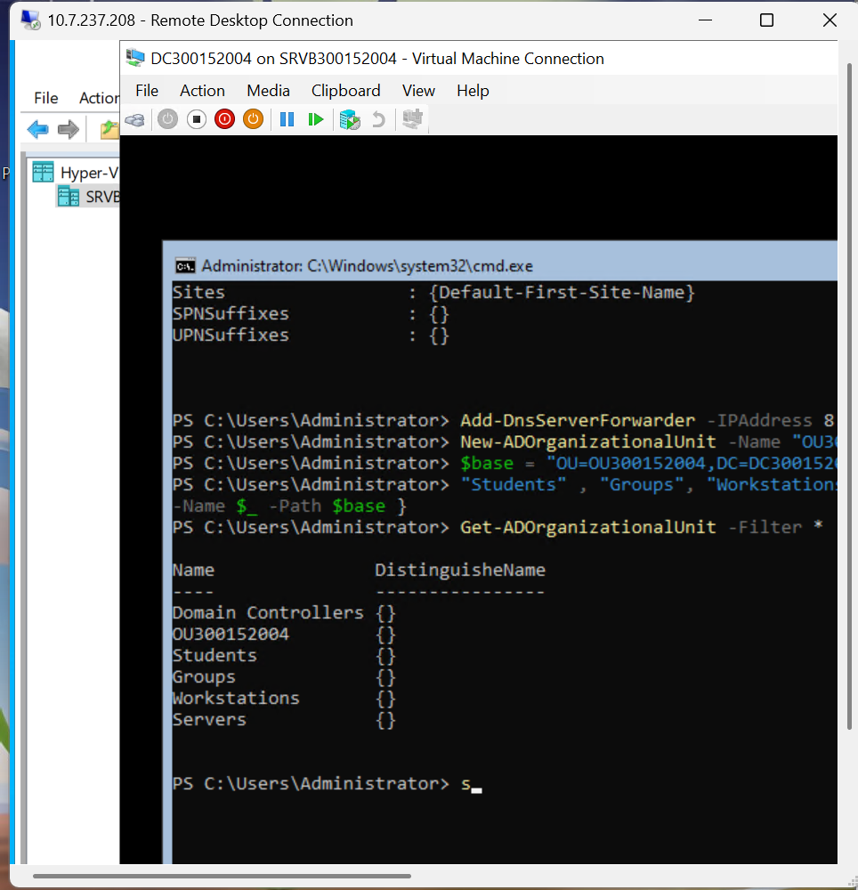
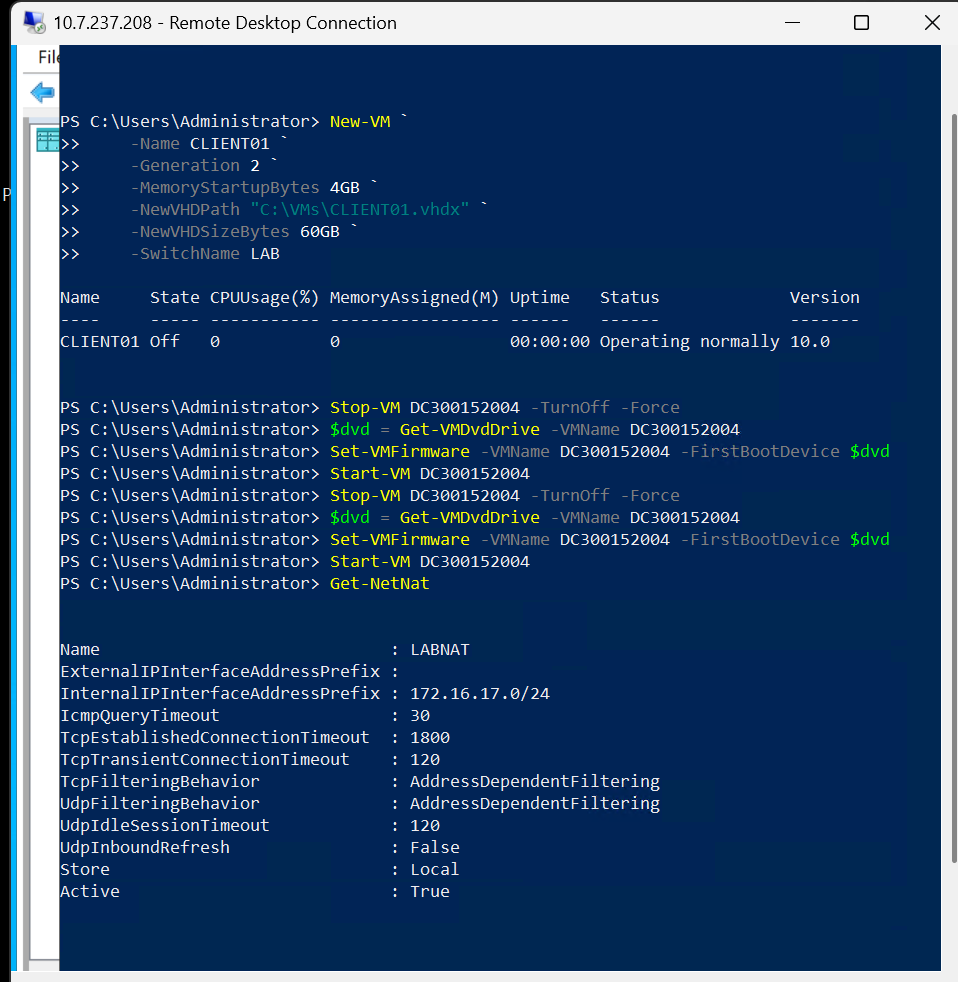
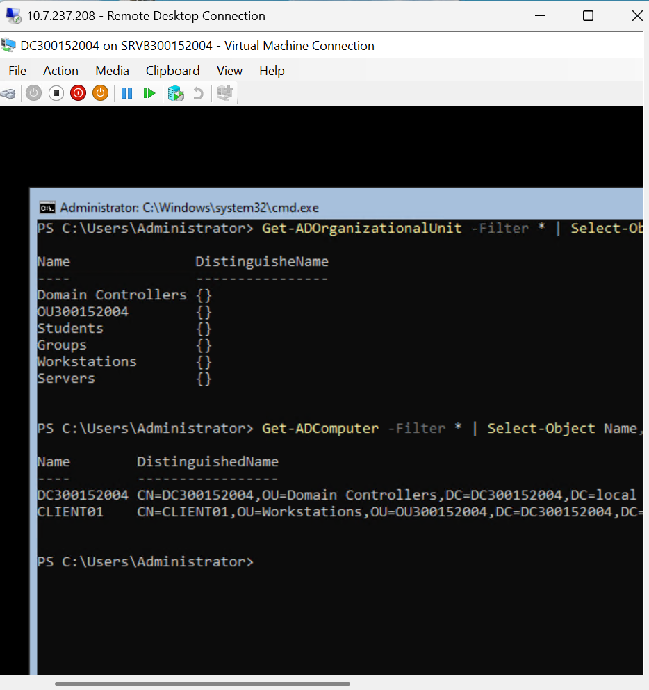

# Architecture simplifiée 
# 300152004

**Serveur parent :** `SRVB300152004` — **Domaine :** `DC300152004.local` — **Réseau privé :** `172.16.17.0/24`

Étape 1 Réseau privé et passerelle NAT

Je crée d'abord le commutateur interne `LAB`, puis j'attribue l'adresse `172.16.17.1` à l'interface `vEthernet (LAB)` et je crée le NAT `LABNAT` pour le réseau `172.16.17.0/24`. Avec `Get-VMSwitch`, je vois que le commutateur `LAB` est bien de type Internal, et `Get-NetNat` confirme que `LABNAT` est actif sur le préfixe `172.16.17.0/24`.

Étape 2 Configuration réseau du contrôleur de domaine

Je crée la VM du contrôleur de domaine sur le commutateur `LAB`, puis je configure son réseau. Avec `ipconfig /all`, je vérifie que l'adresse IPv4 est `172.16.17.10`, le masque `255.255.255.0`, la passerelle `172.16.17.1` et que le serveur DNS est lui-même, à l'adresse `172.16.17.10`.

Étape 3 Installation d'Active Directory et création de la forêt

J'installe le rôle AD DS avec `Install-WindowsFeature AD-Domain-Services -IncludeManagementTools`, puis je crée la forêt avec `Install-ADDSForest`. Mes premiers essais ont échoué, d'abord à cause d'un tiret oublié devant `-DomainNetbiosName`, ensuite parce que la vérification m'a indiqué que le nom `DC300152004` était déjà utilisé. J'ai donc choisi un autre nom NetBIOS, `AD300152004`. `Get-ADDomain` confirme que le domaine `DC300152004.local` existe avec ce nom NetBIOS.

Avec `Get-ADForest`, je vérifie que la forêt s'appelle `DC300152004.local`, qu'elle contient un seul domaine et que le contrôleur de domaine `DC300152004` est le catalogue global et détient les rôles de maître de schéma et de maître de nommage.

Étape 5 Structure Active Director

Je configure d'abord un redirecteur DNS avec `Add-DnsServerForwarder` pour que le contrôleur de domaine puisse résoudre les noms externes. Je crée ensuite l'OU principale `OU300152004`, puis une boucle `foreach` crée les sous-OU `Students`, `Groups`, `Workstations` et `Servers` dans cette OU. `Get-ADOrganizationalUnit -Filter *` me montre toute la structure, avec en plus l'OU `Domain Controllers` créée par défaut.

Étape 6 Création du client

Je crée la VM `CLIENT01` avec `New-VM` : génération 2, 4 Go de mémoire, un disque de 60 Go (`C:\VMs\CLIENT01.vhdx`) et le commutateur `LAB`. Elle apparaît à l'état `Off`, prête à être démarrée. Sur la même capture, je force aussi le DVD comme premier périphérique de démarrage du contrôleur de domaine avec `Set-VMFirmware`, puis je relance cette VM et je revérifie le NAT avec `Get-NetNat`.

Étape 7 Accès en écriture au partage

Avec `Get-ADComputer`, je vois deux ordinateurs dans l'annuaire : `DC300152004`, dans l'OU `Domain Controllers`, et `CLIENT01`, dans l'OU `Workstations` de `OU300152004`. Cela confirme que le client est bien enregistré dans mon domaine.

