# LABORATOIRE 6.Nested | COMPTE RENDU TECHNIQUE

```

Étudiant : Oualid Salhi

Matricule : 300156534

Date : 17 novembre 2026

Dernière mise à jour : 24 novembre 2026

Serveur parent : SRV300156534 — 10.7.237.212

Réseau privé : 172.16.26.0/24

Passerelle : 172.16.26.1

Contrôleur de domaine : DC300156534 — 172.16.26.10

Domaine : DC300156534.local

Nom NetBIOS : AD300156534

Client : CLIENT01 — 172.16.26.20

Compte administrateur : Administrator

Mot de passe administrateur : Infra@2024
Compte étudiant : AD300156534\etudiant01

Nouveau mot de passe étudiant : walid@2027

CONFIDENTIEL — Les mots de passe sont inscrits à la demande de l’étudiant. Ne pas publier ce document sur GitHub. Modifier ces mots de passe avant toute diffusion.

```

## 1. Objectif et architecture

Créer une infrastructure indépendante comprenant un commutateur Hyper-V interne, une passerelle NAT, un contrôleur de domaine AD DS et DNS, cinq sous-unités organisationnelles et un client membre du domaine.

```

SRV300156534 (10.7.237.212)

  LAB / LABNAT — 172.16.26.0/24

  ├─ SRV01 : DC300156534 — 172.16.26.10

  └─ CLIENT01 — 172.16.26.20

```

##

## 2. Création du réseau privé Hyper-V

Création du commutateur interne LAB et vérification des commutateurs disponibles. Commandes PowerShell utilisées:

```

Get-VMSwitch

New-VMSwitch -Name LAB -SwitchType Internal

Get-VMSwitch

```

**Capture 01 — Commutateur virtuel et état initial**

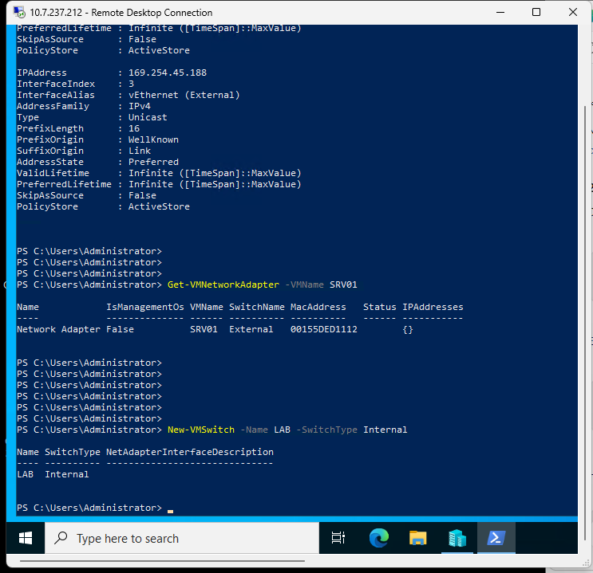

**Capture 02 — Commutateur virtuel et état initial**

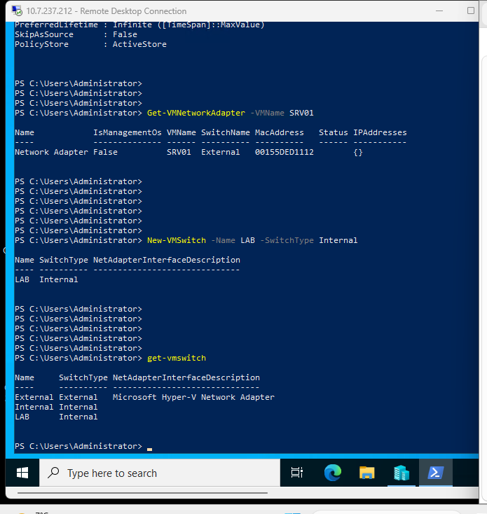

**Capture 03 — Commutateur virtuel et état initial**

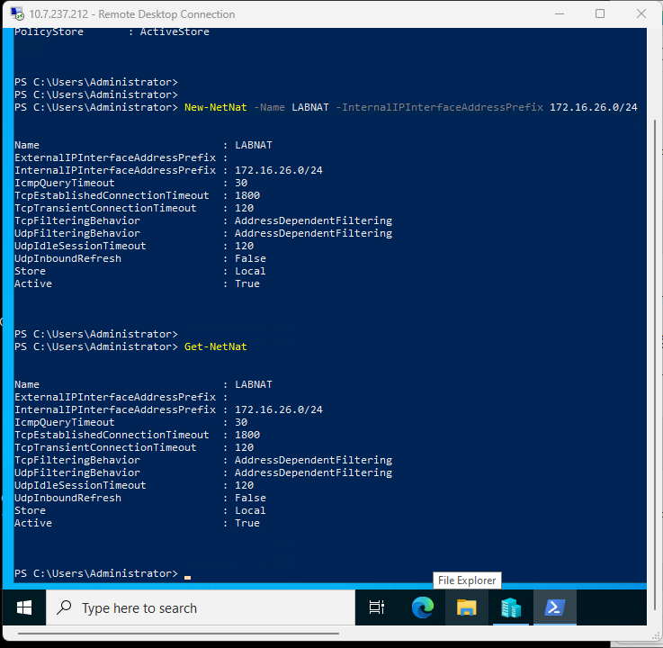

## 3. Configuration de la passerelle NAT Attribution de l’adresse 172.16.26.1/24 au commutateur interne et mise en place du NAT LABNAT. 

Commandes PowerShell utilisées :

```powershell
New-NetIPAddress -IPAddress 172.16.26.1 -PrefixLength 24 -InterfaceAlias "vEthernet (LAB)"
New-NetNat -Name LABNAT -InternalIPInterfaceAddressPrefix 172.16.26.0/24
Get-NetNat
Get-NetIPAddress -InterfaceAlias "vEthernet (LAB)" -AddressFamily IPv4
```

**Capture 04 — Passerelle, interface LAB et NAT**

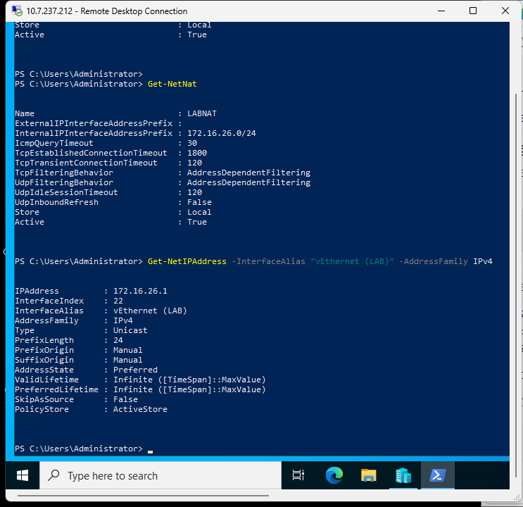

**Capture 05 — Passerelle, interface LAB et NAT**

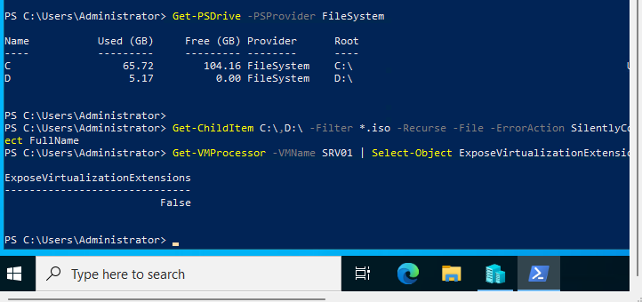

**Capture 06 — Passerelle, interface LAB et NAT**

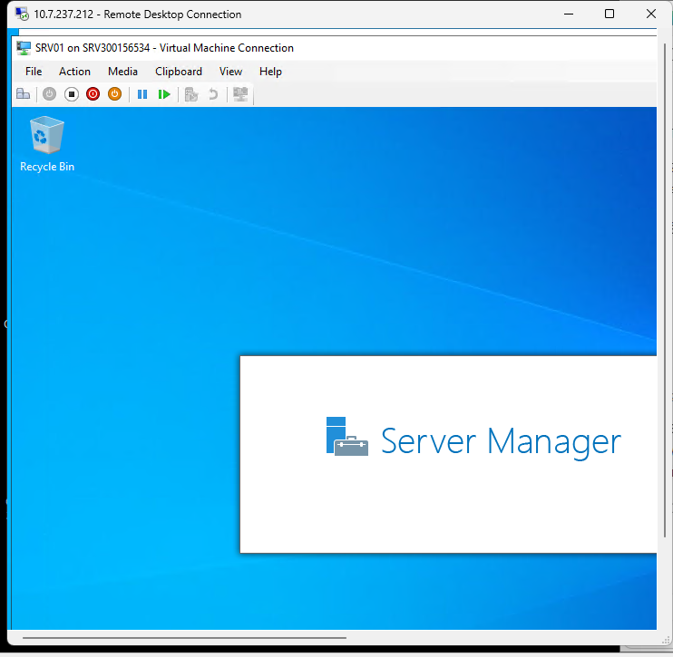

## 4. Préparation du contrôleur de domaine Utilisation de la VM SRV01 existante, raccordée au commutateur LAB, puis configuration du nom et de l’adresse IP du contrôleur. 

Commandes PowerShell utilisées :

```powershell
Get-VM
Connect-VMNetworkAdapter -VMName SRV01 -SwitchName LAB
Get-VMNetworkAdapter -VMName SRV01
Enter-PSSession -VMName SRV01 -Credential (Get-Credential)
Get-NetAdapter
New-NetIPAddress -InterfaceAlias "Ethernet" -IPAddress 172.16.26.10 -PrefixLength 24 -DefaultGateway 172.16.26.1
Set-DnsClientServerAddress -InterfaceAlias "Ethernet" -ServerAddresses 172.16.26.10
Rename-Computer -NewName "DC300156534"
Exit-PSSession
Restart-VM -Name SRV01
```

**Capture 07 — Machine virtuelle et préparation du contrôleur**

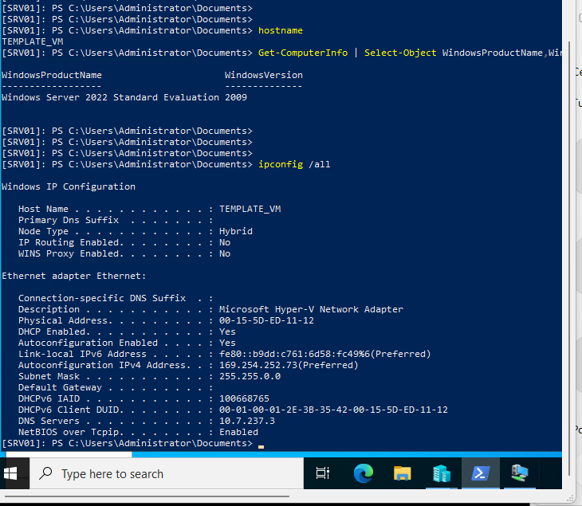

**Capture 08 — Machine virtuelle et préparation du contrôleur**

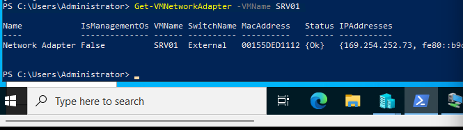

**Capture 09 — Machine virtuelle et préparation du contrôleur**

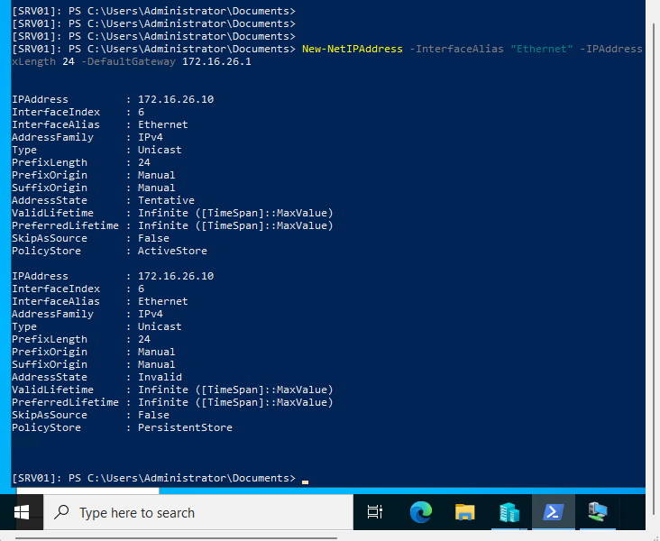

**Capture 10 — Machine virtuelle et préparation du contrôleur**

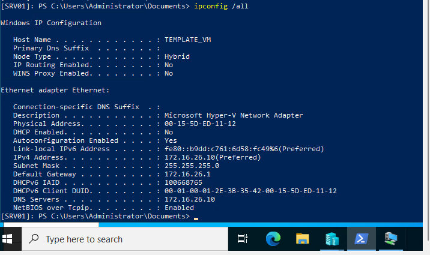

## 5. Installation des services Active Directory Installation du rôle AD DS sur la VM renommée DC300156534. 

Commandes PowerShell utilisées :

```powershell
Install-WindowsFeature AD-Domain-Services -IncludeManagementTools
Get-WindowsFeature AD-Domain-Services
```

**Capture 11 — Installation du rôle AD DS**

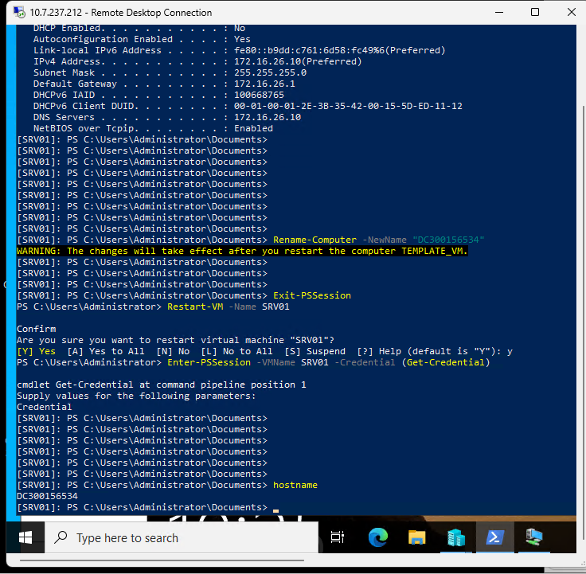

**Capture 12 — Installation du rôle AD DS**

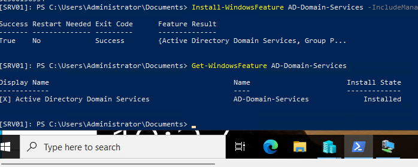

## 6. Création de la forêt et du DNS Création de la forêt personnelle. La première tentative a demandé explicitement un nom NetBIOS ; la commande a été corrigée. 

Commandes PowerShell utilisées :

```powershell
Install-ADDSForest -DomainName "DC300156534.local" -DomainNetbiosName "AD300156534" -InstallDNS
Get-ADDomain
Get-Service NTDS,DNS
```

**Capture 13 — Forêt Active Directory et DNS**

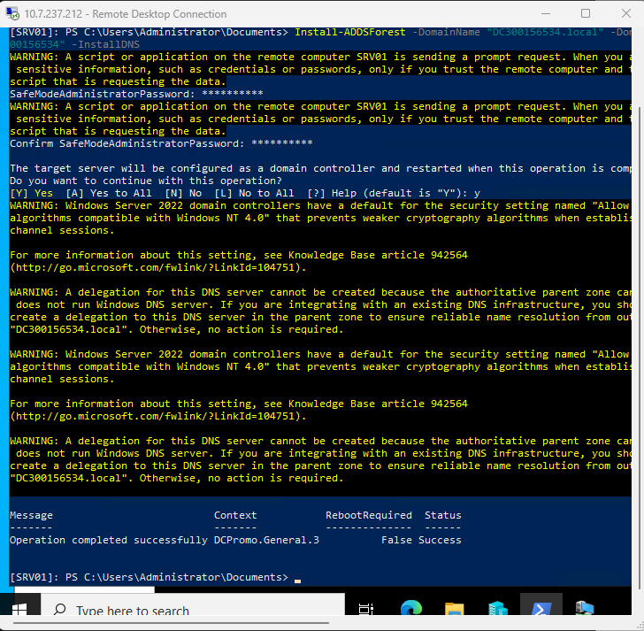

**Capture 14 — Forêt Active Directory et DNS**

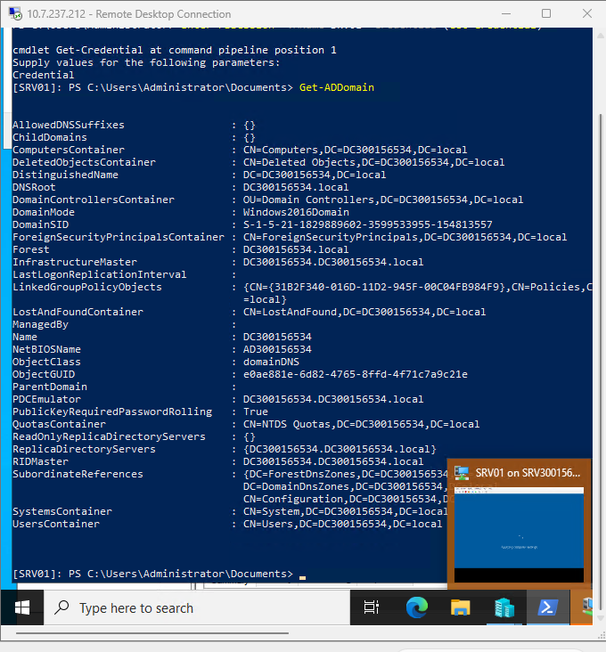

**Capture 15 — Forêt Active Directory et DNS**

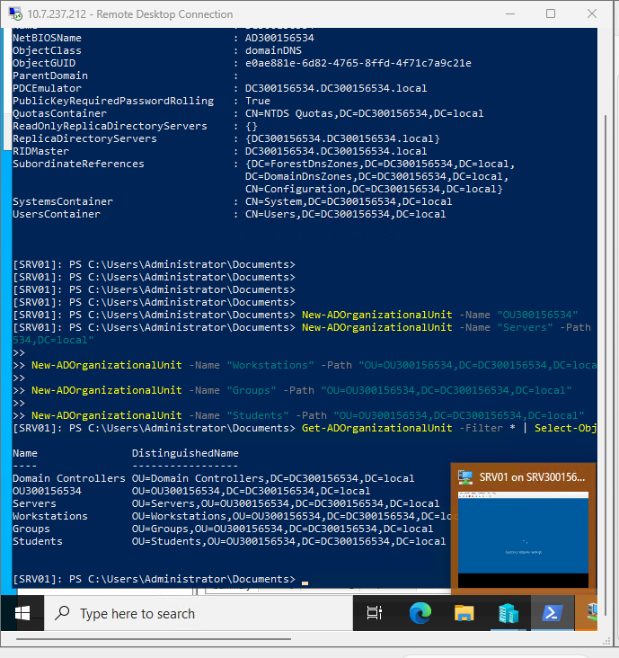

## 7. Organisation Active Directory Création de l’OU principale et des quatre sous-OU prévues par les consignes. 

Commandes PowerShell utilisées :

```powershell
New-ADOrganizationalUnit -Name "OU300156534"
New-ADOrganizationalUnit -Name "Students" -Path "OU=OU300156534,DC=DC300156534,DC=local"
New-ADOrganizationalUnit -Name "Groups" -Path "OU=OU300156534,DC=DC300156534,DC=local"
New-ADOrganizationalUnit -Name "Workstations" -Path "OU=OU300156534,DC=DC300156534,DC=local"
New-ADOrganizationalUnit -Name "Servers" -Path "OU=OU300156534,DC=DC300156534,DC=local"
Get-ADOrganizationalUnit -Filter \\* | Select-Object Name,DistinguishedName
```

**Capture 16 — Unités organisationnelles**

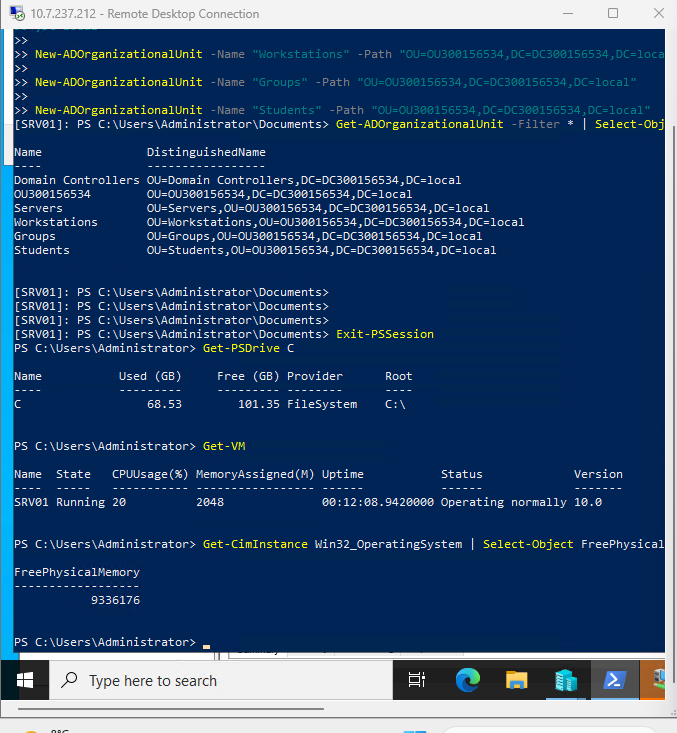

**Capture 17 — Unités organisationnelles**

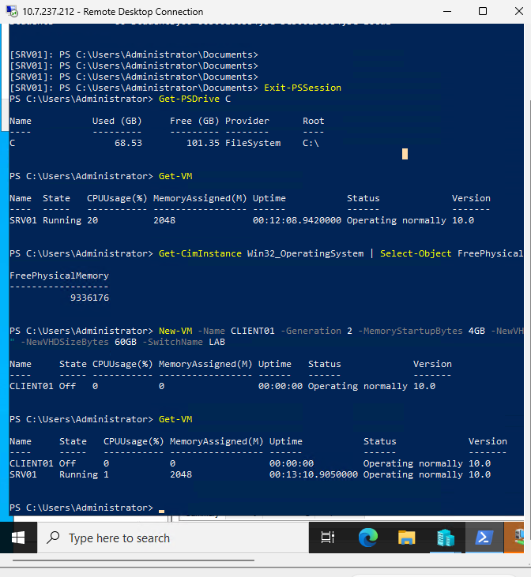

## 8. Création et installation de CLIENT01 Création de CLIENT01 sur LAB, transfert de l’ISO Windows Server 2022, montage du DVD virtuel et installation en mode Desktop Experience. 

Commandes PowerShell utilisées :

```powershell
New-VM -Name CLIENT01 -Generation 2 -MemoryStartupBytes 4GB -NewVHDPath "C:\VMs\CLIENT01.vhdx" -NewVHDSizeBytes 60GB -SwitchName LAB
Get-VMHardDiskDrive -VMName CLIENT01
Add-VMDvdDrive -VMName CLIENT01 -Path "C:\iso\en-us_windows_server_2022_updated_july_2023_x64_dvd_541692c3.iso"
$dvd = Get-VMDvdDrive -VMName CLIENT01
Set-VMFirmware -VMName CLIENT01 -FirstBootDevice $dvd
Set-VMFirmware -VMName CLIENT01 -EnableSecureBoot Off
Start-VM -Name CLIENT01
```

**Capture 18 — Création de CLIENT01 et support Windows**

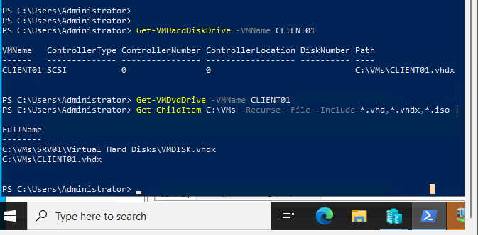

**Capture 19 — Création de CLIENT01 et support Windows**

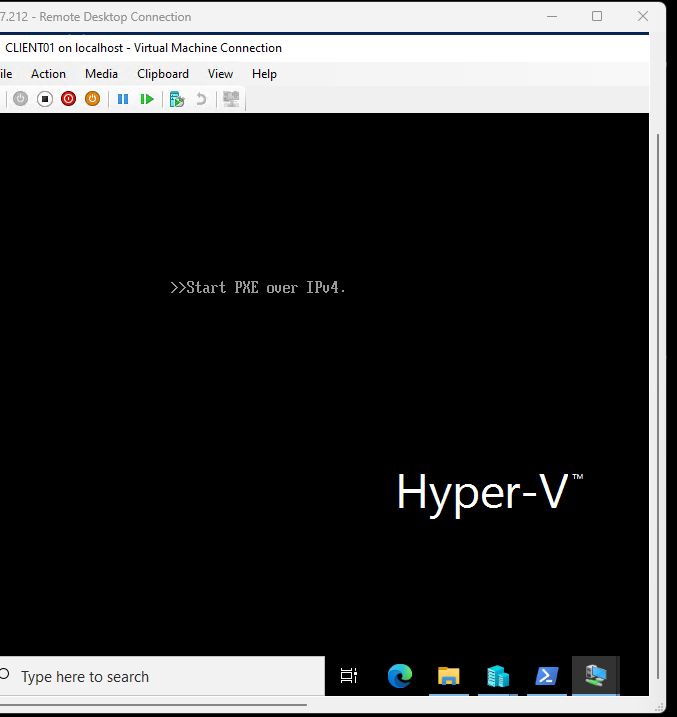

**Capture 20 — Création de CLIENT01 et support Windows**

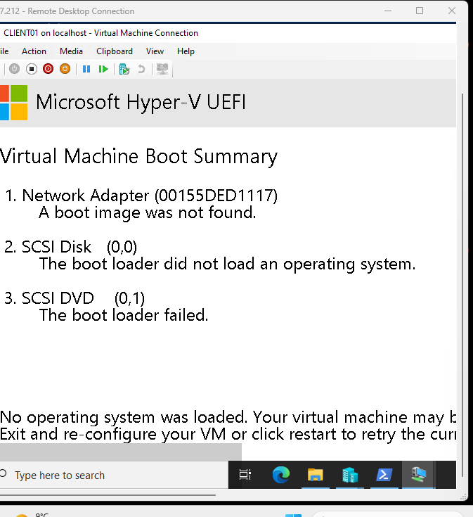

## 9. Configuration réseau et jonction au domaine Configuration du client et vérification de la communication avec le DC avant la jonction au domaine. 

Commandes PowerShell utilisées :

```powershell
Enter-PSSession -VMName CLIENT01 -Credential (Get-Credential)
Get-NetAdapter
New-NetIPAddress -InterfaceAlias "Ethernet" -IPAddress 172.16.26.20 -PrefixLength 24 -DefaultGateway 172.16.26.1
Set-DnsClientServerAddress -InterfaceAlias "Ethernet" -ServerAddresses 172.16.26.10
ipconfig /all
ping 172.16.26.10
Resolve-DnsName DC300156534.local
Rename-Computer -NewName "CLIENT01"
Add-Computer -DomainName "DC300156534.local" -Credential "AD300156534\Administrator" -Restart
Get-CimInstance Win32_ComputerSystem | Select-Object Name,Domain,PartOfDomain
```

**Capture 21 — Installation, réseau et jonction de CLIENT01**

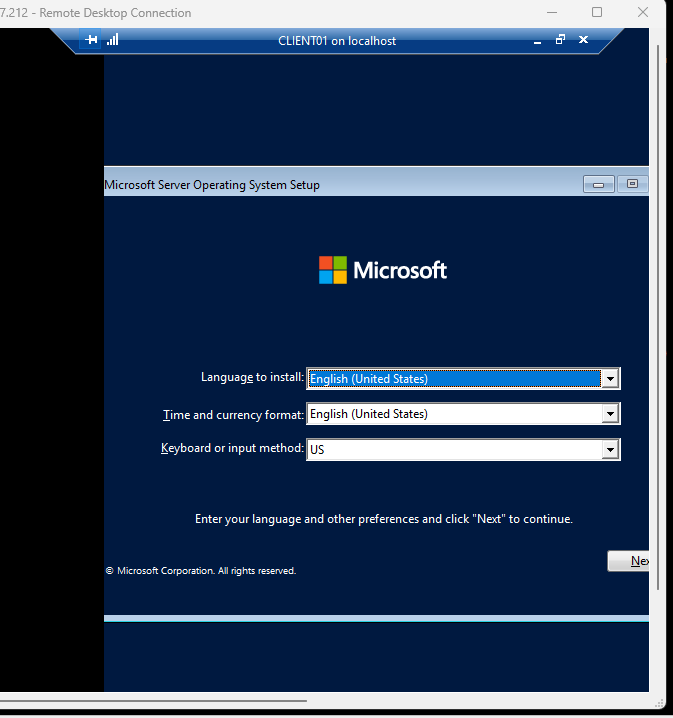

**Capture 22 — Installation, réseau et jonction de CLIENT01**

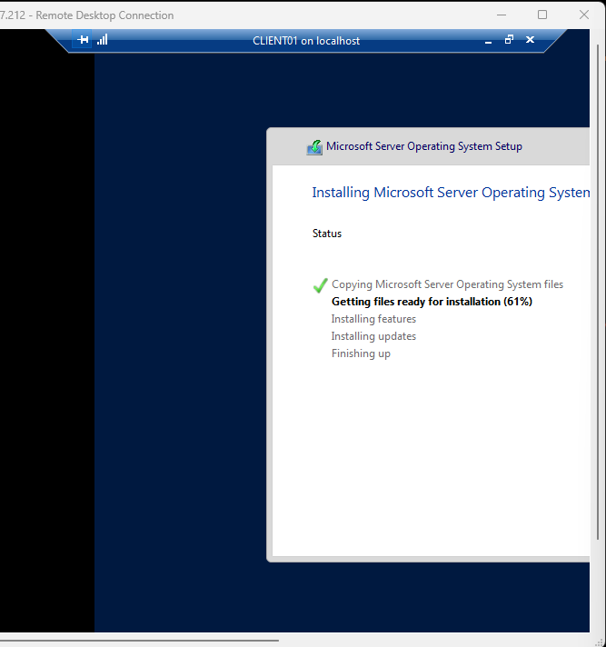

**Capture 23 — Installation, réseau et jonction de CLIENT01**

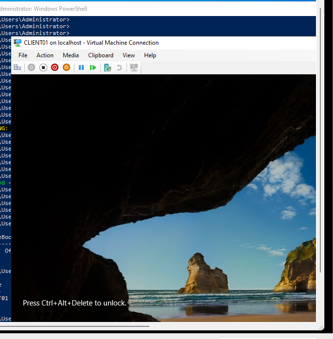

**Capture 24 — Installation, réseau et jonction de CLIENT01**

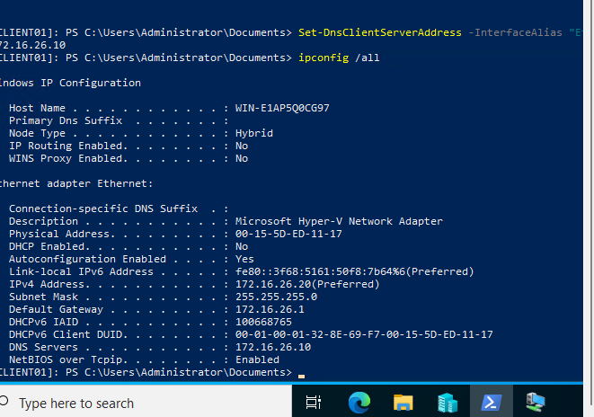

**Capture 25 — Installation, réseau et jonction de CLIENT01**

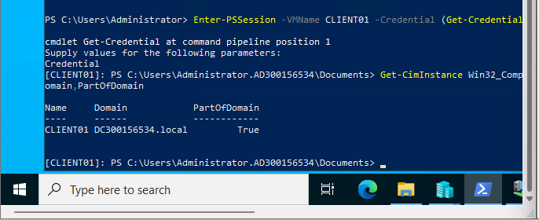

## 10. Modifications et vérifications du 24 novembre 2026

### 10.1. Création de ServiceAccounts

J’ai ajouté une cinquième sous-OU pour les comptes de service. La seconde tentative a retourné une erreur de doublon, car la première avait réussi.

```powershell

New-ADOrganizationalUnit -Name "ServiceAccounts" -Path "OU=OU300156534,DC=DC300156534,DC=local"

Get-ADOrganizationalUnit -Filter * | Select-Object Name, DistinguishedName

```

```text

OU300156534

├── Servers

├── Workstations

├── Groups

├── Students

└── ServiceAccounts

```

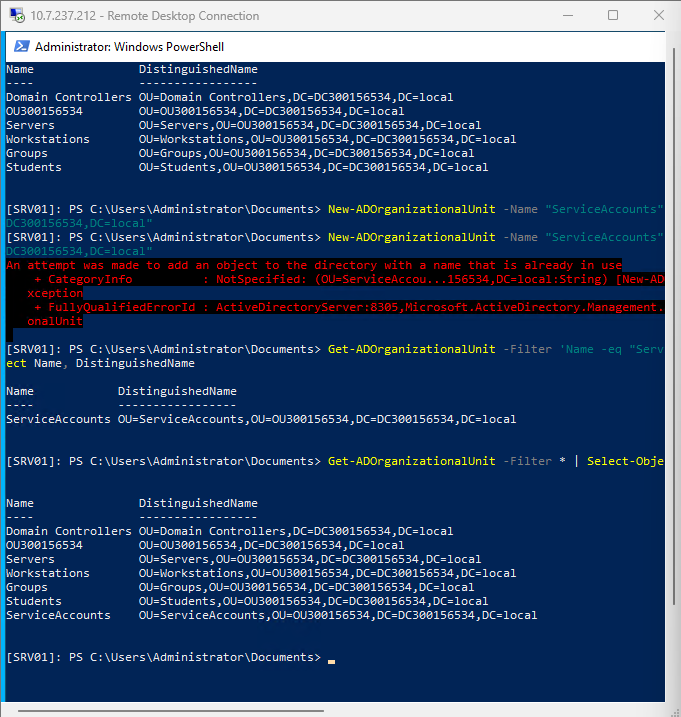

### 10.2. Groupe de sécurité et utilisateur

J’ai créé le groupe global de sécurité GG_Students dans Groups et ajouté le compte etudiant01.

```powershell

New-ADGroup -Name "GG_Students" -GroupScope Global -GroupCategory Security -Path "OU=Groups,OU=OU300156534,DC=DC300156534,DC=local"

Add-ADGroupMember -Identity "GG_Students" -Members "etudiant01"

Get-ADGroupMember -Identity "GG_Students" | Select-Object Name, SamAccountName

```

Résultat : Etudiant01 est membre du groupe GG_Students.

### 10.3. Déplacement du client

```powershell

Move-ADObject -Identity "CN=CLIENT01,CN=Computers,DC=DC300156534,DC=local" -TargetPath "OU=Workstations,OU=OU300156534,DC=DC300156534,DC=local"

Get-ADComputer -Identity "CLIENT01" | Select-Object Name, DistinguishedName, Enabled

```

Résultat : CLIENT01 est actif et se trouve dans Workstations.

### 10.4. Vérification du domaine et des services

```powershell

Get-GPO -All | Select-Object DisplayName, GpoStatus

Get-ADDomain | Select-Object DNSRoot, NetBIOSName, DomainMode

Get-ADForest | Select-Object Name, RootDomain, ForestMode

Get-DnsServerZone | Select-Object ZoneName, ZoneType, IsDsIntegrated

Get-ADDomainController -Filter * | Select-Object Name, IPv4Address, Domain, IsGlobalCatalog

Get-Service NTDS, DNS, Netlogon

dcdiag /q

```

| Élément | Résultat |
|---|---|
| Domaine | DC300156534.local |
| Niveau fonctionnel du domaine | Windows2016Domain |
| Niveau fonctionnel de la forêt | Windows2016Forest |
| Catalogue global | True |
| NTDS, DNS, Netlogon | Running |
| Zones DNS du domaine et _msdcs | Intégrées à AD |
| GPO | Deux stratégies par défaut actives |
| dcdiag /q | Aucune erreur affichée |

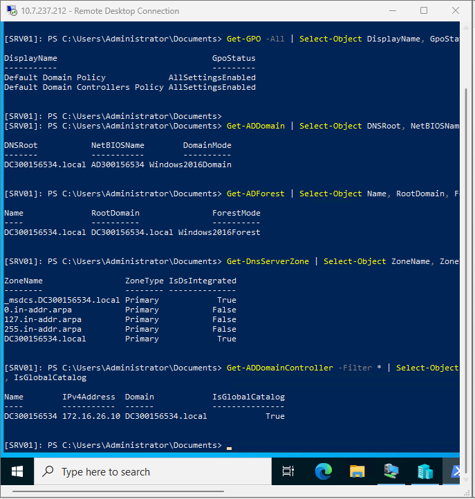

### 10.5. Vérification de CLIENT01

Depuis le serveur parent :

```powershell

Get-VM | Select-Object Name, State

Enter-PSSession -VMName CLIENT01 -Credential (Get-Credential)

```

Depuis CLIENT01 :

```powershell

hostname

ipconfig /all

nslookup DC300156534.local

ping 172.16.26.10

Test-ComputerSecureChannel

```

| Élément | Résultat |

|---|---|

| SRV01 et CLIENT01 | Running |

| Adresse client | 172.16.26.20/24 |

| Passerelle | 172.16.26.1 |

| DNS | 172.16.26.10 |

| Relation de confiance | True |

Le test Test-ComputerSecureChannel avait échoué sur le contrôleur de domaine. Cette commande est destinée aux ordinateurs membres ; le résultat True obtenu sur CLIENT01 valide son canal sécurisé.

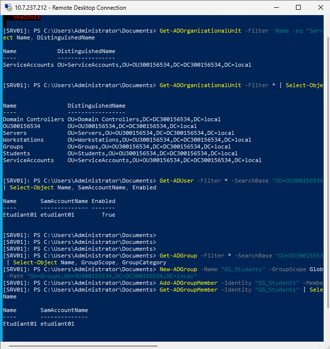

### 10.6. Réinitialisation du mot de passe étudiant

Une première tentative de connexion a échoué. J’ai vérifié l’état du compte puis réinitialisé son mot de passe sur le contrôleur de domaine.

```powershell

Get-ADUser -Identity etudiant01 -Properties LockedOut,PasswordExpired | Select-Object Name,Enabled,LockedOut,PasswordExpired

Set-ADAccountPassword -Identity etudiant01 -Reset -NewPassword (Read-Host "Nouveau mot de passe" -AsSecureString)

```

Le compte était actif, non verrouillé et son mot de passe non expiré.

### 10.7. Comptes et mots de passe — CONFIDENTIEL

| Compte | Mot de passe | Remarque |

|---|---|---|

| Administrator | `walid@2026` | Indiqué dans la version mise à jour ; non revérifié (le rapport initial mentionne une autre valeur) |

| AD300156534\etudiant01 | `walid@2027` | Nouveau mot de passe du 24 novembre |

Ne pas publier ces identifiants sur GitHub. Les mots de passe des autres comptes éventuels ne sont pas documentés.

### 10.8. Connexion avec le compte étudiant

J’ai ouvert une session sur CLIENT01 avec le compte du domaine etudiant01. Dans PowerShell, j’ai exécuté :

```powershell

whoami

hostname

whoami /groups

```

Résultats confirmés : `ad300156534\etudiant01` et `CLIENT01`. La liste des groupes est partiellement visible sur la capture ; la présence de GG_Students dans le jeton de session reste à vérifier.

Les captures disponibles des vérifications complémentaires sont intégrées ci-dessus.

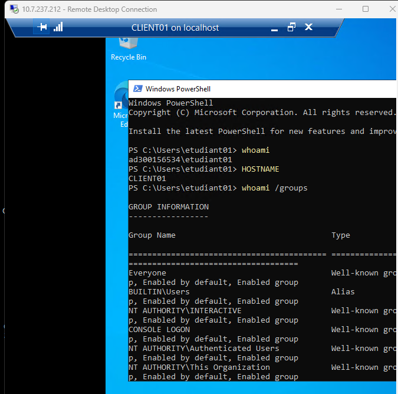

## 11. Résultats et conclusion

Les vérifications réseau ont donné quatre réponses sur quatre au ping du contrôleur de domaine, sans perte de paquets. Le DNS retourne 172.16.26.10. CLIENT01 est membre du domaine et son canal sécurisé est valide. La connexion avec le compte étudiant a réussi. L’infrastructure Hyper-V, AD DS et DNS est fonctionnelle. Les modifications du 24 novembre complètent les configurations précédentes. La conformité exhaustive aux consignes originales reste à vérifier.
