# INF1084 - Laboratoire 6.Nested

**Nom :** Kevin Mayele  
**Numéro étudiant :** 300158085  
**Serveur parent :** SRV300158085  
**Adresse IP :** 10.7.237.219

## Introduction

Dans ce laboratoire, j’ai utilisé mon serveur du collège pour créer un environnement réseau avec Hyper-V et Active Directory.

Le travail consistait à créer un réseau privé, installer un contrôleur de domaine et joindre une deuxième machine à ce domaine. J’ai ensuite créé un utilisateur dans l’unité d’organisation Students et testé sa connexion sur CLIENT01.

J’ai utilisé principalement PowerShell pour les configurations et les vérifications, ainsi que la console Active Directory Users and Computers pour créer le compte utilisateur.

## Plan d’adressage

| Élément | Configuration |
|---|---|
| Serveur parent | SRV300158085 |
| Adresse du serveur parent | 10.7.237.219/23 |
| Commutateur virtuel | LAB, de type Internal |
| Réseau privé | 172.16.18.0/24 |
| Passerelle NAT | 172.16.18.1 |
| Contrôleur de domaine | DC300158085 |
| Adresse IP du contrôleur de domaine | 172.16.18.10/24 |
| Machine cliente | CLIENT01 |
| Adresse IP de CLIENT01 | 172.16.18.20/24 |
| Serveur DNS des VM | 172.16.18.10 |
| Domaine Active Directory | DC300158085.local |
| Nom NetBIOS du domaine | BOREAL85 |

## 1. Création du réseau LAB

J’ai commencé par vérifier les commutateurs virtuels qui existaient déjà sur mon serveur. Ensuite, j’ai créé un commutateur interne nommé LAB.

```powershell
New-VMSwitch -Name LAB -SwitchType Internal
```

Au départ, j’avais créé deux commutateurs avec le même nom. Après avoir remarqué le problème, j’ai supprimé le doublon et conservé un seul commutateur LAB.

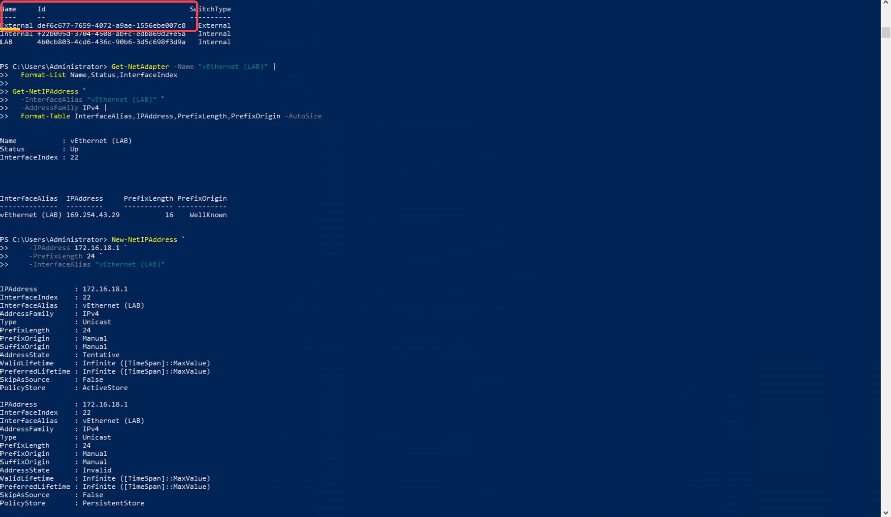

## 2. Configuration IP et NAT

Une fois le commutateur créé, j’ai attribué l’adresse IP `172.16.18.1/24` à l’interface `vEthernet (LAB)`. Cette adresse sert de passerelle aux machines de mon laboratoire.

J’ai ensuite configuré le NAT pour le réseau `172.16.18.0/24`.

```powershell
New-NetIPAddress -IPAddress 172.16.18.1 -PrefixLength 24 -InterfaceAlias "vEthernet (LAB)"

New-NetNat -Name LABNAT -InternalIPInterfaceAddressPrefix 172.16.18.0/24
```

Après ces commandes, j’ai vérifié que l’adresse IP était bien enregistrée et que le NAT était actif.

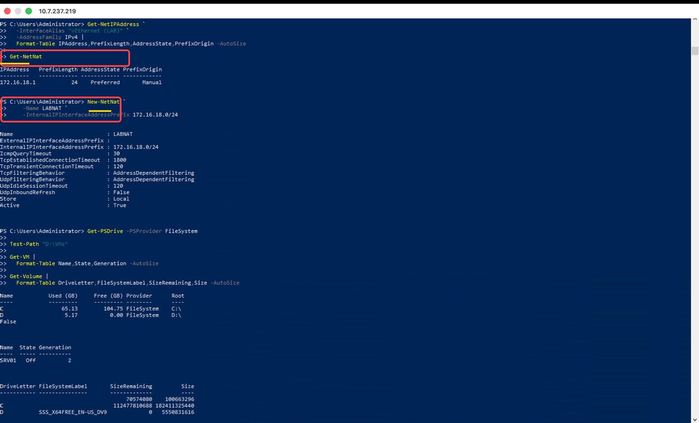

## 3. Création du contrôleur de domaine

J’ai créé une machine virtuelle appelée `DC300158085` avec Hyper-V.

J’ai choisi une machine de génération 2 avec 4 Go de RAM au démarrage, un disque virtuel dynamique de 60 Go et une connexion au commutateur LAB.

Les fichiers de cette machine sont stockés dans `C:\VMs\DC300158085`.

Après sa création, j’ai vérifié que les paramètres étaient corrects.

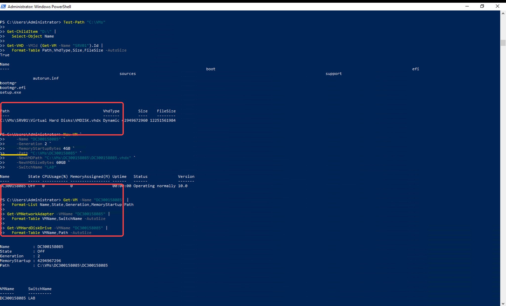

## 4. Installation de Windows Server

Pour installer Windows Server 2022, j’ai utilisé les fichiers disponibles sur le lecteur `D:` de mon serveur.

Comme je n’avais pas de fichier ISO directement disponible, j’ai utilisé l’image `install.wim` pour installer Windows sur le disque virtuel.

J’ai choisi Windows Server 2022 Standard Evaluation avec l’interface graphique, appelée Desktop Experience.

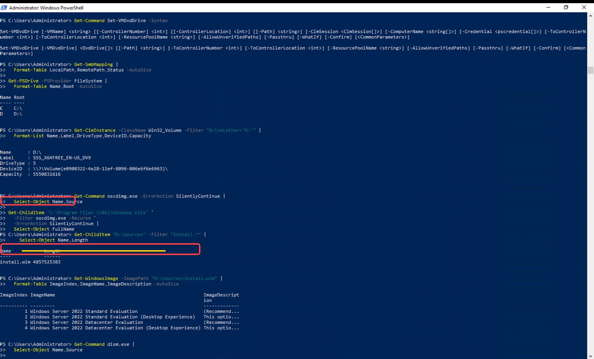

Une fois Windows installé, j’ai renommé la machine `DC300158085`, puis je l’ai redémarrée pour appliquer le nouveau nom.

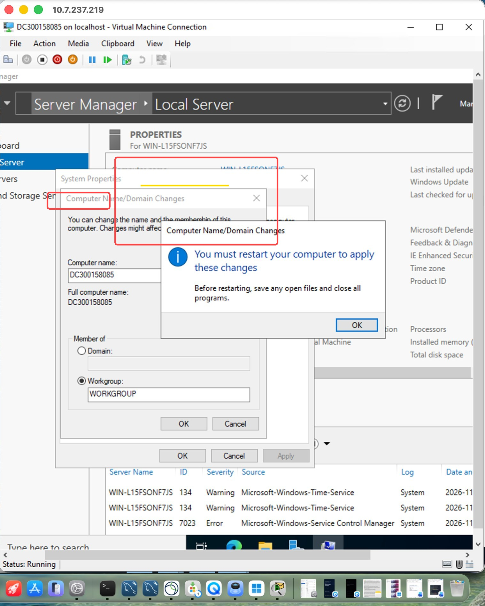

J’ai ensuite configuré son réseau :

| Paramètre | Valeur |
|---|---|
| Adresse IP | 172.16.18.10 |
| Masque | 255.255.255.0 |
| Passerelle | 172.16.18.1 |
| Serveur DNS | 172.16.18.10 |

J’ai fait un ping vers la passerelle pour vérifier la communication. Le test a réussi.

## 5. Installation d’Active Directory

Après avoir préparé le serveur, j’ai installé le rôle Active Directory Domain Services avec ses outils de gestion.

```powershell
Install-WindowsFeature AD-Domain-Services -IncludeManagementTools
```

L’installation s’est terminée correctement. J’ai ensuite créé une forêt avec le domaine `DC300158085.local`.

J’ai rencontré un problème avec le nom NetBIOS pendant cette étape : le nom initial était déjà utilisé dans l’environnement. J’ai donc choisi `BOREAL85`.

```powershell
Install-ADDSForest -DomainName "DC300158085.local" -DomainNetbiosName "BOREAL85"
```

Après le redémarrage, j’ai utilisé la commande suivante pour vérifier le domaine :

```powershell
Get-ADDomain
```

Les informations retournées confirmaient le domaine `DC300158085.local` et le nom NetBIOS `BOREAL85`.

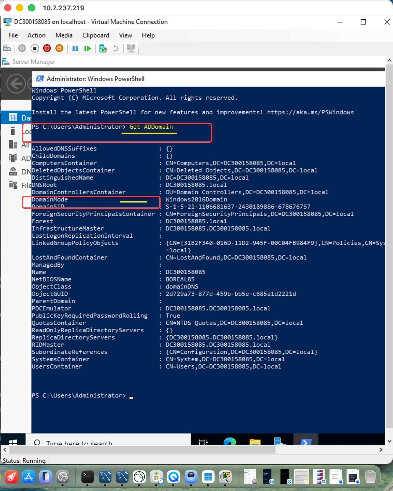

## 6. Création des unités d’organisation

Pour réaliser l’exercice 7 de l’énoncé, j’ai créé une unité d’organisation principale appelée `OU300158085`.

À l’intérieur, j’ai ajouté les quatre sous-OU demandées :

- Students
- Groups
- Workstations
- Servers

J’ai ensuite affiché la liste des OU avec PowerShell pour vérifier qu’elles étaient toutes présentes au bon endroit.

Ces OU permettent d’organiser les objets Active Directory. Leur création ne crée pas automatiquement de comptes utilisateurs ou de groupes.

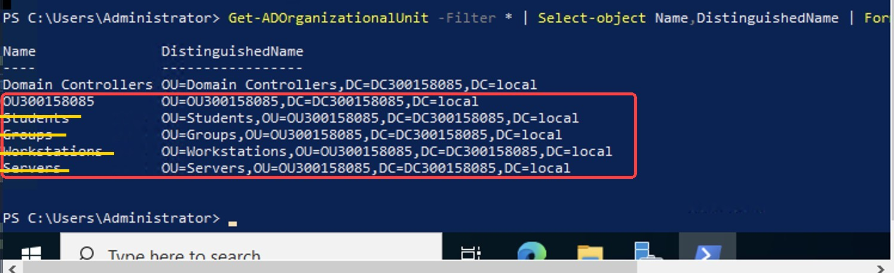

## 7. Création de CLIENT01

Après avoir configuré le domaine, j’ai créé une deuxième machine virtuelle nommée `CLIENT01`.

Comme pour le contrôleur de domaine, j’ai choisi la génération 2, 4 Go de RAM au démarrage, un disque virtuel dynamique de 60 Go et une connexion au réseau LAB.

J’ai utilisé Windows Server 2022 avec l’interface graphique comme système client pour ce laboratoire.

J’ai préparé les partitions du disque, puis installé Windows avec DISM et configuré le démarrage avec BCDBoot.

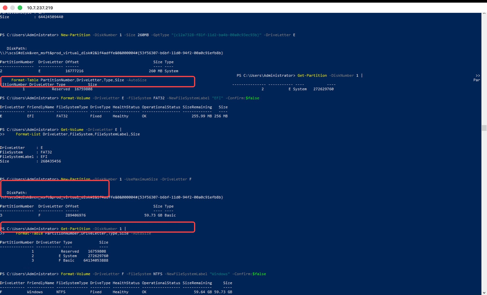

L’installation a réussi et CLIENT01 a démarré normalement.

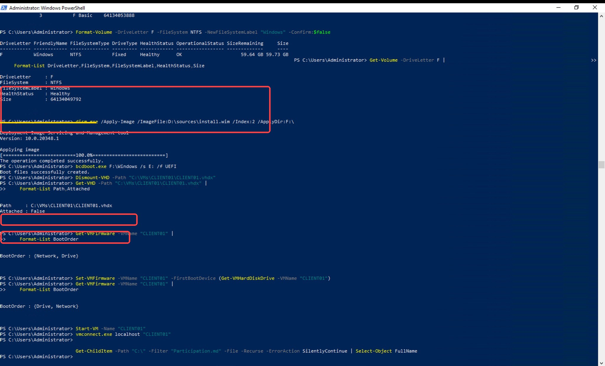

## 8. Configuration réseau de CLIENT01

J’ai commencé par vérifier le nom de la machine :

```powershell
hostname
```

J’ai ensuite configuré son réseau avec les paramètres suivants :

| Paramètre | Valeur |
|---|---|
| Adresse IP | 172.16.18.20 |
| Masque | 255.255.255.0 |
| Passerelle | 172.16.18.1 |
| Serveur DNS | 172.16.18.10 |

Après la configuration, j’ai vérifié l’adresse IP avec PowerShell. Elle apparaissait avec l’état `Preferred`.

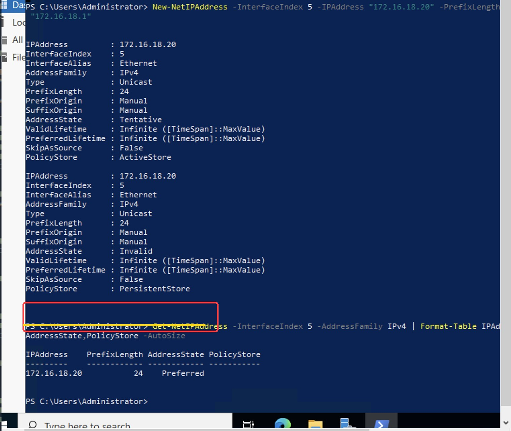

## 9. Tests réseau et DNS

Avant de joindre CLIENT01 au domaine, j’ai vérifié qu’elle pouvait communiquer avec le contrôleur de domaine.

J’ai lancé un ping vers `172.16.18.10`. Les quatre paquets ont été reçus, sans aucune perte.

J’ai aussi testé la résolution DNS pour vérifier que le nom `DC300158085.local` correspondait bien à l’adresse `172.16.18.10`.

Les deux tests ont réussi.

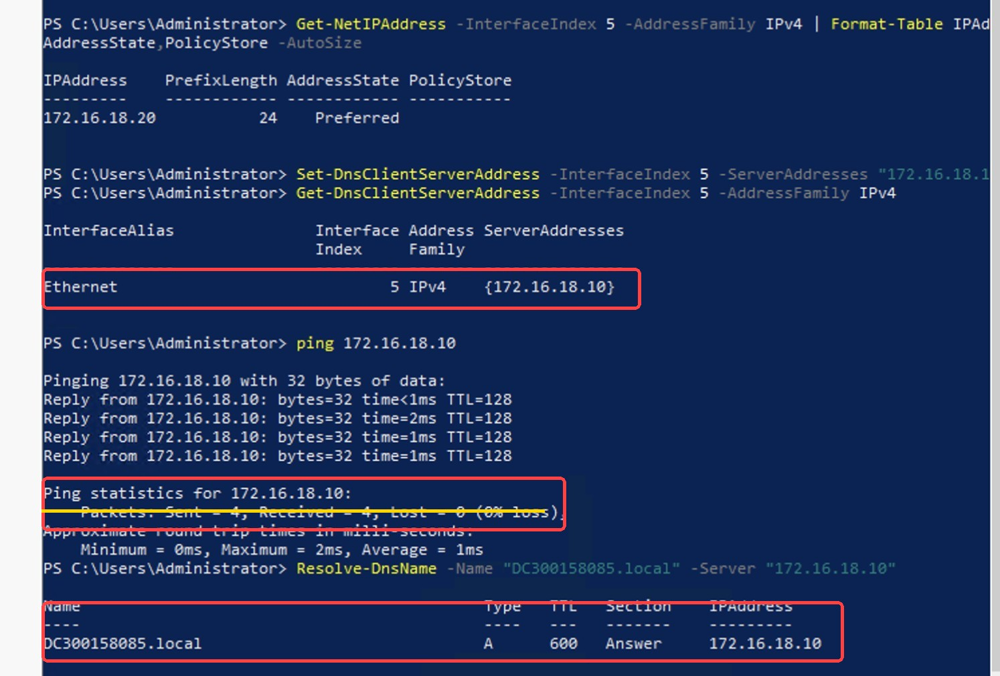

## 10. Vérification de la jonction de CLIENT01 au domaine

J’ai vérifié que CLIENT01 appartenait bien au domaine `DC300158085.local`.

Lorsque j’ai essayé d’ajouter la machine au domaine, Windows m’a indiqué qu’elle en faisait déjà partie. J’ai donc vérifié son appartenance avec cette commande :

```powershell
Get-CimInstance Win32_ComputerSystem | Select-Object Name, Domain, PartOfDomain
```

Le résultat indiquait :

```text
Name       Domain                 PartOfDomain
CLIENT01   DC300158085.local       True
```

J’ai ensuite vérifié la relation de confiance avec le domaine :

```powershell
Test-ComputerSecureChannel -Verbose
```

Le résultat était `True`. Windows indiquait également que le canal sécurisé entre CLIENT01 et le domaine fonctionnait correctement.

Il n’était donc pas nécessaire de recommencer la jonction.

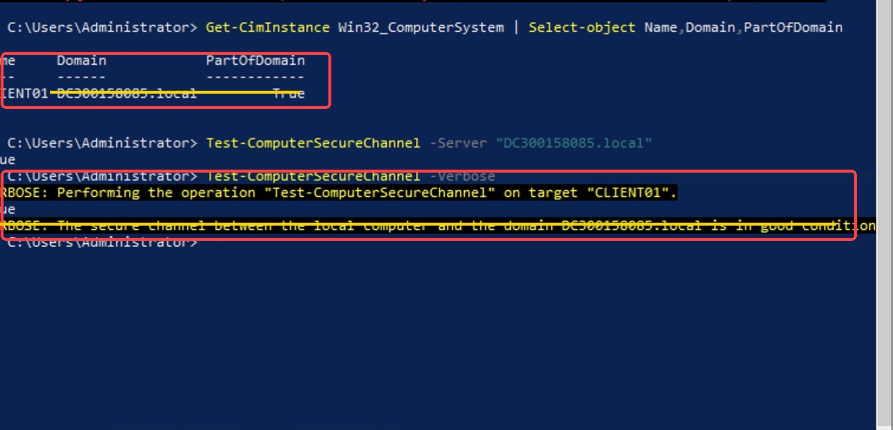

## 11. Création d’un utilisateur et test de connexion

### Création du compte dans Students

Pour compléter la demande du professeur concernant les utilisateurs, j’ai créé mon compte dans l’OU `Students`.

Dans **Active Directory Users and Computers**, j’ai sélectionné `OU300158085`, puis `Students`. J’ai ensuite fait un clic droit sur cette OU et choisi **New > User**.

Avant de remplir les champs, j’ai vérifié que l’emplacement de création était :

```text
DC300158085.local/OU300158085/Students
```

J’ai renseigné mon prénom et mon nom, puis choisi `kevin.mayele` comme nom de connexion. J’ai défini un mot de passe et terminé la création du compte.

Le compte **Kevin mayele**, de type **User**, apparaissait ensuite dans l’OU `Students`.

La capture suivante met en évidence l’OU principale, l’OU Students, le nom du compte et son type.

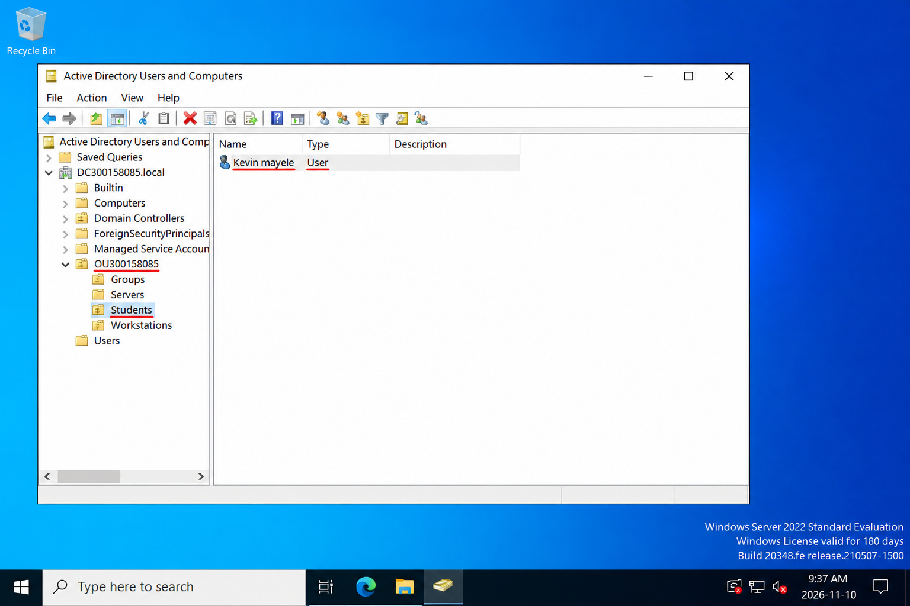

Dans les propriétés du compte, l’onglet **Account** confirmait les identifiants suivants :

| Format de connexion | Identifiant |
|---|---|
| Domaine et utilisateur | `BOREAL85\kevin.mayele` |
| Nom principal d’utilisateur | `kevin.mayele@DC300158085.local` |

### Connexion sur CLIENT01

Après avoir vérifié que CLIENT01 appartenait au domaine et que sa relation de confiance fonctionnait, j’ai fermé la session Administrator.

J’ai ensuite ouvert une session avec le compte suivant et son mot de passe :

```text
BOREAL85\kevin.mayele
```

Une fois le bureau affiché, j’ai ouvert PowerShell et exécuté :

```powershell
whoami
```

Le résultat affichait :

```text
boreal85\kevin.mayele
```

Ce résultat confirme que la session ouverte sur CLIENT01 utilisait bien le compte Active Directory créé dans Students.

La capture suivante met en évidence le nom de la machine, la commande utilisée et l’identité de l’utilisateur connecté.

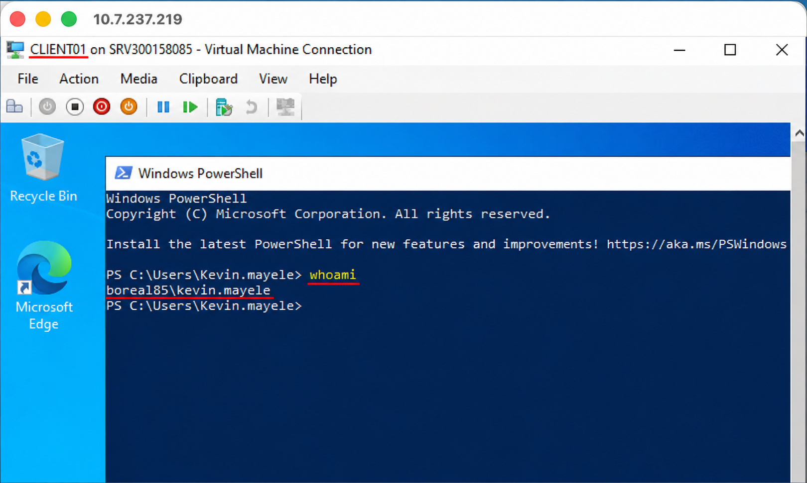

## 12. Difficultés rencontrées

Ce laboratoire m’a demandé du temps, surtout pendant la création des machines virtuelles et la configuration du domaine.

J’ai dû corriger certaines commandes PowerShell, supprimer un commutateur LAB créé en double et choisir un autre nom NetBIOS pour le domaine.

Lors de la création de l’utilisateur, j’avais d’abord ouvert l’assistant dans le conteneur `Users`. J’ai annulé cette opération et recommencé depuis l’OU `Students` pour placer le compte au bon endroit.

J’ai aussi appris à distinguer le serveur parent, le contrôleur de domaine et la machine cliente. Cette distinction était importante pour ouvrir la session utilisateur sur CLIENT01.

À chaque étape, j’ai vérifié les résultats avant de continuer. Cela m’a aidé à comprendre les erreurs et à les corriger sans recommencer tout le laboratoire.

## Conclusion

Ce laboratoire m’a permis de mettre en pratique la configuration d’un réseau virtuel avec Hyper-V, la création d’une forêt Active Directory et la jonction d’une machine cliente au domaine.

Les tests ont confirmé le fonctionnement du réseau, de la résolution DNS et de la relation de confiance entre CLIENT01 et le domaine.

J’ai également créé le compte `kevin.mayele` dans l’OU Students et réussi à ouvrir une session sur CLIENT01 avec ce compte. La commande `whoami` a confirmé l’identité de l’utilisateur connecté.

Ce que je retiens surtout, c’est l’importance de vérifier chaque configuration et de conserver des captures montrant les résultats obtenus.
