# INF1084 — Architecture Active Directory avec Hyper-V

**Nom :** Islem TOUADJNI  
**Numéro étudiant :** 300159195  
**Cours :** INF1084 — Administration Windows  
**Environnement :** Windows Server 2022, Hyper-V, PowerShell, Active Directory Domain Services

---

## Objectif

L'objectif de ce laboratoire est de construire une architecture Active Directory indépendante dans Hyper-V.

L'environnement réalisé comprend :

- un serveur parent Hyper-V ;
- un réseau privé `172.16.20.0/24` ;
- une passerelle NAT ;
- un contrôleur de domaine Windows Server 2022 ;
- une forêt et un domaine Active Directory ;
- une structure d'unités organisationnelles ;
- un groupe et des utilisateurs Active Directory ;
- un partage SMB avec permissions NTFS ;
- une machine cliente `CLIENT01` ;
- l'intégration de `CLIENT01` au domaine.

---

## Architecture finale

```text
SRV300159195
10.7.237.221
      |
    Hyper-V
      |
      LAB
      |
    LABNAT
      |
172.16.20.0/24
      |
      +---- DC300159195
      |     172.16.20.10
      |     DNS : 172.16.20.10
      |     Domaine : DC300159195.local
      |
      +---- CLIENT01
            172.16.20.20
            Passerelle : 172.16.20.1
            DNS : 172.16.20.10
```

### Plan d'adressage

| Élément | Configuration |
|---|---|
| Serveur parent | `SRV300159195` |
| IP du serveur parent | `10.7.237.221` |
| Commutateur virtuel | `LAB` |
| Réseau privé | `172.16.20.0/24` |
| Passerelle NAT | `172.16.20.1` |
| Contrôleur de domaine | `DC300159195` |
| IP du DC | `172.16.20.10` |
| Domaine AD DS | `DC300159195.local` |
| Client | `CLIENT01` |
| IP du client | `172.16.20.20` |

---

## 1. Vérification du serveur parent

Avant de créer l'environnement virtuel, j'ai vérifié le nom du serveur parent ainsi que sa configuration réseau.

Le serveur utilisé est `SRV300159195` et son adresse sur le réseau du collège est `10.7.237.221`.

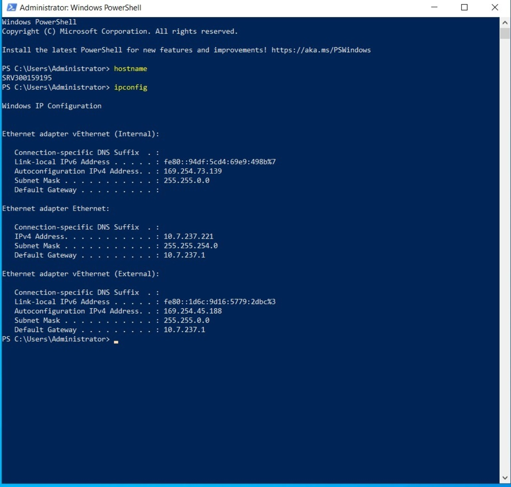

---

## 2. Création du réseau privé

J'ai créé un commutateur Hyper-V interne nommé `LAB`.

```powershell
New-VMSwitch -Name LAB -SwitchType Internal
Get-VMSwitch
```

La vérification confirme que le commutateur `LAB` existe et qu'il est de type `Internal`.

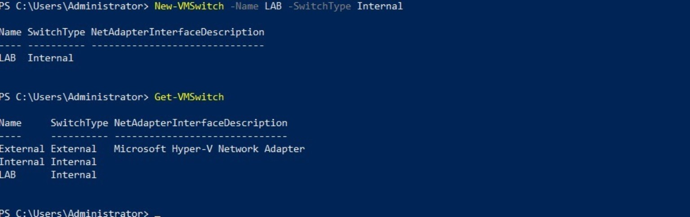

---

## 3. Configuration de la passerelle NAT

Le réseau privé utilisé est :

```text
172.16.20.0/24
```

La passerelle du réseau est :

```text
172.16.20.1
```

Le NAT a été créé sous le nom `LABNAT`.

```powershell
New-NetIPAddress `
  -IPAddress 172.16.20.1 `
  -PrefixLength 24 `
  -InterfaceAlias "vEthernet (LAB)"

New-NetNat `
  -Name LABNAT `
  -InternalIPInterfaceAddressPrefix 172.16.20.0/24
```

Les commandes de vérification confirment l'adresse de l'interface virtuelle et la présence du NAT.

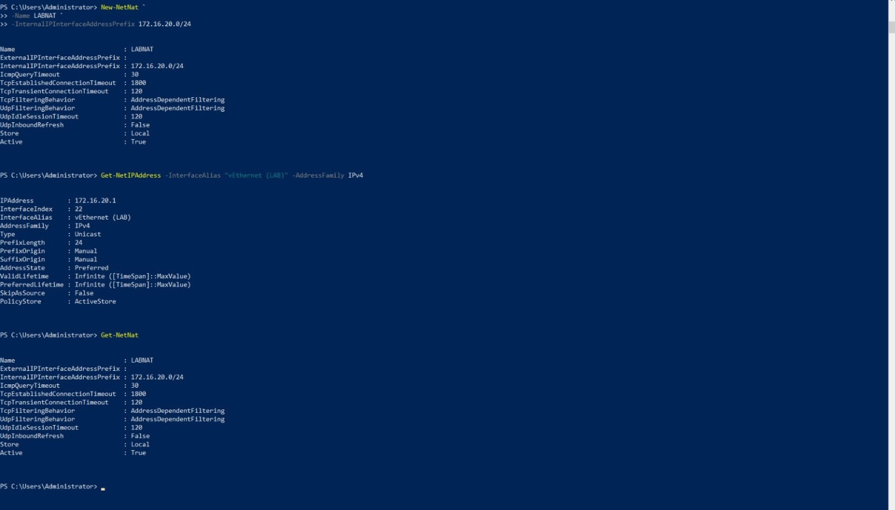

---

## 4. Création du contrôleur de domaine

Une machine virtuelle de génération 2 nommée `DC300159195` a été créée et connectée au commutateur `LAB`.

La VM utilise un disque virtuel de 60 Go.

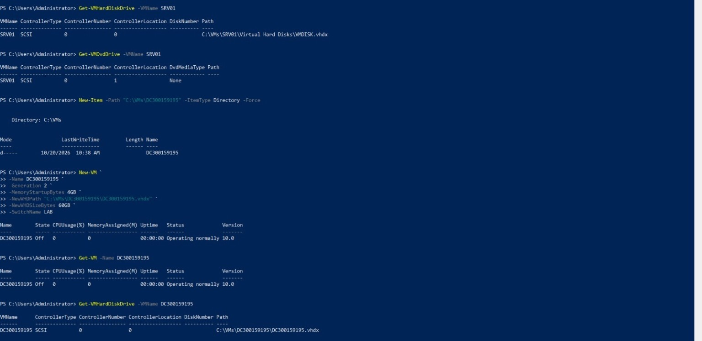

Après le démarrage et la configuration du système, le nom de la machine a été vérifié.

```powershell
hostname
```

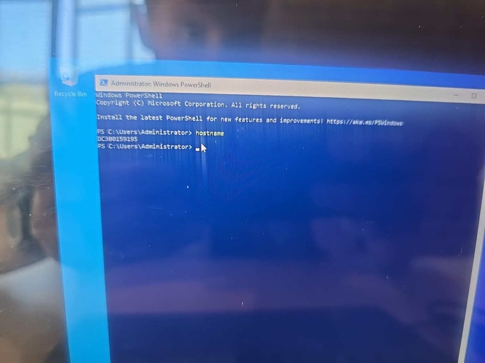

---

## 5. Installation d'Active Directory

Le rôle **Active Directory Domain Services** a été installé sur le contrôleur de domaine avec les outils de gestion.

```powershell
Install-WindowsFeature AD-Domain-Services -IncludeManagementTools
```

Le serveur a ensuite été promu en contrôleur de domaine.

---

## 6. Création de la forêt Active Directory

La forêt et le domaine utilisés sont :

```text
DC300159195.local
```

La commande `Get-ADDomain` a été utilisée après la promotion afin de vérifier le domaine.

```powershell
Get-ADDomain
```

La sortie confirme notamment le domaine `DC300159195.local` et le contrôleur de domaine `DC300159195`.

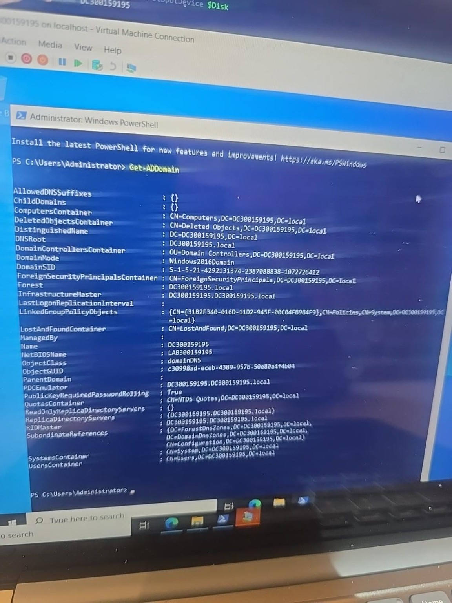

---

## 7. Création de la structure Active Directory

Une OU principale nommée :

```text
OU300159195
```

a été créée.

Les sous-OU suivantes ont ensuite été ajoutées :

```text
Students
Groups
Workstations
Servers
```

La structure finale a été vérifiée avec PowerShell.

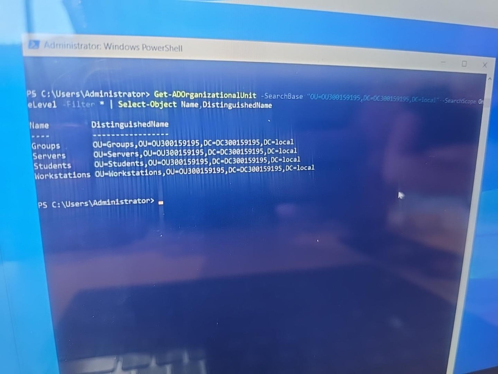

La hiérarchie obtenue est :

```text
DC300159195.local
|
+-- OU300159195
    |
    +-- Students
    +-- Groups
    +-- Workstations
    +-- Servers
```

---

## 8. Création des utilisateurs et du groupe Students

Un groupe global de sécurité nommé `Students` a été créé dans l'OU `Groups`.

Deux comptes ont ensuite été créés dans l'OU `Students` :

- `Etudiant1`
- `Etudiant2`

### Etudiant1

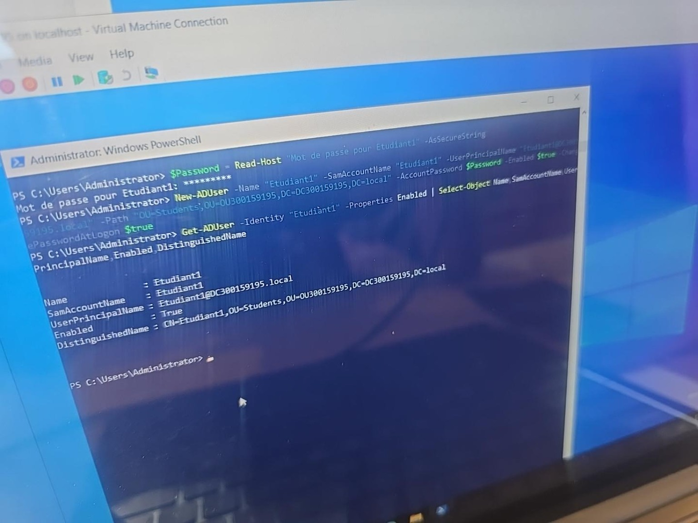

### Etudiant2

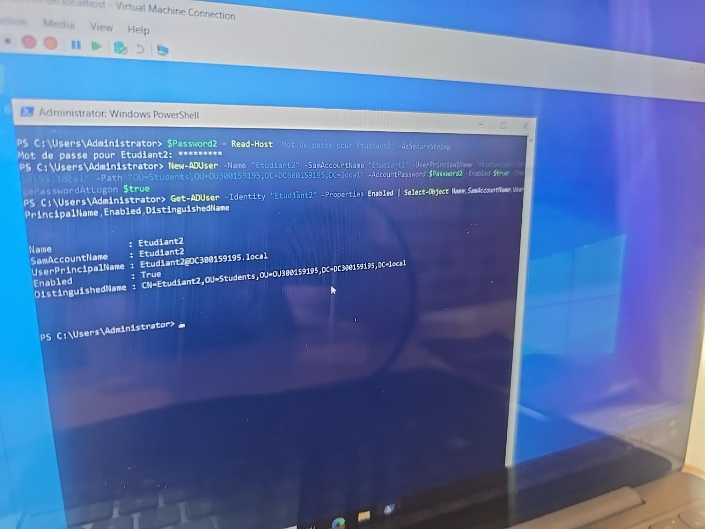

Les deux utilisateurs ont été ajoutés au groupe `Students`.

La commande de vérification confirme la présence des deux comptes dans le groupe.

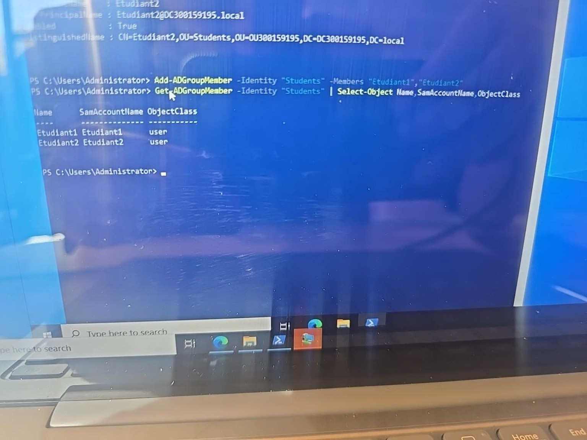

---

## 9. Création du partage réseau

Un dossier a été créé sur le contrôleur de domaine :

```text
C:\PartageStudents
```

Il a ensuite été publié en SMB sous le nom :

```text
PartageStudents
```

Le groupe `Students` possède le droit `Change` sur le partage.

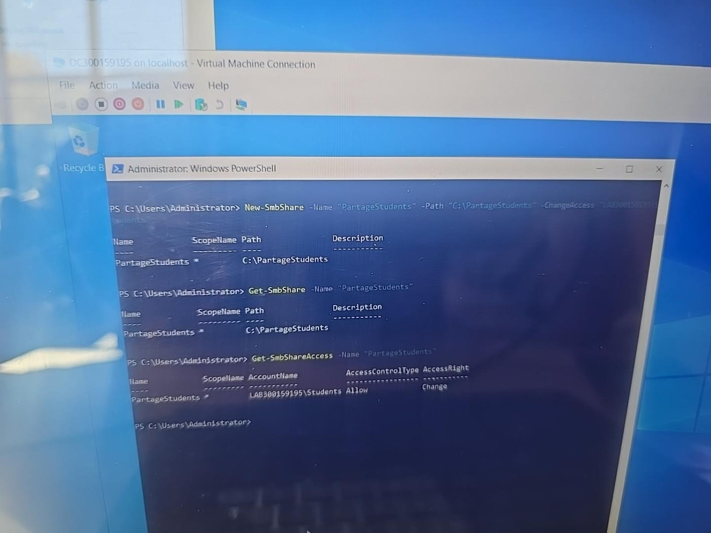

---

## 10. Configuration des permissions NTFS

Les permissions NTFS du dossier ont été configurées pour le groupe `Students`.

La vérification avec `icacls` montre notamment :

```text
Students:(OI)(CI)(M)
```

`M` correspond à **Modify**.  
`OI` et `CI` permettent l'héritage des permissions sur les fichiers et les sous-dossiers.

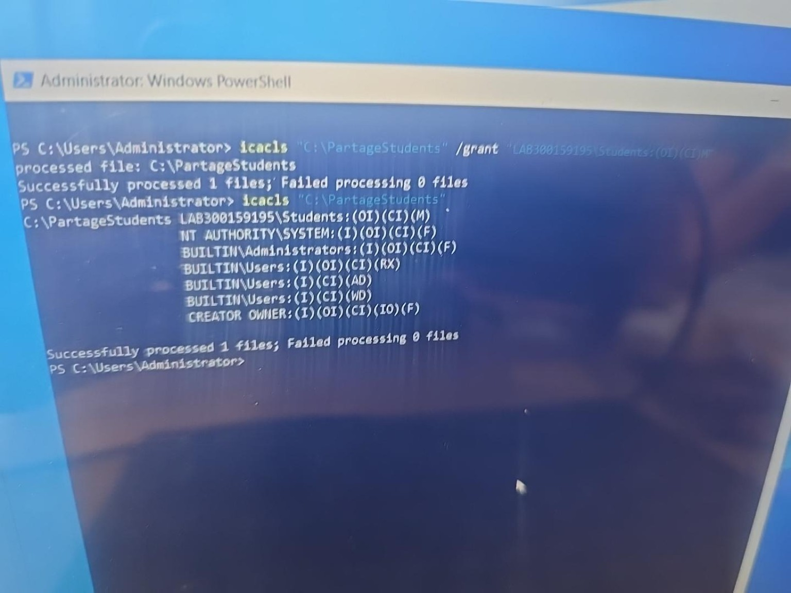

---

## 11. Création du client

Une machine virtuelle cliente nommée `CLIENT01` a été créée.

Configuration principale :

```text
Nom        : CLIENT01
Génération : 2
Mémoire    : 4 Go
Disque     : 60 Go
Réseau     : LAB
```

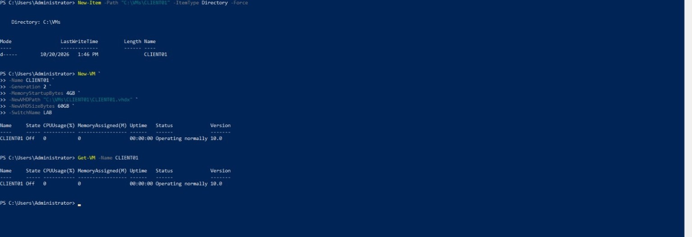

La configuration réseau utilisée pour le client est :

```text
Adresse IP : 172.16.20.20
Masque     : 255.255.255.0
Passerelle : 172.16.20.1
DNS        : 172.16.20.10
```

---

## 12. Intégration du client au domaine

La dernière étape consistait à joindre `CLIENT01` au domaine :

```text
DC300159195.local
```

La vérification finale a été effectuée avec :

```powershell
Get-CimInstance Win32_ComputerSystem |
Select-Object Name,Domain,PartOfDomain
```

Résultat :

```text
Name      Domain               PartOfDomain
----      ------               ------------
CLIENT01  DC300159195.local    True
```

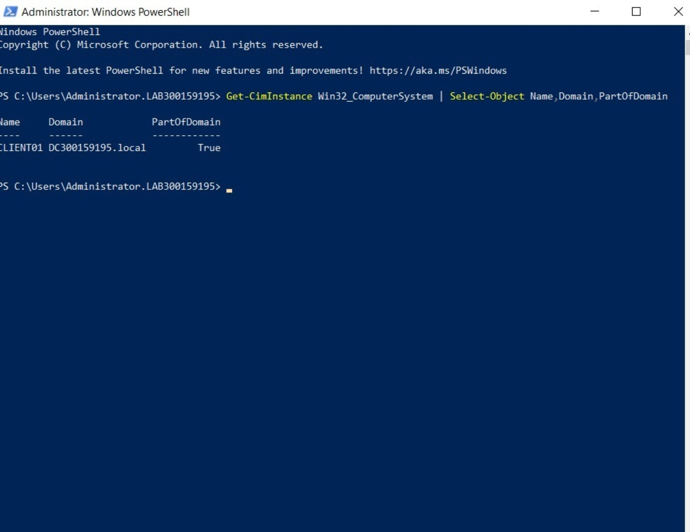

La valeur `PartOfDomain = True` confirme que la machine cliente appartient correctement au domaine.

---

## Résultats finaux

| Vérification | Résultat |
|---|---|
| Commutateur privé `LAB` | Réussi |
| Réseau `172.16.20.0/24` | Réussi |
| NAT `LABNAT` | Réussi |
| VM `DC300159195` | Réussi |
| Domaine `DC300159195.local` | Réussi |
| OU `OU300159195` | Réussi |
| Sous-OU Students / Groups / Workstations / Servers | Réussi |
| Utilisateurs Etudiant1 et Etudiant2 | Réussi |
| Groupe Students | Réussi |
| Partage `PartageStudents` | Réussi |
| Permissions SMB et NTFS | Réussi |
| VM `CLIENT01` | Réussi |
| CLIENT01 membre du domaine | Réussi |

---

## Conclusion

Ce laboratoire m'a permis de construire une infrastructure Active Directory complète dans un environnement Hyper-V isolé.

J'ai configuré le commutateur virtuel et le NAT, créé le contrôleur de domaine Windows Server 2022, installé Active Directory Domain Services et créé le domaine `DC300159195.local`.

J'ai ensuite organisé Active Directory avec plusieurs unités d'organisation, créé des utilisateurs et un groupe de sécurité, configuré un partage réseau avec des permissions SMB et NTFS, puis créé une machine cliente.

La vérification finale de `CLIENT01` avec `PartOfDomain = True` confirme que l'architecture fonctionne correctement.
